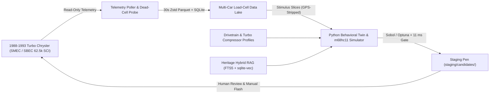

# LogicAIDE — Logic Module + Agentic IDE

**LogicAIDE** is an offline-first telemetry workbench, splayed Motorola `68HC11` ROM engineering environment, modular Mopar drivetrain & turbocharger thermodynamics suite, and cleanroom Chrysler heritage RAG system for **1988–1993 Turbo Chrysler SMEC and SBEC** engine controllers.

Designed for **Daytona Shelby**, **Shelby CSX**, **Turbo Shadow**, **Spirit R/T**, **Omni GLH / GLHS**, and **Turbo Minivans** (`2.2L`, `2.5L`, and `2.4L` builds), LogicAIDE turns chaotic road pulls and opaque 32 KB binaries into reproducible, verified calibration candidates—without ever letting an AI touch live vehicle hardware.

---

## Core Capabilities

- **Live 62.5k SCI Telemetry & Dead-Cell Probe (`telemetry/`)**: Reads Chrysler's `62.5 kbaud` bidirectional SCI diagnostic stream, quarantines stale/stuck sensors on startup, merges phone IMU logs, chunks drives into 30-second Zstd-compressed Parquet files, and aggregates a multi-car SQLite/Parquet **Load-Cell Data Lake** (`250 RPM x 10 kPa MAP x TPS Regime x Charge-Temp`).
- **Splayed 68HC11 ROM & Python Behavioral Twin (`rom/`, `emulator/`)**: Decompiles and splays monolithic `32 KB` (`$8000`–`$FFFF`) ROMs into modular `.asm` files indexed by `rom_manifest.json` and `ctags`. Algorithm changes are prototyped in readable Python (`rom/models/*_twin.py`), proven bit-exact against `m68hc11` emulation, and stress-tested across `scipy.stats.qmc` Sobol/LHS and `Optuna` Monte Carlo sweeps under the **11 ms** main-loop cycle ceiling.
- **Modular Mopar Drivetrain & Compressor Thermodynamics (`profiles/`)**: Models `2.2L` / `2.5L` / `2.4L` engine blocks, 8V SOHC / 2.2L Lotus 16V Turbo III / `2.4L`-compatible Neon `ECC` DOHC cylinder heads, `A525`/`A555`/`A568`/`NV-T350`/`A413` transaxle ratios, and 4-point digitized compressor maps (`turbo_spec.json`).
- **Chrysler Heritage Hybrid RAG (`knowledge/`)**: Curates cleanroom 3-tier provenance digests indexed via SQLite `FTS5` + `sqlite-vec` for rapid lookup of SMEC/SBEC hardware quirks, Bosch/Mopar injectors, and diagnostic tables without committing copyrighted factory scans.
- **Strict Human-Only Hardware Deadbolt (`SECURITY.md`, `staging/candidates/`)**: AI agents are strictly read-only toward serial ports and ROM programmers. Approved candidates land in `staging/candidates/<build_id>/` with SHA-256 checksums, `$FFC0`–`$FFFF` vector validation, Monte Carlo trace diffs, and a copyable manual flash command for the human tuner.

---

## System Architecture

---

## CLI-First + FastMCP + Agent-Neutral Design

LogicAIDE is **IDE- and agent-neutral** (compatible with Claude Code, Antigravity, Cursor, Codex CLI, and VS Code Copilot). Every core capability runs deterministically via the `uv run logicaide` CLI and shares the same underlying library with three optional **FastMCP** servers:

| Domain | CLI Entrypoint | FastMCP Server |
| :--- | :--- | :--- |
| Telemetry & Lake | `uv run logicaide telemetry ...` | `ecu-telemetry` (`mcp_servers/`) |
| 68HC11 Twin & Sim | `uv run logicaide sim ...` | `hc11-emulator` (`mcp_servers/`) |
| Heritage Hybrid RAG | `uv run logicaide heritage ...` | `chrysler-heritage` (`mcp_servers/`) |

---

## Quickstart & Documentation

1. **Read the safety rules first**: Review [SECURITY.md](SECURITY.md) before connecting any FTDI/SCI adapter or powering a 60-way SMEC/SBEC bench harness (especially the **12V/21V Pin 11 SMEC-vs-SBEC continuity check**).
2. **Place your stock ROM locally**: Copy your user-supplied `32 KB` `.bin` into [`rom/inputs/`](rom/inputs/README.md) (gitignored) and verify its SHA-256 baseline.
3. **Explore workflows and UI**:
   - End-to-end user & agent workflows (`WF-01`–`WF-06`): [`docs/WORKFLOWS.md`](docs/WORKFLOWS.md)
   - Offline Quiet UI engineering showcase: [`docs/showcase/index.html`](docs/showcase/index.html)
   - Six-layer architecture & trust boundaries: [ARCHITECTURE.md](ARCHITECTURE.md)
   - Agent contract & visual rules: [AGENTS.md](AGENTS.md), [CLAUDE.md](CLAUDE.md), [.quiet-ui.md](.quiet-ui.md)

---

## Repository Map

| Path | Purpose |
| :--- | :--- |
| `rom/` & `rom/inputs/` | Splayed 68HC11 `.asm`, `rom_manifest.json`, Python Behavioral Twins, immutable baselines |
| `telemetry/` | 62.5k SCI poller, dead-cell quarantine, 30s Zstd Parquet chunker, IMU merge |
| `emulator/` | `m68hc11` `$8000`–`$FFFF` harness, `$1000`–`$103F` hooks, Sobol & Optuna sweeps |
| `profiles/` | Modular Mopar block/head/transaxle matrix & `turbo_spec.json` compressor maps |
| `knowledge/` | Cleanroom 3-tier provenance digests (`FTS5` + `sqlite-vec` RAG index) |
| `issues/` | `tuning_issues` & `optimization_campaigns` linking logs to ROM candidates |
| `mcp_servers/` | FastMCP wrappers sharing core Python modules with `uv run logicaide` |
| `ui/` | Quiet UI `v9.5.0` workbench (Garage Dark & Sunlight High-Contrast) |
| `staging/candidates/` | Human-gated candidate `.bin` artifacts, `REPORT.md`, and manual flash commands |
| `tests/` & `tests/fixtures/` | Unit, SHA-256 round-trip, bit-exact twin parity, visual contract, & GPS-stripped slices |
