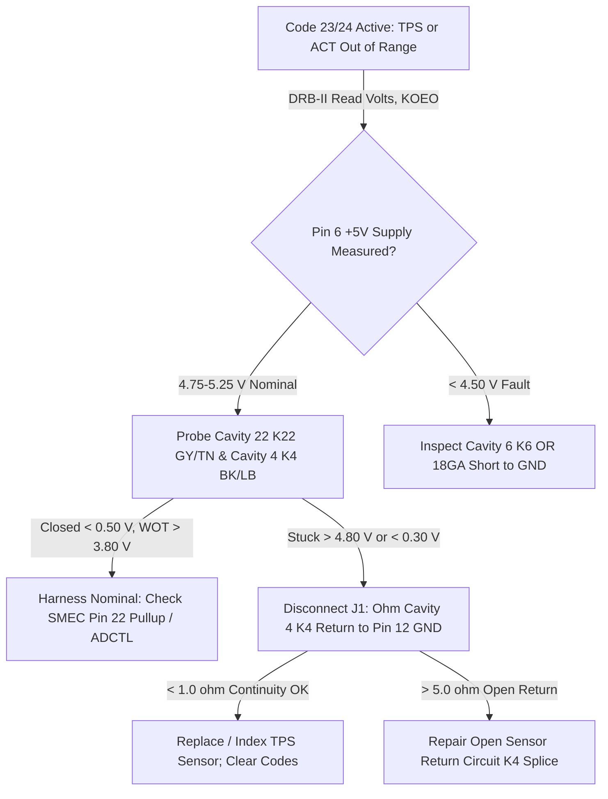

# Chrysler ECU Heritage Preservation & Parent-Child Hybrid RAG Specification

Decades of primary 1984–1993 Chrysler LM/SMEC/SBEC documentation live on expiring enthusiast domains, paginated forum archives, scanned Factory Service Manuals (FSMs), and former Chrysler engineer binders. LogicAIDE preserves these artifacts offline inside a provenance-verified, structure-aware Parent-Child RAG system that strictly isolates copyrighted raw captures from curated cleanroom knowledge (`knowledge/`) and never guesses unverified hex addresses or 60-way pinouts (`AGENTS.md`).

---

## 1. Five Automotive RAG Failure Modes & Cleanroom Split

Naive fixed-500-token chunkers and stock dense embeddings break down systematically on vintage Chrysler technical sources:

1. **1990s `<pre>`/`<table>` HTML & Multi-Page Forum Sprawl**: Classic Turbo-Mopar pages use fixed-width `<pre>` ASCII pinout tables and deeply nested HTML layout tables, while multi-page forum threads dilute verified fixes under `page=1..N` pagination, signature footers, avatars, and multi-level quote pyramids.
2. **Multi-Column & Cross-Page 60-Way Tables**: Chrysler Section `8W` connector pinouts span `60+` rows across facing pages (`pp. 14–15 (Cont.)`). Splitting at token limits severs lower rows (`Pin 31..60`) from column headers (`Cavity | Circuit | Function | ECU`), causing retrieval to misread power, ground, and signal assignments.
3. **Opaque Raster Schematics & Handwritten Engineer Binders**: Wiring harnesses, DRB-II fault trees, vacuum/boost routing diagrams, and penciled margin notes inside faded 1980s engineer binders vanish under plain text extractors unless rasterized (`300 DPI`), OCR-grounded, transpiled, and syntactically verified.
4. **`SMEC` (`1988–89`) vs. `SBEC` (`1990–93`) Pin 11 Cross-Contamination**: Mixing two-box `LM/PM`, dual-board `SMEC`, and single-board `SBEC` chunks without hard chunk-level ECU scope metadata merges incompatible assignments—most critically **Pin 11** (`+12V/+21V` bootstrap on `88–89 SMEC` vs. chassis ground on some `90–93 SBEC`), **Pin 2/3** (`CTS` vs. early `Knock`), and **Pin 25/45** (`SCI` vs. `A/C Clutch`).
5. **Dense-Vector Hex Blindness & Default `FTS5` Stripping**: Pure cosine embeddings smooth away exact literals (`$8000`, `0xF2`, `0xF4`, `#782`, `#445`, `P4529353`, `Pin_11`), while SQLite's stock `unicode61` tokenizer strips `$`, `#`, `-`, and `.` characters.

| Storage Zone | Git Tracked? | Permitted Contents & Directories | Enforced Cleanroom & Rebuild Policy |
| :--- | :---: | :--- | :--- |
| **`data/heritage_raw/`** | **No** (`.gitignore`) | `warc/` (ISO 28500 `.warc.gz`), `web_md/`, `pdfs/`, `figures/`, `discovery_queue/` (CDX/memento manifests), `wiki_stage/` (default `sync-wiki` staging). | Local offline preservation vault only; never committed to git and never copied verbatim into `knowledge/` or `wiki/`. |
| **`knowledge/`** | **Yes** | Distilled attributed cleanroom fact sheets, normalized tables, verified Mermaid schematics + walkthroughs, YAML provenance headers, `discovery_leads.yaml`. | Every Markdown file MUST pass YAML frontmatter validation and carry a `trust_tier` badge (`Tier 1`, `Tier 2`, or `Tier 3`); leads must be PII-scrubbed. |
| **`wiki/`** | **Yes** | Canonical Living Heritage Wiki (`Home.md`, `_Sidebar.md`, `_Footer.md`, and 6 topic directories with `<category>-overview.md` naming). | Every content page MUST pass frontmatter, cross-link, Mermaid, and Hardware Deadbolt/PII checks before RAG indexing or outbound `.wiki.git` mirror. |
| **`data/heritage_index.sqlite`** | **No** (rebuildable) | Parent-child corpus (`heritage_parents`, `heritage_children`), `FTS5` lexical index (`heritage_fts`), and `sqlite-vec` `BAAI/bge-m3` 1024-d index (`heritage_vec`). | Deterministically rebuilt offline from both `knowledge/**/*.md` and `wiki/**/*.md` via `uv run logicaide heritage build-index`. |

---

## 2. Two-Tier Web Scraping & Preservation (`Web -> WARC -> Clean Markdown`)

### 2.1 Polite Archival Capture (`warcio` -> `.warc.gz`)
- **Single-Pass Rate-Limited Preservation**: `uv run logicaide heritage crawl` fetches vanishing enthusiast technical sites (**`minimopar.net`**, **`thedodgegarage.com`**, **`shelbydodge.com/turbonator-wiki/`**, **`chryslerccdsci.wordpress.com`**) and Wayback Machine CDX snapshots at a hard **`1 req/s` per-host rate limit** (respecting robots/HTTP backoff, zero CAPTCHA or paywall bypass).
- **Immutable ISO 28500 Replay**: Every HTTP response body, header, canonical URL, and UTC timestamp lands in `data/heritage_raw/warc/*.warc.gz`, ensuring hobbyist servers never require re-scraping as offline parsers evolve.

### 2.2 Pre-Extraction `lxml` Normalizer + `Trafilatura`
1. **DOM Pre-Normalization (`lxml`)**: Before text extraction, an `lxml` pass inspects WARC HTML payloads and rewrites:
   - Fixed-width `<pre>` ASCII cam profiles, gear ratios, and 60-way pinout tables into clean GFM Markdown pipe tables (`| ... |`) using column-boundary detection.
   - Legacy nested HTML `<table>` grids (stripping spacer cells/attributes) into normalized tables without row loss.
   - Inline `.gif`/`.jpg` schematic and wiring `` assets saved locally to `data/heritage_raw/figures/<doc_id>/` alongside their `alt`, caption, and preceding heading tokens.
2. **Main-Body Extraction (`Trafilatura`)**: Invokes `trafilatura.extract(..., include_tables=True, include_formatting=True, include_links=True, output_format="markdown")`, stripping navigation bars and framing chrome while recording source URL and `warc_capture_date`.

### 2.3 Multi-Page Forum & Wayback Thread Stitcher (`Crawl4AI`)
- Targets historical threads on **`turbo-mopar.com`**, **`turbododge.com`**, and **SDAC archives**:
  - Consolidates paginated thread URLs (`page=1..N`) sequentially from local WARC/Wayback mirrors or rate-limited fetch into chronological post lists.
  - Strips nested quote pyramids (`<blockquote>` / `[QUOTE]`), user signatures, avatars, and reaction widgets while retaining `author`, `post_date`, and `post_id`.
  - Distills long threads into **`Symptom / Build Goal -> Verified Fix`** Markdown digests mapped to `profiles/schema/vehicle_build.schema.json` tokens (`block_code`, `head_code`, `ecu_family`) and tagged strictly **`Tier 3`** unless corroborated by `Tier 1`/`Tier 2` bench proof.

---

## 3. Local FSM, TSB & Engineer-Binder Pipeline (`Docling` + `Marker`/`Surya` + Mermaid Gate)

### 3.1 Dual Offline Parser & Cross-Page Table Stitching
1. **Primary Structural Parser (IBM `Docling`)**: Runs `TableFormer` layout analysis across scanned Chrysler FSMs and TSBs (`data/heritage_raw/pdfs/`), emitting high-resolution **`300 DPI` figure crops** into `data/heritage_raw/figures/` and tracking exact `page_ref`.
   - **Cross-Page Table Stitching**: Consecutive tables split across PDF page breaks (matching header column count/signatures or `(Cont.)` markers) merge automatically into a single contiguous Markdown pipe table before chunking.
2. **OCR Fallback (`Marker` + `Surya`)**: Invoked automatically when `Docling` flags low OCR confidence, skew, faded mimeograph ink, microfiche speckle, or handwritten Chrysler engineer margin annotations, emitting explicit blockquotes (`> [Engineer Margin Note, p. X]: ...`) anchored to the host routine/page.

### 3.2 Four-Step Diagram-to-Mermaid Transpilation & Two-Gate Validation
Raster engineering figures undergo deterministic 4-step conversion into inspectable text graphs:
1. **`300 DPI` Crop & Context Harvest**: Extract the cropped schematic alongside surrounding captions, `page_ref`, and 2 neighboring paragraphs.
2. **Archetype Classification (4 Chrysler Mermaid Grammars)**:

| Chrysler Figure Archetype | Grammar | Structural Rules & Required Edge Labels |
| :--- | :--- | :--- |
| **FSM / DRB-II Diagnostic Trees** | `flowchart TD` | Quoted nodes `id["Label (Detail)"]`; explicit meter/DRB-II probe condition on every directed edge (`\|"Cav 22: < 0.45 V"\|`). |
| **Wiring / Relay / 60-Way Harness** | `flowchart LR` | `subgraph` per module (`SMEC_60WAY`, `ASD_RELAY`); edge format `\|"Cav <N> · <Circuit> <Gauge> <Color>"\|`. |
| **Vacuum / Boost / Wastegate / Baro** | `flowchart LR` | Directed pneumatic path from compressor housing -> solenoid (`VNT`/`WG`) -> actuator -> atmospheric vent. |
| **SCI / 68HC11 Interrupt Timing** | `sequenceDiagram` / `stateDiagram-v2` | Exact baud rates (`7812.5` -> `62500`), opcode/byte triggers (`0x12`, `0xF2`, `0xF4`), and `<= 12 ms` timeout guards. |

Concrete example (**SMEC Code 23 / 24 TPS & Cavity 22 Diagnostic Decision Tree**, `flowchart TD`):



3. **Gate 4a — Headless Syntax Gate (`mmdlint` / `mermaid-cli`)**: Validates Mermaid parser AST in-process without browser launch flakiness, automatically quoting hazardous tokens (`()`, `/`, `$`, `+12V`, `#`) and allowing at most `2` repair passes (`<= 2x` retry budget).
4. **Gate 4b — Page-OCR Token Grounding Gate**: Extracts every connector pin/cavity (`Pin 11`, `Pin 22`, `Pin 25`, `Pin 45`, `Cavity 6`), circuit ID (`K4`, `K6`, `K22`, `Z1`), fault code (`Code 23`, `Code 24`), and hex symbol (`0xF2`, `$8000`) from the Mermaid AST and asserts `100%` presence in that page's OCR + verified caption tokens.
   - **Verified Output (`VERIFIED`)**: Emits `mermaid_verification: VERIFIED` plus a **3–5 bullet natural-language edge walkthrough** paired in the same parent block.
   - **Quarantine Rule (`NEEDS_HUMAN_REVIEW`)**: Any unbacked pin, circuit code, or hex literal—or failure after `2` Gate 4a syntax retries—tags the figure `mermaid_verification: NEEDS_HUMAN_REVIEW`. Automated wiring retrieval (`get_verified_schematic`) strictly skips quarantined diagrams, and the UI surfaces them in **`ISA-101` amber** in the operator review queue until human sign-off.

---

## 4. Parent-Child Structural Chunking & Scope Prefix Injection

Every indexed child chunk receives a **mandatory 2-line immutable scope header** prior to tokenization (`FTS5`) and embedding (`BAAI/bge-m3`), eliminating cross-year ECU contamination:

```text
[DOC: <doc_id> | TIER: <tier> | ECU: <SMEC_88_89|SBEC_90_93> | ENGINE: <code> | SECTION: <breadcrumb>]
[SOURCE: <source_citation> | REF: <page_ref or warc_capture_date> | MERMAID: <VERIFIED|NEEDS_HUMAN_REVIEW|NONE>]
```

*(Multi-era docs set `ECU: SMEC_88_89`, `SBEC_90_93`, `LM_PM_84_87`, or explicit shared tags; `ENGINE` binds to `vehicle_build.schema.json` codes `2.2L_K`, `2.5L_K`, `2.0L_ECC`, `2.4L_EDZ`, or `ALL`.)*

| Document Element | `heritage_parents` Storage Rule | `heritage_children` Indexing & Hydration Rule |
| :--- | :--- | :--- |
| **Diagnostic Decision Trees** | Store entire procedure + verified Mermaid `flowchart TD` + walkthrough (`800–2,000` tokens). | Emit `1` prefixed child chunk per fault code / decision branch pointing to `parent_id`; search hydrates full tree. |
| **Tables `> 35` Rows** | Store the complete cross-page stitched Markdown table in one `heritage_parents` row. | Slice into `15–20` row child chunks that **repeat the full Markdown header row + `\| :--- \|` separator** on every slice; search hydrates whole parent table. |
| **Wiring / Vacuum Schematics** | Keep verified Mermaid `flowchart LR` atomic with its 3–5 bullet prose edge walkthrough. | Never split inside ` ```mermaid ` fences; child chunks index individual circuit/cavity edge bullets with `pins_referenced`. |
| **Engineer Notes & Disassembly** | Group by full ROM routine or calibration table (`WOTTBL`, `PEFTBL`, `BatOff`). | Split strictly at routine/`$XXXX` symbol boundaries, populating `symbols_referenced` and `pins_referenced` metadata. |

---

## 5. Expanded YAML Frontmatter, Parent-Child SQLite DDL & Trust-Weighted RRF

### 5.1 Expanded Cleanroom YAML Frontmatter (`knowledge/**/*.md`)

```yaml
---
doc_id: "smec-60way-pin11-bootstrap"
title: "SMEC vs. 1990-93 TBI SBEC 60-Way Pin 11 Harness Divergence"
trust_tier: "Tier 1"
source_type: "FACTORY_TECH_BULLETIN"
source_citation: "Chrysler 1989/1991 Powertrain Diagnostic Wiring Supplement & MiniMopar Pinout Archive"
warc_capture_date: "2025-11-04T00:00:00Z"
page_ref: "Sec 8W-30 / pp. 14-16"
ecu_families: ["SMEC_DUAL_BOARD", "SBEC_SINGLE_BOARD"]
ecu_scope: ["SMEC_88_89", "SBEC_90_93"]
engine_scope: ["2.2L_K", "2.5L_K"]
hex_symbols: ["0x12", "0xF2", "0xF4", "$8000"]
symbols_referenced: ["ADCTL", "PEFTBL", "SCI_RX_VECTOR"]
pins_referenced: ["Pin 11", "Pin 12", "Pin 22", "Pin 25", "Pin 45"]
mermaid_verification: "VERIFIED"
cleanroom_status: "DISTILLED_ATTRIBUTED"
verified_by: "human_maintainer"
---
```

### 5.2 SQLite Parent-Child Hybrid DDL (`data/heritage_index.sqlite`)

```sql
PRAGMA foreign_keys = ON;

CREATE TABLE heritage_parents (
    parent_id            TEXT PRIMARY KEY,
    doc_id               TEXT NOT NULL,
    trust_tier           TEXT NOT NULL CHECK (trust_tier IN ('Tier 1', 'Tier 2', 'Tier 3')),
    ecu_scope            TEXT NOT NULL,
    engine_scope         TEXT NOT NULL,
    section_path         TEXT NOT NULL,
    source_citation      TEXT NOT NULL,
    page_ref             TEXT,
    warc_capture_date    TEXT,
    body_markdown        TEXT NOT NULL,
    mermaid_source       TEXT,
    mermaid_verification TEXT NOT NULL DEFAULT 'NONE'
                         CHECK (mermaid_verification IN ('VERIFIED', 'NEEDS_HUMAN_REVIEW', 'NONE')),
    token_count          INTEGER NOT NULL,
    sha256               TEXT NOT NULL
);

CREATE TABLE heritage_children (
    child_id                TEXT PRIMARY KEY,
    parent_id               TEXT NOT NULL REFERENCES heritage_parents(parent_id) ON DELETE CASCADE,
    doc_id                  TEXT NOT NULL,
    chunk_kind              TEXT NOT NULL CHECK (chunk_kind IN ('TREE_BRANCH', 'TABLE_SLICE', 'SCHEMATIC_EDGE', 'NOTE_ROUTINE')),
    row_range               TEXT,
    prefixed_text           TEXT NOT NULL,
    symbols_referenced_json TEXT NOT NULL DEFAULT '[]',
    pins_referenced_json    TEXT NOT NULL DEFAULT '[]'
);

CREATE VIRTUAL TABLE heritage_fts USING fts5(
    child_id UNINDEXED,
    parent_id UNINDEXED,
    title,
    symbols_text,
    pins_text,
    prefixed_text,
    tokenize = "unicode61 remove_diacritics 0 tokenchars '$_-#.'"
);

CREATE VIRTUAL TABLE heritage_vec USING vec0(
    child_rowid INTEGER PRIMARY KEY,
    embedding float[1024] distance_metric=cosine
);
```

- **Why `tokenchars '$_-#.'` Matters**: Preserving `$`, `_`, `-`, `#`, and `.` ensures exact lexical matching for `$8000`, `0xF2`, `0xF4`, `Pin_11`, `#782`, `#445`, `8W-30`, and `P4529353` alongside diacritics-exact units (`°C`, `lb·min⁻¹`), while `heritage_vec` computes offline cosine similarity over `BAAI/bge-m3` (`1024-d` float32) vectors.

### 5.3 Trust-Weighted RRF, Reranking & `No Verified Source Match` Abstention
1. **Weighted Reciprocal Rank Fusion (`k = 60`)**: Lexical BM25 (`heritage_fts`) and dense cosine (`heritage_vec`) candidate lists are fused per child chunk $c$ and scaled by provenance tier multiplier $w_{\text{tier}}$ (`Tier 1 = 1.25x`, `Tier 2 = 1.10x`, `Tier 3 = 0.90x`):
   $$\text{Score}(c) = w_{\text{tier}} \left( \frac{w_{\text{lex}}}{60 + \text{rank}_{\text{FTS5}}(c)} + \frac{w_{\text{vec}}}{60 + \text{rank}_{\text{vec}}(c)} \right)$$
2. **Optional Rerank & Parent Hydration**: Top-$N$ fused children optionally pass through local **`BAAI/bge-reranker-v2-m3`** cross-encoder scoring, deduplicate by `parent_id`, and hydrate the complete `heritage_parents` record (never returning truncated table slices).
3. **Zero-Hallucination & Safety Abstention**:
   - Returns **`No Verified Source Match`** whenever fused/rerank scores fall below threshold OR a `60-way` pin / `0xF2`/`0xF4` RAM address query resolves strictly to `Tier 3` forum speculation.
   - `get_verified_schematic` refuses diagrams marked `NEEDS_HUMAN_REVIEW` until signed off by a maintainer.

---

## 6. Wave-Driven Discovery Harvester (`uv run logicaide heritage discover`)

Before running blind broad crawls, `src/logicaide/heritage/discovery.py` implements **Wave A** targeted archival discovery (`SCHEMA_VERSION = "1.0"`):

1. **Read-Only Fingerprint Extraction (`private_references/`)**: Inspects `private_references/` strictly read-only (`MAX_TEXT_SCAN_BYTES = 524288`, `MAX_TEXT_SCAN_FILES = 800`) to harvest high-entropy search seeds without copying private payloads:
   - Legacy tooling domains & uncalibrated TurboCalc v5 beta 4 raster maps (`squirrelpf.com`, `sqrl_tools`, `turbocalc`, and the `14` `KNOWN_UNCALIBRATED_MAPS` basenames such as `703457-2comp_e.jpg`, `gt3071r_700382_3_com_e.gif`, `hx40.jpg`, `td04h-16t-cfm.gif`).
   - OEM Chrysler turbochargers (`T03 Garrett`, `TB03 Garrett`, `TE04H`, `VNT25`, `TD04LR`) and head casting / ECU lineage tokens (`#782`, `#445`, `G-Head`, `88-90 SMEC 52-way`, `SBEC`).
2. **SHA-256 Vault Deduplication**: Computes SHA-256 digests across existing `data/heritage_raw/` artifacts and parses `private_references/_INDEX_AND_ROUTING_MANIFEST.md` so already-preserved captures are skipped before queueing.
3. **Polite Wayback CDX & Memento Queue (`data/heritage_raw/discovery_queue/`)**:
   - Constructs canonical Wayback Machine CDX API queries (`fl=timestamp,original,mimetype,statuscode,digest&filter=statuscode:200&collapse=digest`).
   - Remains deterministic and offline by default; when `--fetch-cdx` is passed, executes live CDX queries with a hard **`1.5s` per-request delay** (`POLITE_REQUEST_DELAY_S = 1.5`) and emits verbatim `https://web.archive.org/web/<ts>id_/<url>` raw memento URLs into gitignored `data/heritage_raw/discovery_queue/`.
4. **Tracked Cleanroom Leads (`knowledge/discovery_leads.yaml`)**: Scrubs local paths, emails, and UNC hostnames via `scrub_pii()` and writes a tracked, PII-free lead manifest (`knowledge/discovery_leads.yaml`) mapping each fingerprint to its target cleanroom destination (`profiles/turbo/`, `knowledge/engine/`, `knowledge/ecu/`, or `data/heritage_raw/warc/`).

---

## 7. Dual-Publish Living Heritage Wiki (`wiki/` + `uv run logicaide heritage sync-wiki`)

Human-browsable documentation lives canonically inside repo-tracked `wiki/` and shares the same cleanroom verification and SQLite RAG index as `knowledge/`:

```text
wiki/
├── Home.md                       # Root index (full YAML frontmatter)
├── _Sidebar.md                   # GitHub Wiki navigation chrome partial
├── _Footer.md                    # GitHub Wiki footer chrome partial
├── ecu-families/                 # ecu-families-overview.md + SMEC/SBEC pages
├── rom-and-sci/                  # rom-and-sci-overview.md + 68HC11 / SCI pages
├── turbo-and-airflow/            # turbo-and-airflow-overview.md + map/head pages
├── drivetrain-and-swaps/         # drivetrain-and-swaps-overview.md
├── wiring-and-diagnostics/       # wiring-and-diagnostics-overview.md
└── hardware-bench/               # hardware-bench-overview.md
```

- **Flat-Namespace Collision Prevention**: Topic overview pages use unique `<category>-overview.md` filenames (never generic `README.md` or `overview.md` inside subdirectories), ensuring lossless 1:1 flattening when mirroring to GitHub Wiki.
- **Pre-Index & Pre-Mirror Validation (`src/logicaide/heritage/wiki_sync.py`)**:
  - `validate_wiki_tree(wiki_dir)` enforces required content-page YAML frontmatter (`title`, `slug`, `category`, `tier`, `provenance`, `ecu_scope`, `engine_scope`, `status`, `last_verified`, `tags`) on `Home.md` and `wiki/**/*.md`, while permitting `_Sidebar.md` and `_Footer.md` chrome partials without full frontmatter.
  - Validates all relative Markdown links (including `_Sidebar.md` and GitHub Wiki flat page links), runs deterministic `validate_mermaid_block(..., use_external_linter=False)` structural checks on every ```` ```mermaid ```` fence, and blocks PII or Hardware Deadbolt/flash tokens (`WikiValidationError`).
- **Shared RAG Indexing**: `uv run logicaide heritage build-index` ingests both `knowledge/**/*.md` and validated `wiki/**/*.md` into `data/heritage_index.sqlite`.
- **Dual-Publish Mirror (`sync_wiki` / `run_sync_wiki`)**:
  - Never mutates `wiki/` in place; stages safely to `data/heritage_raw/wiki_stage/` by default (supporting `--dry-run` and `--validate-only`).
  - **GitHub `.wiki.git` Target (`strip_frontmatter=True`, `flatten_for_github_wiki=True`)**: Strips YAML frontmatter ONLY on the outbound `.wiki.git` copy (preserving `_Sidebar.md` / `_Footer.md`) and rewrites relative directory links to flattened page filenames.
  - **Static-Site Target (`flatten_for_github_wiki=False`)**: Preserves subdirectories and leaves relative directory links untouched for zero-rewrite portability to a future static site generator.

---

## 8. Deterministic CLI & `chrysler-heritage` FastMCP Subcommands

Every pipeline step and retrieval primitive maintains 100% logic parity between `uv run logicaide heritage ...` and `mcp_servers/chrysler_heritage.py`:

```bash
# Stage 0: Wave A discovery from read-only private_references/ -> discovery_leads.yaml & discovery_queue/
uv run logicaide heritage discover [--fetch-cdx]

# Stage 1: Polite 1 req/s ISO 28500 WARC archival capture -> data/heritage_raw/warc/
uv run logicaide heritage crawl --site minimopar --rate-limit 1.0

# Stage 2: lxml <pre>/<table> normalization + Trafilatura + Crawl4AI multi-page thread stitcher
uv run logicaide heritage parse-web --input data/heritage_raw/warc/minimopar.warc.gz --stitch-threads

# Stage 3: Docling TableFormer + cross-page stitch + Marker/Surya fallback + Mermaid Gate 4a/4b
uv run logicaide heritage parse-docs --input data/heritage_raw/pdfs/smec_notes.pdf --verify-mermaid

# Stage 4: Validate wiki/ + knowledge/, inject 2-line scope prefix, build FTS5 + BAAI/bge-m3 vec0 index
uv run logicaide heritage build-index --verify-frontmatter   # alias: logicaide heritage index

# Stage 5: Validate wiki/ & stage dual-publish mirror (outbound .wiki.git or static site)
uv run logicaide heritage sync-wiki --dry-run

# Stage 6: Hybrid query & verified Mermaid schematic inspection / human sign-off
uv run logicaide heritage query "Pin 11 SBEC ground vs SMEC bootstrap" --min-tier 2 --ecu SMEC_88_89
uv run logicaide heritage diagram --doc smec-code23-tps-tree --pending-review
```

| CLI Subcommand | `chrysler-heritage` FastMCP Tool | Contract Guarantee |
| :--- | :--- | :--- |
| `logicaide heritage discover` | `discover_heritage_leads` | Read-only fingerprint scan + SHA-256 dedup + PII-scrubbed `knowledge/discovery_leads.yaml` & CDX/memento queue (`1.5s` delay on `--fetch-cdx`) |
| `logicaide heritage sync-wiki` | `sync_heritage_wiki` | Frontmatter + cross-link + Mermaid + PII gate; non-mutating mirror (`--strip-frontmatter`/`--flatten` for `.wiki.git` vs `--no-strip-frontmatter --no-flatten` for static sites) |
| `heritage query` | `search_heritage_docs` | Trust-weighted RRF (`1.25x`/`1.10x`/`0.90x`) + parent hydration + `No Verified Source Match` gate |
| `heritage diagram` | `get_verified_schematic` | Returns only `mermaid_verification = 'VERIFIED'` graphs + walkthrough; excludes `NEEDS_HUMAN_REVIEW` |
| `heritage query --pin` | `lookup_60way_pin` | Filters strictly `Tier 1`/`Tier 2`, separating `SMEC_88_89` vs `SBEC_90_93` Pin 11/2/3/25/45 rules |
| `heritage query --sci` | `lookup_sci_offset` | Cross-references `Tier 1`/`Tier 2` heritage digests with verified `rom_manifest.json` symbols |
| `heritage query --provenance` | `get_provenance_card` | Exposes full `doc_id`, `trust_tier`, `source_citation`, `page_ref`, `warc_capture_date`, `sha256` |
