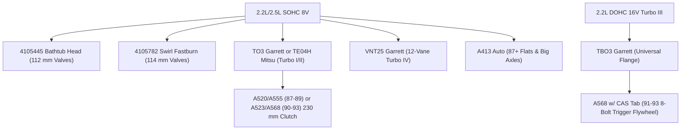

> **Scope**: Cleanroom Tier 2 Technical Digest of Chrysler `2.2L`/`2.5L` FWD Transaxles (`A460`–`A568`, `A413`), Turbochargers (`TO3`, `TE04H`, `VNT25`, `TBO3`), Cylinder Heads, Camshafts, and Engine Specifications
> **Boundary**: Distilled strictly from `TheDodgeGarage` and `Allpar (pre-2017 archive)` cleanroom web archives; covers mechanical/drivetrain tolerances and compatibility without PII or flash-write tokens.

---
doc_id: "mopar-fwd-transaxles-and-turbo-specs"
title: "Chrysler FWD Transaxles, Turbochargers, Cylinder Heads, Camshafts & 2.2L Engine Specs"
trust_tier: "Tier 2"
source_type: "DRIVETRAIN_AND_ENGINE_SPECS"
source_citation: "TheDodgeGarage (Transaxle, Turbo, Heads, Camshaft Guides) & Allpar Pre-2017 Archive (2.2L Specs & 2.2T History)"
warc_capture_date: "2026-11-27T00:00:00Z"
page_ref: "thedodgegarage/trans_guide, turbo_turbo, turbo_heads, turbo_camshaft; allpar/22-specs, 22t"
ecu_families: ["LM_PM", "SMEC_DUAL_BOARD", "SBEC_SINGLE_BOARD"]
ecu_scope: ["LM_6803", "SMEC_88_89", "SBEC_90_93"]
engine_scope: ["2.2L_K", "2.5L_K"]
hex_symbols: []
symbols_referenced: ["A460", "A465", "A525", "A520", "A555", "A523", "A543", "A568", "A413", "A515", "A522", "EDF", "EDS", "TO3", "TE04H", "VNT25", "TBO3", "4105445", "4323287", "4105782", "P4452005", "P4452006", "P4452007", "P4452008", "4293819", "4387850", "4387721", "P4529314", "P5249496", "4323808"]
pins_referenced: []
mermaid_verification: "VERIFIED"
cleanroom_status: "DISTILLED_ATTRIBUTED"
verified_by: "human_maintainer"
---

# Chrysler FWD Transaxles, Turbochargers, Heads, Cams & `2.2L` Specs

## 1. FWD Manual & Automatic Transaxles (`TheDodgeGarage`)

| Transaxle | Years & Application | Key Mechanical Notes & Compatibility |
| :--- | :--- | :--- |
| **`A460` / `A465` / `A525`** | `1981–1985` `A460` (`4-spd`); `1984–1990` `A465`/`A525` (`5-spd`) | `A460` used stamped steel forks until mid-`1984` cast-iron upgrade; `1983` added `.72` overdrive. `A525` is close-ratio `A465` (dropped after `1987` except L-body). Weakest differential; benefits from diff girdle and spider-pin inspection. |
| **`A520` / `A555`** | `1987–1989` (`A555` for `Turbo II` & `89` `2.5T` Caravan) | `A520` CAD redesign added cast diff housing, larger bearings, and thicker axles (`5W-30` motor oil fill). `A555` adds heat-treated case and Getrag internals with `4-pinion` differential. |
| **`A523` / `A568`** | `1990–1994` `A523` (`V6`=`A543`); `1990–1993` `A568` (`IC Turbo`) | `A523` adds 4-rail/3-plane shifter, low-friction cables, cast 5th end cover, and `1991` larger input shaft. `A568` combines `A555` strength with `A523` synchros/4-plane shifter; some carry `CAS` tab/hole for `224 hp` `16V` Turbo III. |
| **`A413` Auto** | `1984–1992` (`2.2L`/`2.5L` & `3.0L V6`) | `84–85`: 3-lug converter, 6-bolt flexplate, pump notches (prone to crack), small axles. `86`: 4-lug, 8-bolt, pump flats, small axles. `87–92`: 4-lug, 8-bolt, pump flats, redesigned diff & big axles. |

- **Flywheels, Clutches & Fluids**: Carb/TBI use `215 mm` clutches; all Turbos and Caravans use `230 mm` (`5` flywheel variants: `82–85 6-bolt/215 mm`, `84 6-bolt/230 mm`, `86–94 8-bolt/215 mm`, `86–93 8-bolt/230 mm`, `91–93 16V 8-bolt/230 mm` with crank trigger slots). `1991+` larger input shafts require matching `91+` disc (`84–90` transaxles use `84–90` T2 disc). Torque flywheel `65–70 ft/lbs`, pressure plate `21 ft/lbs`; grind flywheel (do not lathe-turn); fill manual transaxles with motor oil (`5W-30` / `10W-30`), never `ATF`.
- **`A413` Ratios & Clearances**: Stock transfer (`0.91`, `1.04` Neon, `1.06`, `1.22`) x ring (`2.86`, `3.05`) yield final drives `2.60`, `2.78`, `3.02`, `3.22`, `3.50`, `3.72` (`2.98`/`3.19` Neon). Reverse-pattern manual valve bodies require `90–100 psi` line pressure; tighten front clutch pack clearance from `.087–.133 in` factory toward `.050–.075 in` (`1996` spec) with flat snap ring.

---

## 2. Stock Turbochargers & Nickel Markings (`TheDodgeGarage`)

| Turbo Model | Years & Engine | A/R (Comp / Exh) | Wheels (Ind / Exd / Turb) | Key Hardware & Boost Notes |
| :--- | :--- | :---: | :---: | :--- |
| **`Garrett TO3`** | `1984–1987` Turbo I (`7.5–10 psi`) | `.42` / `.48` | `42 / 60 / 48 mm` | `84`: dual-port pneumatic can. `85–87`: single-port ECU-controlled; `2.25 in` small flange. |
| **`Mitsubishi TE04H`** | `1988–1993` `2.2`/`2.5` T-I (`7–9 psi`) | Small / Smaller | `38 / 53 / 51 mm` | Fast spool, restrictive exhaust housing; `88` `2.25 in` vs `89–93` `2.50 in` outlet; unique oil/coolant lines. |
| **`Garrett TO3` (T-II)** | `1986–1989` Turbo II (`12 psi` IC) | `.42` / `.48` | `42 / 60 / 48 mm` | Notched housing clears `#3` runner; `88` large flange, `89` `2.50 in` outlet. `86–88` weak wastegate bleeds at `14 psi`; `89` stiffer can. |
| **`Garrett VNT25`** | `1989–1990` Turbo IV (`12 psi` IC) | `.48` / `.64` | `36 or 40 / 52 / small` | `12` movable exhaust vanes eliminate wastegate; exhaust manifold stamped `'N'` (high nickel). |
| **`Garrett TBO3`** | `1991–1993` DOHC Turbo III (`224 hp`) | `.52` / `.48` | `45 / 60 / 48 mm` | Universal exhaust flange (`SVO`-style); will NOT bolt to SOHC exhaust manifold. |

- **Nickel Markings**: Turbine housings and outlets carry `M26` (early, crack-prone), `M3` (lower nickel), or `M4` (high nickel, improved thermal-cycle resistance on `VNT`, `87–88` `T-II`, and `T-III`).

---

## 3. Cylinder Heads, Camshafts & `2.2L` Engine Specifications (`TheDodgeGarage` & `Allpar`)

- **8V SOHC Heads**: Bathtub (`4105445` `83–84` `2.2L` & `86–94` carb/TBI; `4323287` `85` `2.2L`, `~10%` higher airflow) vs. Swirl/Fastburn (`4105782` `86–94`, `6 cc` smaller chamber). **Do NOT mix valves**: Swirl valves are `114 mm` tall vs. `112 mm` Bathtub (mixing holds valves open -> zero compression).
- **Turbo Head & Block Guards**: Turbo heads use stiffer springs, superior exhaust valves, and `'TS'` tapered-shroud stamp on `#4` end. Turbo II & `2.5T` heads/blocks are cross-drilled. Avoid `"OSJ"`-stamped heads (oversize cam journals dump oil pressure with standard cams). Late-`1989+` heads omit oil-squirter passages on cam caps `2, 3, 4`—inspect before installing any slider cam.
- **Fasteners & Gaskets**: `1983–85` `10 mm` bolts (`35-45-45-1/4 turn` ft/lbs); `1986–94` `11 mm` (`45-65-65-1/4 turn`). Mopar gaskets: `P4452005` (Carb/T-I), `P4452006` (`T-II`/`2.5T`), `P4452007` (O-ringed), `P4452008` (O-ringed + cross-drilled).
- **Camshafts**: `1984–87` T-I/II slider `4293819` (`.430` lift, `240-240` dur); `1988` `4387850` (`.430`, `236-232`); `1989–92` roller `4387721` (`.430`, `228-228`); MP `"314"` `P4529314` (`.460`, `240-240`); MP `Super 60` `P5249496` (`.499`, `260-260`, short slider wear life `10–18k mi`). **Followers are NOT interchangeable** between roller (`75%` less idle friction) and slider cams.

| Specification (`Allpar` Pre-2017 Scan) | `A515` `2.2L` HPTBI (`EDF`, `93 hp`) | `A522` `2.2L` Turbo III (`EDS`, `224 hp`) |
| :--- | :--- | :--- |
| **Assembly PN / Type / Firing Order** | `4536606` / SOHC I4 / `1-3-4-2` | `4536619` / DOHC 16V I4 / `1-3-4-2` |
| **Bore x Stroke / Displacement** | `87.5 x 92.0 mm` / `2213 cc` | `87.5 x 92.0 mm` / `2213 cc` |
| **Nominal CR / Chamber Vol / Plugs** | `9.00:1` / `48.5–51.5 cc` / `RN12YC` @ `0.035 in` | `8.3:1` / `57.0–60.0 cc` / `RN9YC` @ `0.035 in` |
| **Main / Rod Bearing Clearance** | `0.011–0.072 mm` / `0.019–0.075 mm` | Same; head oil restrictor `4323808` (`2.93–3.43 mm`) |

- **Turbo Lineage (`Allpar`)**: **Turbo I** (`142–150 hp`, `84` `7 psi` -> `85` `7/9 psi` transient, `89` `2.5T` `150 hp`); **Turbo II** (`174 hp / 200 lb-ft`, `12 psi`, forged crank, intercooled); **Turbo III** (`224 hp`, `91–93` Lotus DOHC 16V, DIS); **Turbo IV** (`174 hp / 225 lb-ft`, `89–90` VNT).
