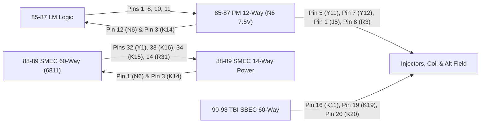

> **Scope**: Cleanroom Tier 2 Cross-Reference of `1984–1987` Logic/Power Module (`LM`/`PM`), `1988–1989` `SMEC`, and `1990–1993` `SBEC` Harness Architecture and Pinouts
> **Boundary**: Distilled strictly from `MiniMopar` cleanroom web archives (`Russ W. Knize`); covers architecture deltas, `1985–1987` Turbo PM `10-Way`/`12-Way`, `1988–1989` Turbo II SMEC `14-Way`/`60-Way`, and `1990–1993` TBI SBEC `60-Way` circuits without PII or flash-write tokens.

---
doc_id: "smec-sbec-lm-pm-harness-pinout-crossref"
title: "Chrysler LM/PM, SMEC & SBEC Architecture and Harness Pinout Cross-Reference"
trust_tier: "Tier 2"
source_type: "ECU_HARNESS_PINOUT_CROSSREF"
source_citation: "MiniMopar ECU Architecture, 1985-1987 Turbo Power Module, 1988-1989 Turbo II SMEC, and 1990-1993 TBI SBEC Pinouts (Russ W. Knize)"
warc_capture_date: "2026-11-27T00:00:00Z"
page_ref: "minimopar/ecu, pm-1985-turbo, smec-1988-t2, sbec-1990-tbi"
ecu_families: ["LM_PM", "SMEC_DUAL_BOARD", "SBEC_SINGLE_BOARD"]
ecu_scope: ["LM_6803", "SMEC_88_89", "SBEC_90_93"]
engine_scope: ["2.2L_K", "2.5L_K"]
hex_symbols: []
symbols_referenced: ["6803", "6811", "27C128", "87C257", "J1", "J2", "J5", "J9", "J11", "K1", "K3", "K4", "K5", "K7", "K8", "K9", "K10", "K11", "K13", "K14", "K15", "K16", "K19", "K20", "K22", "K24", "K29", "K35", "K39", "K40", "K41", "K51", "K52", "K54", "K59", "K60", "K01", "K02", "K04", "K06", "K07", "N1", "N2", "N3", "N4", "N5", "N6", "N7", "N11", "N12", "N13", "R3", "R31", "Y1", "Y4", "Y6", "Y7", "Y11", "Y12", "Z1", "Z6", "Z11", "Z12", "DK20", "DK21", "D01", "D02", "D20", "D21", "A14", "A21", "C13", "C20", "C27", "D40", "G7", "G03", "G07", "G21", "S4", "T21", "T24", "V31", "V32", "V33", "V35", "V36", "X31", "X32", "X33", "X35", "X36"]
pins_referenced: ["10-Way Pin 1", "10-Way Pin 2", "10-Way Pin 3", "10-Way Pin 5", "10-Way Pin 7", "10-Way Pin 8", "12-Way Pin 1", "12-Way Pin 5", "12-Way Pin 8", "12-Way Pin 10", "12-Way Pin 11", "12-Way Pin 12", "14-Way Pin 1", "14-Way Pin 3", "14-Way Pin 5", "14-Way Pin 8", "14-Way Pin 9", "14-Way Pin 10", "14-Way Pin 11", "14-Way Pin 12", "14-Way Pin 13", "14-Way Pin 14", "60-Way Pin 14", "60-Way Pin 16", "60-Way Pin 19", "60-Way Pin 20", "60-Way Pin 31", "60-Way Pin 32", "60-Way Pin 33", "60-Way Pin 34", "60-Way Pin 51", "60-Way Pin 52"]
mermaid_verification: "VERIFIED"
cleanroom_status: "DISTILLED_ATTRIBUTED"
verified_by: "human_maintainer"
---

# Chrysler `LM/PM`, `SMEC` & `SBEC` Architecture and Harness Cross-Reference

## 1. Architectural Evolution & Visual Identification (`1984–1993`)

| Generation | Physical Layout & Cooling | MCU / Memory | Connectors & MAP Mounting |
| :--- | :--- | :--- | :--- |
| **`1984–1987` `LM` + `PM`** | Split modules: `LM` behind passenger kick panel; `PM` in left front fender ducted to intake airbox for transistor cooling (retain ducting). | `Motorola 6803` (`LM`); `1984` `PM` handles more internal control than `1985–1987`. | `PM`: `10-way` + `12-way` large pins. `<=1986` & `87` L-body `LM` have integral MAP; other `87` `LM` use external MAP. |
| **`1988–1989` `SMEC`** | Combined engine-bay case in fender spot; dual separately potted `logic` and `power` boards linked via local wiring. | `Motorola 6811` (`11 ms` loop); single `16kx8` EEPROM (`27C128`). `89` adds live limp-in recovery. | Bolt-on `60-way` (`logic` board) + `14-way` large-pin (`power` board). |
| **`1990–1993` `SBEC`** | Single circuit board in simple box housing (`TBI` archive page header mislabels `88-89 SMEC`, body specifies `90-93 TBI SBEC`). | `Motorola 6811` (`11 ms` loop); `90-93` TBI uses address-latched `32kx8` EPROM (`87C257`). | Single bolt-on `60-way` connector only; eliminates external inter-board control wires. |

- **Limp-In & Inter-Board Control**: `1984–1987` `LM` units stay in limp-in until key-off; `1988+` `SMEC`/`SBEC` re-test failed sensors and can recover live. `PM` and `SMEC` power boards regulate the logic supply (`7.5V` `N6` on `85–87 PM`, `8V` `N6` on `88–89 SMEC`) and execute `LM`/logic-board commands for coil dwell, injector drivers, and alternator field.

---

## 2. `1985–1987` Turbo Power Module (`10-Way` & `12-Way` Connectors)

Wire colors use `Color/Tracer*` (`BK/YL*` = black with yellow tracer; `BK` Black, `BR` Brown, `DB` Dark Blue, `DG` Dark Green, `GY` Grey, `LB` Light Blue, `LG` Light Green, `OR` Orange, `PK` Pink, `RD` Red, `TN` Tan, `VT` Violet, `WT` White, `YL` Yellow).

| Pin | 10-Way Circuit | Gauge/Color | Function | 12-Way Pin | 12-Way Circuit | Gauge/Color | Function |
| :---: | :---: | :---: | :--- | :---: | :---: | :---: | :--- |
| 1 | `J5` | `18 BK/YL*` | Ignition coil driver output | 1 | `K16` | `22 VT/YL*` | Fuel injector control from `LM` |
| 2 | `J2` | `14 DB` | `12V` ign switch `run`/`start` feed | 2 | `Y5` | `18 BK/LB*` | Signal ground from `LM` |
| 3 | `K14` | `18 DB/WT*` | `12V` feed to `LM` (from `J2`) | 3 | `K22` | `22 RD/BK*` | Battery temp sensor output |
| 4 | `J1` | `12 PK` | Direct battery feed | 4 | `-` | `-` | Not used |
| 5 | `Y11` | `18 WT` | Fuel injector `#1`/`#2` driver output | 5 | `K19` | `20 DB/YL*` | `ASD` relay control from `LM` |
| 6 | `Z1` | `14 DG/BK*` | `ASD` relay power output | 6 | `J11` | `20 RD/WT*` | Direct battery feed to `LM` |
| 7 | `Y12` | `18 TN` | Fuel injector `#3`/`#4` driver output | 7 | `-` | `-` | Not used |
| 8 | `R3` | `18 DG` | Alternator field coil driver output | 8 | `Y1` | `20 GY/WT*` | Fuel injector on signal from `LM` |
| 9 | `J9` | `16 BK` | Engine ground at fuel rail bolt | 9 | `-` | `-` | Not used |
| 10 | `J9` | `16 BK` | Engine ground at fuel rail bolt | 10 | `K15` | `22 YL` | Anti-dwell control from `LM` |
| - | - | - | - | 11 | `R31` | `22 DG/OR*` | Voltage regulation from `LM` |
| - | - | - | - | 12 | `N6` | `18 OR` | `7.5V` power feed to `LM` |

---

## 3. `1988–1989` Turbo II `SMEC` `14-Way` Power Board & Inter-Board Links

| Pin | 14-Way Circuit | Gauge/Color | Function | Paired `60-Way` Pin (`Circuit`) |
| :---: | :---: | :---: | :--- | :--- |
| 1 | `N6` | `18 OR` | `8V` power supply to logic board | `Pin 52` (`N6`) |
| 2 | `K5` | `16 BK/WT*` | Signal ground from fuel rail bolt | `Pin 5` (`K5`) |
| 3 | `K14` | `18 DB/WT*` | Ign `start`/`run` feed to logic board & `ASD` (`J2`) | `Pin 12` (`K14`) |
| 4 | `J2` | `14 DB` | Ignition `start`/`run` power feed | External harness |
| 5 | `Y1` | `20 GY/WT*` | Fuel injector control `#2` from logic board | `Pin 32` (`Y1`) |
| 6 | `J9` | `16 BK` | Power ground from fuel rail bolt | Shared rail ground (`Pin 15`/`Pin 16` `K9`) |
| 7 | `J9` | `16 BK` | Power ground from fuel rail bolt | Shared rail ground |
| 8 | `K16` | `20 VT/YL*` | Fuel injector control `#1` from logic board | `Pin 33` (`K16`) |
| 9 | `Y11` | `18 WT` | Fuel injector driver `#1` output | External to injectors |
| 10 | `Y12` | `18 TN` | Fuel injector driver `#2` output | External to injectors |
| 11 | `R31` | `20 DG/OR*` | Voltage regulation signal from logic board | `Pin 14` (`R31`) |
| 12 | `J5` | `18 BK/YL*` | Ignition coil driver output | External to coil |
| 13 | `K15` | `20 YL` | Anti-dwell control signal from logic board | `Pin 34` (`K15`) |
| 14 | `R3` | `18 DG` | Alternator field coil driver output | External to alternator |

---

## 4. `1988–1989` Turbo II `SMEC` vs. `1990–1993` TBI `SBEC` `60-Way` Cross-Reference

Key signal remaps between dual-board `SMEC` (`1988–1989` T2) and single-board `SBEC` (`1990–1993` TBI):

| Pin | `88–89` T2 `SMEC` Circuit & Function | `90–93` TBI `SBEC` Circuit & Function | Notes / Delta |
| :---: | :--- | :--- | :--- |
| 1 | `K4` (`DG/RD*`) MAP signal | `K01` (`DG/RD*`) MAP signal | Same cavity, circuit renumbered |
| 2 | `N12` (`BK/LG*`) Detonation sensor | `K02` (`TN/BK*`) Coolant temp sensor | TBI lacks knock sensor; `CTS` moves `3 -> 2` |
| 3 | `K10` (`TN/WT*`) Coolant temp sensor | `A14` (`RD/WT*`) `ASD` relay sense | `ASD` sense moves `10 -> 3` |
| 4 | `N5` (`BK/LB*`) Sensor signal ground | `K04` (`BK/LB*`) Sensor signal ground | Preserved cavity |
| 5 | `K5` (`BK/WT*`) Signal ground source | `Z11` (`BK`) Signal ground source | Fuel rail (`SMEC`) vs top rear engine (`SBEC`) |
| 6 | Not used | `K06` (`VT`) `5V` supply (`MAP` / `TPS`) | `5V` moves `13 -> 6` |
| 7 | `X33` (`WT/LG*`) Cruise resume | `K07` (`OR`) `8V` ign ref sensor supply | Cruise moves to `48–50`; `8V` ref out on `7` |
| 9 | `X31` (`BR/RD*`) Cruise set | `A21` (`DB`) Ign `start`/`run` feed | Replaces `12` (`K14`) |
| 10 | `Z1` (`DG/BK*`) `ASD` relay sense | Not used | Moved to `Pin 3` (`A14`) |
| 11 | Not used | `Z12` (`BK/TN*`) Power ground source | `SBEC` uses `11` & `12`; `SMEC` uses `15` & `16` (`K9`) |
| 12 | `K14` (`DB/WT*`) Ign `start`/`run` from `J2` | `Z12` (`BK/TN*`) Power ground source | **Power vs Ground pin swap** |
| 13 | `K8` (`VT/WT*`) `5V` supply (`MAP` / `TPS`) | Not used | Moved to `Pin 6` (`K06`) |
| 14 | `R31` (`DG/OR*`) Voltage reg to power board | Not used | Internalized in `SBEC` |
| 16 | `K9` (`LB/RD*`) Power ground source | `K11` (`WT/DB*`) Fuel injector driver | Internalized driver exits `Pin 16` |
| 17–20 | `N2`, `N4`, `N1`, `N3` `AIS` windings `1`/`2` | `17, 18` unused; `19` `K19` coil; `20` `K20` alt | `SBEC` `AIS` moves to `39` (`K39`), `40` (`K40`), `59` (`K59`), `60` (`K60`) |
| 21 | `K13` (`BK/RD*`) Air charge temp (`ACT`) | Not used | Turbo `ACT` only |
| 22 | `K7` (`OR/DB*`) `TPS` signal | `K22` (`OR/DB*`) `TPS` signal | Preserved cavity |
| 23 | `N11` (`BK/DG*`) Heated `O2` sensor | Not used | `O2` moves `23 -> 41` (`K41`) |
| 24 | Not used | `K24` (`GY/BK*`) Ign ref sensor signal | Ign ref moves `47 -> 24` |
| 25 | Not used | `D21` (`PK`) `SCI` `TX` | `SCI TX` moves `51 -> 25` |
| 26 | `Y7` (`TN/YL*`) Injector sync pickup | `D01` (`VT/BR*`) Serial bus `B+` | `CCD`/`Serial` bus added on `26` & `46` (`D02`) |
| 27 | Not used | `C20` (`BR`) A/C damped pressure | A/C switch moves `45 -> 27` |
| 29–30 | `D40` Brake; `S4` Neutral safety | `K29` Brake; `T24` Neutral safety | Preserved cavities |
| 31 | `DK20` (`LG`) `SCI` `RX` | `C27` (`DB/PK*`) Radiator fan relay | `SCI RX` moves `31 -> 45` (`D20`); Fan `57 -> 31` |
| 32 | `Y1` (`GY/WT*`) Inj ctrl `#2` to power board | `G03` (`BK/PK*`) `CEL` lamp output | `CEL` moves `59 -> 32` |
| 33 | `K16` (`VT/YL*`) Inj ctrl `#1` to power board | `V36` (`TN/RD*`) Cruise vacuum servo | Cruise vac moves `53 -> 33` |
| 34 | `K15` (`YL`) Anti-dwell to power board | `C13` (`DB/OR*`) A/C `WOT` cutout relay | A/C cutout moves `56 -> 34` |
| 35–39 | `36` `Z6`; `38` `Y4` Baro; `39` `Y6` Wastegate | `35` `K35` CA EGR; `39` `K39` `AIS` | `40` `K40` `AIS` on `SBEC`; `41` `J1` batt on `SMEC` |
| 43 | Not used | `G21` (`GY/LB*`) Tachometer output | Tach moves `50` (`T21`) -> `43` |
| 45 | `C20` (`BR`) A/C damped pressure | `D20` (`LG`) `SCI` `RX` | `SCI RX` relocated from `31` |
| 47–48 | `47` `N7` Ign ref; `48` `G7` Speed sensor | `47` `G07` Speed sensor; `48` `V31` Cruise set | Speed moves `48 -> 47`; `49` `V32`, `50` `V33` |
| 51–54 | `51` `DK21` `SCI TX`; `52` `N6` `8V`; `53` `X36`; `54` `K1` Purge | `51` `K51` `ASD` relay; `52` `K52` Purge; `53` `V35` Cruise vent; `54` `K54` `PTU` unlock | `ASD` output moves `58` (`K19`) -> `51` (`K51`) |
| 56–60 | `56` `N13`; `57` `C27`; `58` `K19`; `59` `K3`; `60` `X35` | `56–58` unused; `59` `K59` `AIS`; `60` `K60` `AIS` | `SBEC` relocates `56–59` functions to `31–34`, `51` |
