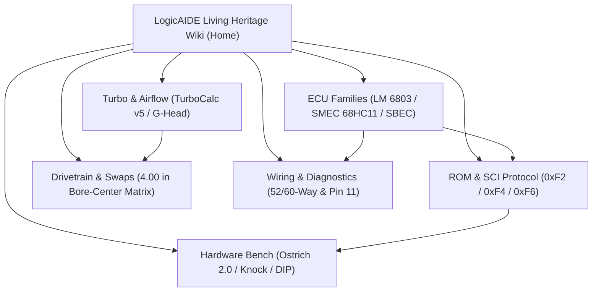

# LogicAIDE Living Heritage Wiki

Welcome to the cleanroom Chrysler `2.2L` / `2.5L` / `2.0L` / `2.4L` powertrain knowledge base for **LogicAIDE**. Every article is attributed by trust tier (`Tier 1` factory manuals & verified harness pinouts, `Tier 2` engineering calculators & bench measurements, `Tier 3` community cross-checks) and normalized for deterministic RAG retrieval.

> [!CAUTION]
> **Hardware Deadbolt Boundary**: LogicAIDE is strictly **read-only** with respect to live vehicle ECU flashing and stock ROM baselines (`rom/inputs/`, `rom/stock_baselines/`). All emulator, SCI, and calibration workflows stage verified artifacts offline only.

## Knowledge Categories

| Category | Status | Trust Tier | Overview |
| :--- | :--- | :--- | :--- |
| **ECU Families** | `stub` | `Tier 1` | [ECU Families Overview](ecu-families/ecu-families-overview.md) |
| **ROM & SCI Protocol** | `stub` | `Tier 1` | [ROM & SCI Overview](rom-and-sci/rom-and-sci-overview.md) |
| **Turbo & Airflow** | `verified` | `Tier 2` | [Turbo & Airflow Overview](turbo-and-airflow/turbo-and-airflow-overview.md) |
| **Drivetrain & Swaps** | `stub` | `Tier 1` | [Drivetrain & Swaps Overview](drivetrain-and-swaps/drivetrain-and-swaps-overview.md) |
| **Wiring & Diagnostics** | `stub` | `Tier 1` | [Wiring & Diagnostics Overview](wiring-and-diagnostics/wiring-and-diagnostics-overview.md) |
| **Hardware Bench** | `stub` | `Tier 2` | [Hardware Bench Overview](hardware-bench/hardware-bench-overview.md) |

### Wave A Verified Reference Articles

- [OEM Chrysler Turbos](turbo-and-airflow/oem-chrysler-turbos.md) — Factory Garrett `T03`/`TB03`/`VNT25` and Mitsubishi `TE04H`/`TD04LR` baselines
- [TurboCalc Compressor Catalog](turbo-and-airflow/turbocalc-compressor-catalog.md) — `145` calibrated turbos, 4-point affine equations, and `NIST SP 811` conversions
- [Cylinder Head Flowbench Atlas](turbo-and-airflow/cylinder-head-flowbench-atlas.md) — `#445`, `#782`, `G-Head`, and `16V` DOHC flowbench curves

## Topic Map

## Navigation Chrome

- Sidebar index: [`_Sidebar.md`](_Sidebar.md)
- Trust-tier & safety footer: [`_Footer.md`](_Footer.md)
