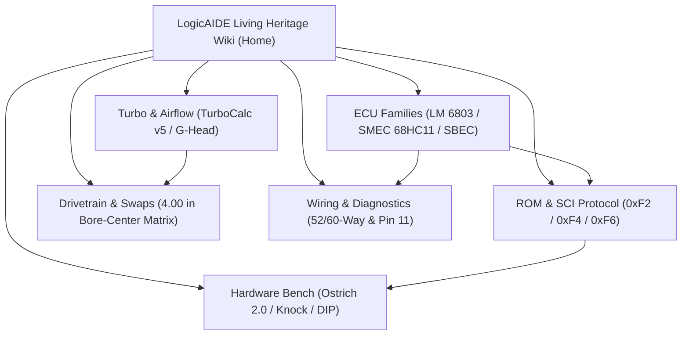

# LogicAIDE Living Heritage Wiki

Welcome to the cleanroom Chrysler `2.2L` / `2.5L` / `2.0L` / `2.4L` powertrain knowledge base for **LogicAIDE**. Every article is attributed by trust tier (`Tier 1` factory manuals & verified harness pinouts, `Tier 2` engineering calculators & bench measurements, `Tier 3` community cross-checks) and normalized for deterministic RAG retrieval.

> [!CAUTION]
> **Hardware Deadbolt Boundary**: LogicAIDE is strictly **read-only** with respect to live vehicle ECU flashing and stock ROM baselines (`rom/inputs/`, `rom/stock_baselines/`). All emulator, SCI, and calibration workflows stage verified artifacts offline only.

## Knowledge Categories

| Category | Status | Trust Tier | Overview |
| :--- | :--- | :--- | :--- |
| **ECU Families** | `verified` | `Tier 1` | [ECU Families Overview](ecu-families/ecu-families-overview.md) |
| **ROM & SCI Protocol** | `verified` | `Tier 2` | [ROM & SCI Overview](rom-and-sci/rom-and-sci-overview.md) |
| **Turbo & Airflow** | `verified` | `Tier 2` | [Turbo & Airflow Overview](turbo-and-airflow/turbo-and-airflow-overview.md) |
| **Drivetrain & Swaps** | `verified` | `Tier 1` | [Drivetrain & Swaps Overview](drivetrain-and-swaps/drivetrain-and-swaps-overview.md) |
| **Wiring & Diagnostics** | `stub` | `Tier 1` | [Wiring & Diagnostics Overview](wiring-and-diagnostics/wiring-and-diagnostics-overview.md) |
| **Hardware Bench** | `verified` | `Tier 2` | [Hardware Bench Overview](hardware-bench/hardware-bench-overview.md) |

### Wave A Verified Reference Articles

- [OEM Chrysler Turbos](turbo-and-airflow/oem-chrysler-turbos.md) — Factory Garrett `T03`/`TB03`/`VNT25` and Mitsubishi `TE04H`/`TD04LR` baselines
- [TurboCalc Compressor Catalog](turbo-and-airflow/turbocalc-compressor-catalog.md) — `145` calibrated turbos, 4-point affine equations, and `NIST SP 811` conversions
- [Cylinder Head Flowbench Atlas](turbo-and-airflow/cylinder-head-flowbench-atlas.md) — `#445`, `#782`, `G-Head`, and `16V` DOHC flowbench curves

### Wave B Verified Reference Articles

- [Chrysler LM / PM 6803 Reference](ecu-families/lm-pm-6803.md) — `1984–1987` dual-box `6803`, `27128` vs. split `2x 2764` (`GLHS`), `MC146823`/`ADC0808`, and `976 -> 7812.5` baud polling
- [Chrysler SMEC 68HC11 Reference](ecu-families/smec-68hc11.md) — `1988–1989` dual-board `68HC11`, `27C256` `$B600`–`$B7FF` EEPROM hole, `DRBFunctionTable`, and `90 °C` IAT reference
- [Chrysler SBEC & SBEC-II 68HC11 Architecture](ecu-families/sbec-68hc11.md) — `1990–1993+` single-board `68HC11`, `0xF2`/`0xF6` SCI dispatch, and `60 °C` IAT transition
- [60-Way Harness Pin 11 Safety Matrix](ecu-families/pin-11-safety-matrix.md) — Pre-connect DMM ohmmeter gate separating SMEC blank Pin 11 from SBEC grounded Pin 11
- [Chrysler SCI 7812.5 & 62,500 Baud Protocol](rom-and-sci/sci-7812-and-62500-protocol.md) — `0x12` handshake, `0xF2`/`0xF4`/`0xF6` RAM reads, and Dead-Cell Quarantine contract
- [DRB-II Commands, 10-Protocol XREF & Fault Registers](rom-and-sci/drb-ii-commands-and-prompts.md) — `0x10`–`0x1C` dispatcher, `26`-entry `DRBMemoryTable`, `402`-variable XREF, and `ERR0`–`ERR3` bitfields
- [68HC11 / 6803 Fuel & Spark Math: BATOFF, PEFTBL, WOTTBL & MAP Scaling](rom-and-sci/fuel-and-spark-math-peftbl-wottbl.md) — Fixed-point `BATOFF` deadtime, `PEFTBL`/`WOTTBL` lookups, `2-bar`/`3-bar` scaling, and `<= 11 ms` twin parity

### Wave C Verified Reference Articles

- [16V DOHC ECC / EDZ Hybrid Swap & K-Block Machining Guide](drivetrain-and-swaps/dohc-ecc-hybrid-swap-guide.md) — `4.00 in` bore-center 3-tier guard, external AN oiling circuit, 7 swap checklist keys, and `PEFTBL` / Hall-sync notes
- [Chrysler FWD Transaxles: A555, A568, A413 Ratios, Rollout Math & Helical LSD QC](drivetrain-and-swaps/a555-a568-a413-transaxles.md) — Assembly-tag gearset matrix, tire rollout RPM-to-MPH inference, `A525` girdle `P4349444`, and helical LSD teardown QC
- [SMEC 28C256 & Bank-Switched Socket Read-Only Hardware Notes](hardware-bench/smec-28c256-read-only-socket-notes.md) — `Pin 11` DMM isolation, `SST27SF020` / Ostrich 2.0 `28-pin` vs. `32-pin` alignment, and `28C256` + `74HC00` BOM
- [SCI, Knock Box Conditioning & Waste-Spark DIS Adaptor Hardware Notes](hardware-bench/knock-and-dis-conditioning.md) — `4N25` / `1N4733A-TR` opto-isolated SCI/knock BOM, `Knock_Board` review, and `PIC12F629`/`PIC16F690` DIS adaptor notes

## Topic Map

## Navigation Chrome

- Sidebar index: [`_Sidebar.md`](_Sidebar.md)
- Trust-tier & safety footer: [`_Footer.md`](_Footer.md)
