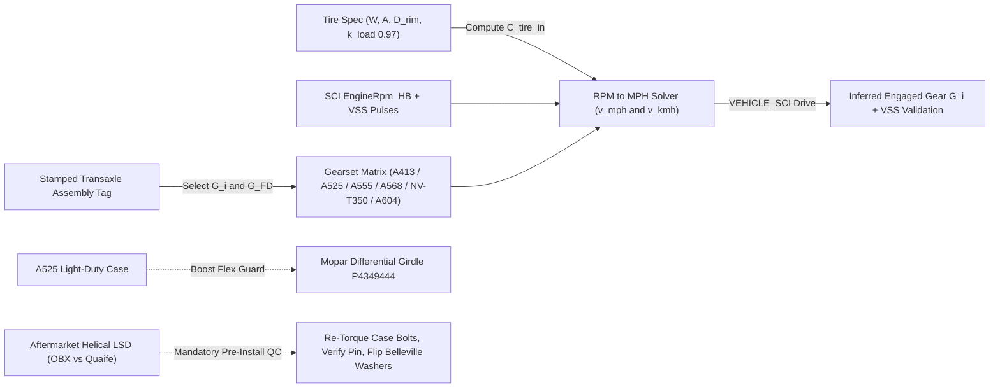

# Chrysler FWD Transaxles: `A555`, `A568`, `A413` Ratios, Rollout Math & Helical LSD QC

Chrysler mixed internal manual and planetary gearsets across model years, turbo packages, and factory assembly tags. Accurate road-speed inference, shift-point analysis, and `VSS` cross-checking in LogicAIDE (`profiles/schema/vehicle_build.schema.json`) require matching the stamped **Transaxle Assembly Tag** against both the baseline schema profiles and historical year/group gearset variants before compiling a vehicle build.

## Road-Speed Inference & Transaxle Pre-Install Flow

## Transaxle Gear Ratio Matrix (Reference Profiles vs. Assembly-Tag Variants)

> [!IMPORTANT]
> **Assembly-Tag Verification Rule**: Factory FSM and historical Chrysler gearing spreadsheets record multiple ratio revisions under the same transaxle family code (especially `A525`, `A555`, `A568` `1990–91` vs. `1992`, and `A413` / `31TH` Group `1–3`). Always confirm the stamped housing assembly tag (`assembly_tag`) when configuring `transaxle_and_gearing.forward_ratios`.

### 5-Speed & 4-Speed Manual Transaxles

| Transaxle & Source Variant | 1st | 2nd | 3rd | 4th | 5th | Final Drive (`G_FD`) | Architecture & Application Notes |
| :--- | :---: | :---: | :---: | :---: | :---: | :---: | :--- |
| **`A460`** *(4-spd historical)* | `3.29` | `1.89` | `1.21` | `0.88` | `—` | `3.56`, `3.87` | Early `1981–1985` 4-speed; stamped steel forks replaced by cast iron mid-`1984`. |
| **`A465` / `A525` Wide** *(historical)* | `3.29` | `1.89` | `1.21` | `0.88` | `0.72` | `3.56`, `3.87` | `1983+` `A460` with `0.72` 5th gear hung off shaft ends. |
| **`A525`** *(LogicAIDE reference)* | `3.20` | `2.08` | `1.36` | `1.00` | `0.72` | `3.05`, `3.56`, `3.85` | `1984–1990` light-duty manual (`L-body` post-`87`); reinforce case with **`P4349444`**. |
| **`A525` Close** *(historical)* | `3.29` | `2.08` | `1.45` | `1.04` | `0.72` | `3.56`, `3.87` | Close-ratio `A525`; shares ratios with `A520` (`3.50`, `3.85`). |
| **`A520` (`87–89`) / `A523` (`90–91`) / `A543`** | `3.29` | `2.08` | `1.45` | `1.04` | `0.72` | `3.50`, `3.85` | CAD-redesigned diff, cast diff cover, larger bearings/axles; `A523` adds 4-rail/3-plane shift & `91+` large input shaft. |
| **`A523` (`92`) / `A543` (`92`)** | `3.31` | `2.06` | `1.36` | `0.97` | `0.71` | `3.77` | Revised 1992 gearset; `A543` uses V6 bellhousing bolt pattern. |
| **`A555`** *(LogicAIDE Getrag HD ref)* | `3.25` | `2.08` | `1.36` | `1.03` | `0.72` | `3.85` | Heat-treated case, Getrag coarse-pitch gears, 4-pinion diff (`Turbo II`, `CSX`, `89 2.5T Caravan`). |
| **`A555`** *(historical gearing sheet)* | `3.00` | `1.89` | `1.28` | `0.94` | `0.71` | `3.85` | Alternate `A555` assembly-tag ratio cluster. |
| **`A568`** *(LogicAIDE Getrag/NPG ref)* | `3.52` | `2.08` | `1.35` | `0.97` | `0.73` | `3.50`, `3.85`, `3.94` | `1990–1993` reinforced `A555` with dual-cone synchros, cast 5th cover, `91+` large input shaft & `16V` crank sensor boss. |
| **`A568` (`1990–1991`)** *(historical)* | `3.00` | `1.89` | `1.28` | `0.94` | `0.71` | `3.85` | Early `A568` ratio set matching `A555` historical ratios. |
| **`A568` (`1992–1993`)** *(historical / FSM)* | `3.31` | `1.89` *(or `2.06`)* | `1.28` *(or `1.36`)* | `0.94` *(or `0.97`)* | `0.71` | `3.85` | `1992` gearing sheet records `3.31/1.89/1.28/0.94/0.71`; `92–93` FSM lists `3.31/2.06/1.36/0.97/0.71`. |
| **`NV-T350` (`A578`)** *(LogicAIDE ref)* | `3.50` | `1.95` | `1.36` | `0.97` | `0.72` | `3.55`, `3.94` | Neon / `2.4L` swap manual (`3.55` SOHC vs. `3.94` DOHC R/T). |
| **`A578` / `A578 B`** *(historical)* | `3.54` | `2.12` | `1.36` | `1.03` | `0.72` (`0.81` `B`) | `3.55`, `3.94` | `A578 B` swaps `0.72` overdrive for `0.81` 5th with `3.94` FD. |

### Automatic Transaxles (`A413` / `31TH` & `A604`)

| Transaxle & Group | 1st | 2nd | 3rd | 4th | Final Drive / Overall Axle Options | Notes |
| :--- | :---: | :---: | :---: | :---: | :--- | :--- |
| **`A413`** *(LogicAIDE `A904`-lineage ref)* | `2.74` | `1.54` | `1.00` | `—` | `3.02`, `3.22`, `3.56` | 3-speed TorqueFlite (`3.02` typical Turbo build); transfer shaft + ring gear sets FD. |
| **`A413`** *(OEM planetary / Group 1–3)* | `2.69` | `1.55` | `1.00` | `—` | `2.86`, `3.05` *(G1: `2.60/2.78`; G2: `3.02/3.22`; G3: `3.50/3.72`)* | Transfer ratios: `0.91` (`52/57T` late L-body), `1.06`, `1.22` (`60/49T` early L-body). |
| **`31TH`** *(Group 1 / Group 2)* | `2.69` | `1.55` | `1.00` | `—` | G1: `2.98` / `3.04`; G2: `3.19` / `3.24` | Neon `1.04` (`47/45T`) transfer yields `2.98` (`2.86` ring) / `3.19` (`3.05` ring). |
| **`A604` (`41TE`)** *(4-spd Ultradrive)* | `2.84` | `1.57` | `1.00` | `0.69` | `2.36` | Electronically shifted via `EATX` controller over `CCD` bus. |

*(For Mitsubishi-derived AWD/FWD platforms referenced alongside Dodge swaps, `F5M33` uses `3.09 / 1.833 / 1.217 / 0.888 / 0.741` with `3.437` FD, and `W5MG1` AWD uses `3.071 / 1.739 / 1.103 / 0.823 / 0.659` with `2.888` FD.)*

## Hardware Evolution, Flywheels, Clutches & `A413` Race Prep (`TheDodgeGarage` / `Allpar`)

- **Manual Lubrication & Retainer Reinforcement**: All `2.2L`/`2.5L` manual transaxles specify engine oil (`5W-30` / `10W-30`, never `ATF`). Replacing the mild-steel mainshaft bearing retainer plate with a **chrome-moly retainer plate** resists shaft deflection under boost that otherwise shears `3rd` gear. Inspect stock differential spider gears and roll pins (`~70,000 mi` galling risk) before drag launches, and replace worn **motor mounts** if experiencing repeated CV-joint breakage under torque (`Allpar (pre-2017 archive)`).
- **Flywheel & Clutch Compatibility Matrix (`2.2L` / `2.5L`)**:
  - `1982–1985` `6`-bolt crank (`215 mm` small carb/TBI vs. `1984` `230 mm` turbo pattern); `1986–1994` `8`-bolt crank (`215 mm` carb/TBI vs. `1986–1993` `230 mm` turbo); `1991–1993` `16V` `8`-bolt `230 mm` with crank-trigger slots.
  - **Input-Shaft Spline Split (`1990` vs. `1991`)**: `1991+` `A523`/`A568` enlarged the input shaft; factory `Turbo III` (`230 mm`) clutch sets (`~300 hp` street/strip capacity) bolt directly to `1991+` transaxles, whereas `1984–1990` small-shaft boxes require pairing a `T-III` pressure plate with a `1984–1990` `T-II` friction disc (surface-grind flywheels rather than lathe-turning; torque flywheel bolts `65–70 lb-ft`, pressure plate `21 lb-ft`).
- **`A413` Model-Year Splits & Strip Durability**:
  - `1984–1985` (`3`-lug converter, `6`-bolt flexplate, notched pump hub prone to ear cracking, small axles) and `1986` (`4`-lug, `8`-bolt, pump flats, small axles) should be bypassed in favor of **`1987–1992`** (`4`-lug, `8`-bolt, pump flats, large axles, redesigned diff).
  - Race upgrades (`TheDodgeGarage`): install `4`-disc/`4`-steel V6 or late-Turbo front clutch drums, replace the front-drum wave snap ring with a flat snap ring set to **`0.050–0.075 in`** (`1996` tight clearance vs. `0.087–0.133 in` factory), verify **`90–100 psi`** line pressure on reverse-manual valve bodies, use `ATF+3` (`7176`), and fit an oversized auxiliary cooler.

## Tire Rollout & `RPM` to `MPH` Inference Math

Given tire section width $W\text{ (mm)}$, aspect ratio $A\text{ (\%)}$, rim diameter $D_{\text{rim}}\text{ (in)}$, loaded rolling radius factor $k_{\text{load}} \approx 0.97$ (or directly measured rollout circumference $C_{\text{tire, in}}$), forward gear ratio $G_i$, and final drive ratio $G_{\text{FD}}$:

$$C_{\text{tire, in}} = \pi \cdot k_{\text{load}} \left(D_{\text{rim}} + \frac{2 \cdot W \cdot (A / 100)}{25.4}\right)$$

$$v_{\text{mph}} = \frac{\text{RPM} \cdot C_{\text{tire, in}} \cdot 60}{G_i \cdot G_{\text{FD}} \cdot 63{,}360}, \qquad v_{\text{km/h}} = v_{\text{mph}} \cdot 1.609344$$

- **Verified Example (`205/50R15` on `A555` `3.85` FD)**: With $W = 205$, $A = 50$, $D_{\text{rim}} = 15$, and $k_{\text{load}} = 0.97$, rollout evaluates to $C_{\text{tire, in}} \approx 70.3\text{ in}$ (`profiles/examples/csx_89_neon_dohc.json`). At `6000 RPM` in 3rd gear ($G_3 = 1.36$), $v_{\text{mph}} = \frac{6000 \cdot 70.3 \cdot 60}{1.36 \cdot 3.85 \cdot 63{,}360} \approx 76.3\text{ mph}$.
- **Telemetry Usage**: LogicAIDE applies this equation during `VEHICLE_SCI` drives lacking a discrete gear switch to infer engaged gear $G_i$ and validate `vss_pulses_per_rev` (typically `8` pulses/rev).

## `A525` Differential Girdle (`P4349444`) & Helical LSD Pre-Install QC

- **`A525` Differential Case Brace (`P4349444`)**: Under elevated boost torque, the light-duty `A525` transaxle case flexes across the differential bearing saddles, accelerating ring-and-pinion wear. Installing Mopar Performance differential girdle **`P4349444`** ties the bearing caps into the housing to stabilize gear mesh.
- **Helical LSD Pre-Installation QC Teardown (`OBX` vs. `Quaife`)**: Budget `OBX` helical LSDs copy the `Quaife` torque-biasing helical gear geometry, but documented teardown inspections revealed critical assembly defects that must be corrected before installation:

| Inspection Checkpoint | `OBX` As-Received Teardown Finding | `Quaife` Spec / Mandatory Corrective Action |
| :--- | :--- | :--- |
| **1. Case Bolts (11x Allen)** | Found loose at **`10–15 lb-ft`** with lower-grade fasteners | Upgrade case fasteners and torque evenly to **`50 lb-ft`** `Quaife` spec |
| **2. Pressed Alignment Pin** | Dowel pin fell out due to loose press fit | Verify tight interference press fit; re-pin or retain securely |
| **3. Center Belleville Washers** | Installed **backwards** (yielding zero preload) | Disassemble center preload stack and flip Belleville washers to proper preload orientation |
| **4. Gear Lash, Deburr & Hardness** | Rough un-deburred exterior, excessive gear lash, mild case hardness (marked by hacksaw blade) | Deburr external/housing edges, measure helical gear lash, and inspect teeth thoroughly |

- **Field Durability Context**: After complete teardown, Belleville washer reversal, deburring, and fastener upgrade/re-torque, inspected helical units have survived `500–600 whp` and `11.4 s` drag passes, though **`3rd`-gear tooth failure** remains the primary transaxle mechanical limit on high-torque FWD builds.

## Related Pages

- [Drivetrain & Engine Swap Compatibility Overview](drivetrain-and-swaps-overview)
- [16V DOHC ECC / EDZ Hybrid Swap & K-Block Machining Guide](dohc-ecc-hybrid-swap-guide)
- [8V Cylinder Heads, Camshafts & Turbo Builds](eight-valve-heads-camshafts-and-turbo-builds)
- [68HC11 / 6803 Fuel & Spark Math: BATOFF, PEFTBL, WOTTBL & MAP Scaling](fuel-and-spark-math-peftbl-wottbl)
- [1988–1989 Chrysler SMEC (Motorola 68HC11 Dual-Board) Reference](smec-68hc11)
- [Wiki Home](Home)
