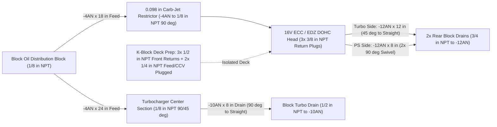

# 16V DOHC `ECC` / `EDZ` Hybrid Swap & K-Block Machining Guide

Chrysler's inline-4 `2.2L` / `2.5L` K-blocks, `2.0L` Neon `ECC`/`ECB` blocks, and `2.4L` `EDZ`/SRT-4 blocks share **`4.00 in` (`101.6 mm`) bore-center spacing** and an **`87.5 mm` standard bore** (`.020` / `.040` overbore capable). Because deck oil/coolant routing, dowel placement, and timing geometry diverge between K-series and `ECC`/`EDZ` architectures, LogicAIDE enforces a strict 3-tier compatibility guard (`profiles/schema/vehicle_build.schema.json`) before any hybrid calibration compiles.

## 3-Tier Block & Head Compatibility Matrix

| Block Code | Bore x Stroke (`mm`) | Displacement | `8V #445` / `#782` SOHC | `Lotus` / `Maserati 16V` | `Neon ECC 2.0L` / `2.4L EDZ` DOHC |
| :--- | :---: | :---: | :---: | :---: | :---: |
| **`2.2L_K`** (`1981–1987` `10 mm` / `1988+` `11 mm`) | `87.5 x 92.0` | `2,213 cm³` | `BOLT_ON_NATIVE` | `BOLT_ON_NATIVE` | **`HYBRID_MACHINING_REQUIRED`** |
| **`2.5L_K`** (`1986–1995` common deck) | `87.5 x 104.0` | `2,501 cm³` | `BOLT_ON_NATIVE` | `BOLT_ON_NATIVE` | **`HYBRID_MACHINING_REQUIRED`** |
| **`2.0L_ECC`** (Neon short-stroke) | `87.5 x 83.0` | `1,996 cm³` | `—` | `—` | Native Deck |
| **`2.4L_EDZ`** (Tall-deck thin-wall) | `87.5 x 101.0` | `2,429 cm³` | **`INCOMPATIBLE`** *(Hard Block)* | **`INCOMPATIBLE`** *(Hard Block)* | **`HYBRID_MACHINING_REQUIRED`** *(chassis swap)* |

> [!CAUTION]
> **`INCOMPATIBLE` Hard Compilation Block**: Attempting to pair an older `8V #445` (`8V_445_BATHTUB`) or `#782` (`8V_782_SWIRL`) SOHC K-head—or K-footprint `LOTUS_16V_T3` / `MASERATI_16V_TC` heads—onto a **`2.4L_EDZ` block** is mechanically non-viable (incompatible oil-pan balance-shaft carrier, deck passages, and head-bolt layout) and halts `logicaide profile compile` immediately.

## Hybrid External Oiling & Coolant Circuit Topology

## The 7 `HYBRID_MACHINING_REQUIRED` Checklist Keys

Every `HYBRID_MACHINING_REQUIRED` build in `profiles/examples/csx_89_neon_dohc.json` (`cylinder_head_and_cam.required_swap_mods`) must satisfy all **7 mandatory checklist keys** below:

| # | Schema Checklist Key (`required_swap_mods`) | Machining / Calibration Requirement |
| :---: | :--- | :--- |
| 1 | **`oil_coolant_deck_passage_plugging`** | Plug 3 front block returns (`1/2" NPT`), stock block feed/CCV (`1/4" NPT`), and 3 head oil returns (`3/8" NPT`); drill matching CCV passage. |
| 2 | **`external_head_oil_feed_and_pan_drainback`** | Route 5 external braided lines (`-4AN` restricted head feed, `-4AN` turbo feed, dual `-12AN` rear drains, `-10AN` turbo drain). |
| 3 | **`head_bolt_stud_sleeve_alignment`** | Drill `2x 3/8"` deep dowel pin pockets in K-block; install `11 mm`-to-`10 mm` stud alignment sleeves (`10mm_11mm_bolt_gasket_note`). |
| 4 | **`custom_timing_belt_tensioner_geometry`** | Machine early timing-belt tensioner/idler for belt tracking across K-block crank and `ECC`/`EDZ` cam sprockets; pair with adjustable cam gears. |
| 5 | **`piston_valve_reliefs`** | Machine 4-valve intake/exhaust pockets into custom or `2.5L Turbo III` forged pistons (`piston_valve_reliefs: true`). |
| 6 | **`smec_sbec_crank_cam_hall_sync`** | Synchronize `SMEC`/`SBEC` Hall-effect crank reference and cam sync edges to `#1`/`#4` TDC phase without `IC1` sync-loss faults. |
| 7 | **`ccw_peftbl_cam_peak_rotation`** | Rotate `PEFTBL_PumpingEfficiency` counter-clockwise to match high-RPM `16V` VE peak and absorb `> 0xFF` demand into `WOTTBL`/injector scaling. |

### 1. Deck Passage Plugging (`oil_coolant_deck_passage_plugging`)

- **`1989+` `2.2L` / `2.5L` Common K-Block**:
  - Drill the **3 front oil return holes** with a **`3/4"` bit (`~2.5"` deep)**, tap **`1/2" NPT`**, install cast-iron or stainless square-head plugs with Red Loctite, and deck the block face flush.
  - Drill and tap **`1/4" NPT`** to plug both the **stock oil feed hole** and the **stock crankcase ventilation (`CCV`) hole**; drill a new `CCV` passage aligned to the Neon `ECC` head.
- **`16V` DOHC Neon `ECC` / `EDZ` Head**:
  - Plug the **3 head oil return holes** using **`3/8" NPT`** aluminum or stainless square-head plugs.

### 2. External Oil Plumbing & `0.098"` Restrictor (`external_head_oil_feed_and_pan_drainback`)

- **Block Rear & Turbo Ports**:
  - Drill and tap **2x `3/4" NPT`** drains into the rear of the K-block fitted with `3/4" NPT` to **`-12AN` straight** adapters (check internal crank counterweights and connecting-rod clearance; trim protruding adapter threads if necessary).
  - Remove the factory press-fit turbo drain tube and tap **`1/2" NPT`** for a **`-10AN` straight** adapter.
- **Head Feed & Drain Fittings**:
  - Tap the side of the cylinder head above the plugged EGR port for a **`-4AN` to `1/8" NPT` `90°`** adapter fitted with a **`0.098"` carburetor jet** as an oil restrictor (prevents excessive top-end oil accumulation and sump starvation at high RPM).
  - Fit the head drains with **`-12AN` to `3/4" NPT` `45°`** (turbo side) and **`-12AN` to `3/4" NPT` straight** (power-steering side) adapters.
- **5 External Braided Oil Lines**:

| Line Function | AN Size | Approx. Length | End Fittings & Routing |
| :--- | :---: | :---: | :--- |
| **Head-to-Block Drain #1 (Turbo Side)** | `-12AN` | `~12"` | `1x` straight, `1x` `45°` (head `45°` to rear block straight) |
| **Head-to-Block Drain #2 (PS Side)** | `-12AN` | `~8"` | `2x` `90°` swivel (head straight to rear block straight) |
| **Head Oil Feed** | `-4AN` | `~18"` | Straight ends (distribution block `1/8" NPT` to head `0.098"` restrictor) |
| **Turbo Oil Feed** | `-4AN` | `~24"` | Straight ends (distribution block `1/8" NPT` `45°` to turbo `1/8" NPT` `90°`/`45°`) |
| **Turbo Oil Drain** | `-10AN` | `~8"` | Straight ends (turbo `1/2" NPT` `90°` to block `1/2" NPT` straight) |

### 3. Dowels, Head Studs & Valvetrain (`head_bolt_stud_sleeve_alignment`, `custom_timing_belt_tensioner_geometry`, `piston_valve_reliefs`)

- **Dowel & Bolt Sleeves**: Drill **`3/8"` deep** pockets in the K-block for **2 head-locating dowel pins**. Pair high-tensile FWD Performance head studs with `11 mm`-to-`10 mm` alignment sleeves when seating `10 mm` `ECC` head bores onto `1988+` `11 mm` common K-blocks (`head_bolt_stud_sleeves_11mm_to_10mm`).
- **Belt Tracking & Manifolds**: Because the factory 2-piece Neon intake manifold interferes with the hybrid timing belt, fabricate a chopped **Stratus DOHC intake manifold** welded to a **`4"` aluminum plenum (`~16"` long)** with an enlarged throttle-body flange (e.g., `68 mm` TB replacing the `46 mm` stock Turbo II unit). Pair with a Mexican Stratus turbo exhaust manifold (or custom header), machined early timing-belt tensioner, adjustable cam gears, and distributor-to-Neon spark plug wires.
- **Piston Valve Reliefs**: Stock `8V` SOHC pistons lack intake/exhaust valve clearance for `16V` lift profiles. Run custom forged pistons or **`2.5L Turbo III` forged pistons** machined with **4 valve reliefs** (`piston_valve_reliefs: true`) and clay-check valve-to-piston clearance during degreeing.

### 4. `SMEC`/`SBEC` Hall Sync & `CCW` `PEFTBL` Rotation (`smec_sbec_crank_cam_hall_sync`, `ccw_peftbl_cam_peak_rotation`)

- **Crank/Cam Sync (`smec_sbec_crank_cam_hall_sync`)**: When retaining `1988–1993` `SMEC` or `SBEC` electronics, Hall-effect crank reference and cam sync edges must align with the distributor/DIS phase expected by `IC1` / `SwitchPortAccessReg` so ignition dwell (`OC5`) and injector bank scheduling remain phase-locked.
- **Volumetric Shift (`ccw_peftbl_cam_peak_rotation`)**: Flowbench measurements (`28.0 inH2O` / `6.97 kPa`, [Cylinder Head Flowbench Atlas](../turbo-and-airflow/cylinder-head-flowbench-atlas.md)) show stock `8V` `#782` swirl heads stall near `126.00 CFM` (`59.465 L/s`) at `0.50"`, causing stock `PEFTBL_PumpingEfficiency` (`0xE9` / `~91%` mid-RPM) to taper to `0xA6` (`~65%`) near redline. A `16V` DOHC `ECC`/`EDZ` head breathes far higher past `5500–7400 RPM`, requiring **counter-clockwise (`CCW`) `PEFTBL` cam-peak rotation**—trimming mid-RPM cells and lifting upper-RPM breakpoints—while scaling `WOTTBL_FuelFullThrottle` and effective injector flow (e.g., `80.0 lb/hr` rated / `89.96 lb/hr` effective at `55.0 psi` in `csx_89_neon_dohc.json`) so fuel demand never clips at the `0xFF` unsigned `PEFTBL` byte limit.

## Related Pages

- [Drivetrain & Engine Swap Compatibility Overview](drivetrain-and-swaps-overview.md)
- [Chrysler FWD Transaxles: A555, A568, A413 Ratios & Helical LSD QC](a555-a568-a413-transaxles.md)
- [68HC11 / 6803 Fuel & Spark Math: BATOFF, PEFTBL, WOTTBL & MAP Scaling](../rom-and-sci/fuel-and-spark-math-peftbl-wottbl.md)
- [Cylinder Head & Intake Manifold Flowbench Atlas](../turbo-and-airflow/cylinder-head-flowbench-atlas.md)
- [1988–1989 Chrysler SMEC (Motorola 68HC11 Dual-Board) Reference](../ecu-families/smec-68hc11.md)
- [Wiki Home](../Home.md)
