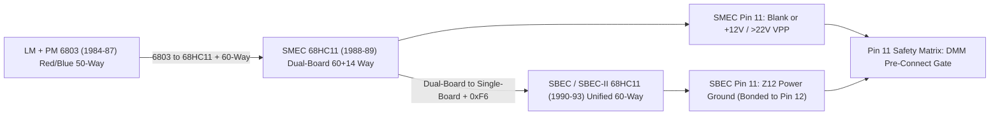

# Chrysler ECU Families Overview (`1984–1993+`)

Chrysler `2.2L` / `2.5L` K-platform turbo and naturally aspirated engine controllers evolved across three core hardware generations—from two-box `6803` Logic/Power Modules to dual-board `68HC11` SMECs and single-board `68HC11` SBEC / SBEC-II units—with `SBEC-II` (`1994–1995` DOHC `2.0L ECC` / `2.4L EDZ` Wave C extensions) continuing the `60-way` architecture.

> [!CAUTION]
> **Hardware Deadbolt & `Pin 11` Cross-Plug Gate**: Although `1988–1989` SMEC and `1990–1993+` SBEC/SBEC-II share a keyed `60-way` connector, `Pin 11` is factory blank/bootstrap-capable on SMEC harnesses and grounded (`Z12 16BK/TN` Power Ground) on SBEC/SBEC-II harnesses. Always execute the [Pin 11 Safety Matrix](pin-11-safety-matrix.md) DMM check before energizing or swapping hardware.

## Controller Generation Comparison Matrix

| Controller Family | Model Years | MCU | EPROM | Housing / Connector | SCI Baud | `Pin 11` |
| :--- | :--- | :--- | :--- | :--- | :--- | :--- |
| **[LM + PM 6803](lm-pm-6803.md)** | `1984–1987` | Motorola `6803` (`HD6303`) | `16 KB` `27128` (`$C000`) or `2x 8 KB` `2764` (`GLHS`) | Dual-module: kick-panel `LM` + airbox `PM`; **Red/Blue `50-way`** (`2 x 25-pin`) | `976` to `7812.5` (`8N1`, 1-byte RAM poll) | Red `Pin 11`: `SCI TX` (`DK21`); Blue `Pin 11`: `A/C` (`C2`) |
| **[SMEC 68HC11](smec-68hc11.md)** | `1988–1989` | Motorola `68HC11` (`2.0 MHz` E) | `32 KB` `27C256` (`$8000`–`$FFFF`, `$B600` hole) | Engine-bay dual-board potted mezzanine; **`60-way` logic + `14-way` power** | `7812.5` echoed (`0x12`) to `62,500` (`0xF2` `$00xx`) | **Factory blank**; `+12V`/`> 22V` VPP flash retrofit (`22V` Zener) |
| **[SBEC 68HC11](sbec-68hc11.md)** | `1990–1991` | Motorola `68HC11` (`2.0 MHz` E) | `32 KB` `27C256` (`$8000`–`$FFFF`, `sbec_90_93_v3_1`) | Engine-bay single-board potted; **unified `60-way`** | `7812.5` to `62,500` (`0xF2` `$00xx` + `0xF6` `FastData`) | **`Z12 16BK/TN` Power Ground** (bonded to `Pin 12`) |
| **[SBEC-II](sbec-68hc11.md)** | `1992–1993+` | Motorola `68HC11` | `32 KB` `27C256` / late SBEC-II (`Wave C` DOHC) | Engine-bay single-board potted; **unified `60-way`** | `7812.5` to `62,500` + `CCD` bus (`Pin 26`/`46`) | **`Z12 16BK/TN` Power Ground** (bonded to `Pin 12`) |

## Generation Evolution & `Pin 11` Safety Topology

## Verified Wave B Reference Articles

- **[LM + PM 6803](lm-pm-6803.md)** — `1984–1987` dual-module hardware map, `lm_86_87_v13` vs. `lm_86_glhs_v1` EPROM/BBRAM layouts, `MC146823` / `ADC0808` registers, and `976` to `7812.5` baud polling.
- **[SMEC 68HC11](smec-68hc11.md)** — `1988–1989` dual-board `68HC11` architecture (`$8000`–`$FFFF`, `$B600`–`$B7FF` EEPROM hole), `PIA1`/`PIA2` allocation, `DRBFunctionTable`, and `0xF2` `$00xx` high-speed SCI.
- **[SBEC 68HC11](sbec-68hc11.md)** — `1990–1993` SBEC/SBEC-II single-board architecture (`sbec_90_93_v3_1`), `0xF2` + `0xF6` `FastDataOutputAddressTable` streaming, `60 degC` enclosed IAT curve, `BATOFF`/`PEFTBL`/`WOTTBL`, and `SMEC` harness deltas.
- **[Pin 11 Safety Matrix](pin-11-safety-matrix.md)** — `60-way` `Pin 11` dead-short hazard (`+12V`/`>22V` SMEC bootstrap vs. `Z12` SBEC ground), `50-way` vs. `60-way` decision matrix, `Key-OFF` DMM protocol, and `FT232RL` isolation boundaries.

## Related Categories

- [Wiki Home](../Home.md)
- [ROM & SCI Protocol Overview](../rom-and-sci/rom-and-sci-overview.md)
- [Wiring & Diagnostics Overview](../wiring-and-diagnostics/wiring-and-diagnostics-overview.md)
- [Hardware Bench Overview](../hardware-bench/hardware-bench-overview.md)
