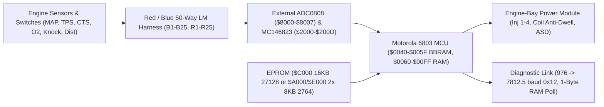

# Chrysler Logic Module & Power Module (`6803`, `1984–1987`)

Chrysler's `1984–1987` turbocharged and naturally aspirated `2.2L` / `2.5L` K-platform vehicles use a **two-box controller architecture** separating low-power digital logic from high-current inductive switching:

- **Logic Module (`LM`)**: Mounted inside the passenger kick panel away from under-hood thermal soak; houses the Motorola `6803` (`HD6303`/`6801`-compatible) MCU, EPROM, `MC146823` parallel I/O expander, `MC6840` programmable timer, and `ADC0808` 8-channel converter.
- **Power Module (`PM`)**: Mounted in the engine-bay airbox or fenderwell for airflow cooling; contains the discrete power transistors for peak-and-hold injector banks, ignition coil dwell switching (`anti-dwell`), Auto Shutdown (`ASD`) relay drive, and alternator field control.

> [!IMPORTANT]
> **Strict Architectural Boundary vs. `68HC11` (`SMEC` / `SBEC`)**: `6803` Logic Module codebases (`16 KB` `27128` or split `2x 8 KB` `2764`) use a different instruction set, external peripheral bus, and memory map than `32 KB` `27C256` `68HC11` `SMEC`/`SBEC` units. `.bin` images, `.tpl` calibration templates, and serial polling tables MUST NEVER be interchanged across `LM`, `SMEC`, and `SBEC` families.

## EPROM Topologies (`lm_86_87_v13` vs. `lm_86_glhs_v1`)

| Calibration Baseline | Model Scope | EPROM Hardware | Address Layout | Vector Window |
| :--- | :--- | :--- | :--- | :--- |
| **`lm_86_87_v13`** | `1986–1987` `2.2L` / `2.5L` Turbo I & II (`T-LM v13`) | Single `16 KB` `27128` (`28-pin`) | `DataOrg = 0xC000`; `CodeOrg = 0xC900`–`$FFFF` | `$FFF0`–`$FFFF` |
| **`lm_86_glhs_v1`** | `1986` Shelby GLHS split-ROM (`T-GLHS v1`) | Dual `8 KB` `2764` (`2x 8 KB`) | Lower chip: `LowerChipOrg = 0xA000`; Upper chip: `DataOrg = 0xE000`, `UpperChipCodeOrg = 0xE600`–`$FFFF` | `$FFF0`–`$FFFF` |

Key table anchor offsets in `lm_86_87_v13` (`DataOrg = 0xC000`) include `WOTTBL_FuelFullThrottle` (`0xC1CA`), `PEFTBL_PumpingEfficiency` (`0xC21E`), and `BATOFF_FuelBatteryOffset` (`0xC231`), whereas `lm_86_glhs_v1` shifts calibration tables to the upper `2764` starting at `0xE000`.

## Motorola `6803` Memory Map & External Peripherals

Unlike the `68HC11` (which integrates on-chip `ADC`, `SPI`, and expanded `Port A`–`E` registers at `$1000`–`$103F`), the `6803` `LM` places internal registers and RAM in zero-page (`$0000`–`$00FF`) and memory-maps external I/O chips across `$2000`–`$8007`:

| Address Range | Subsystem | Verified Function & Key Signals |
| :--- | :--- | :--- |
| **`$0000`–`$001F`** | Internal `6803` I/O & Timer | `Port 1` (`$0002`: `Inj 1-2`, `Inj 3-4`, `CTS bias`, `Power Loss`, `Speed`), `Port 2` (`$0003`: `SCI TX`/`RX`, `Anti-Dwell`, `Dist Ref`), `Timer` (`$0008`–`$000E`, `$0015`–`$001F`), `SCI` (`$0010`–`$0013`), `RAMCR` (`$0014`). |
| **`$0040`–`$005F`** | Battery-Backed Keep-Alive `BBRAM` | Standby-powered fault latches (`ErrorBitRegister0`–`3` & stored registers), `MINTHR_LowestSessionTPS`, `CurrentAisPosition`, `DCCOR1`/`DCCOR2` adaptive wastegate cells, and `AutoCalCell0`–`12`. |
| **`$0060`–`$00FF`** | Volatile Internal Scratchpad RAM | Live engine state: `EngineRpm_HB/LB`, `MapValue`, `TpsVolts`, `CoolantTemp`, `O2SensorVolts`, `CalculatedSparkAdvance`, `InjectorPulsewidth_HB/LB`, cylinder knock retard, and stack/scratch variables. |
| **`$2000`–`$200D`** | External `MC146823` (`Z83`) I/O Expander | `Port A` (`$2002`, alt `$2000`/`$2001`): `ASD` relay, wastegate/baro/fan/EGR/cruise solenoids, A/C clutch; `Port B` (`$2003`): `AIS` stepper phases, tach out, fuel monitor; `Port C` (`$2004`): switches & `CA1`–`CB2` interrupts; `$2006`–`$200B`: DDR/control. |
| **`$4000`–`$4004`** | External `MC6840` (`Z22`) Timer | Programmable triple-counter timer module (`Z22_Timer6840` base `$4000`, `+1`, `+4`). |
| **`$8000`–`$8007`** | External `ADC0808` (`Z85`) 8-Ch A/D | `$8000` MAP, `$8001` Batt Temp, `$8002` O2, `$8003` Air/Charge Temp, `$8004` Coolant Temp, `$8005` TPS, `$8006` Knock, `$8007` Battery Voltage. |

## Red / Blue 50-Way Logic Module Harness Map

The `LM` bulkhead uses two `25-pin` keyed connectors (**Blue `B1`–`B25`** and **Red `R1`–`R25`**, `50-way` combined):

| Connector / Pins | Target Chip / Register | Assigned Signals |
| :--- | :--- | :--- |
| **`B1`, `B2`, `B7`–`B8`, `B16`** | Power / Supply Rails | `B1` `+5V` TPS reference; `B2` standby `BBRAM` power; `B7`/`B8` power grounds; `B16` `N/C`. |
| **`B3`–`B6`** | `146823` `Port A` (`$2002`) | `B3` A/C clutch out; `B4` cruise solenoid (`85 T1`: power loss lamp); `B5` EGR (`85 T1`: purge); `B6` cruise vent (`85 T1`: EGR). |
| **`B9`–`B15`, `B17`** | `146823` `Port C` (`$2004`) | `B9`/`B10` cruise set/resume; `B11` A/C clutch in; `B12` park/neutral; `B13` brake (`CA1`); `B14` speed sensor (`85 T1`, `CA2`); `B15` cruise enable (`CB1`); `B17` distributor sync (`CB2`). |
| **`B18`–`B25`** | `ADC0808` (`$8000`–`$8007`) | `B19` MAP (`$8000`); `B20` batt temp (`$8001`); `B18` O2 (`$8002`); `B25` air temp (`$8003`); `B23` coolant temp (`$8004`); `B21` TPS (`$8005`); `B24` knock (`$8006`); `B22` battery volts (`$8007`). |
| **`R2`–`R6`, `R9`–`R11`, `R13`** | Internal `6803` `Port 1` & `Port 2` | `R2`/`R3` injectors `1-2`/`3-4`; `R4` power loss light; `R5` CTS bias; `R6` anti-dwell; `R9` speed sensor; `R10` distributor ref; `R11` `SCI TX`; `R13` `SCI RX`. |
| **`R12`, `R14`–`R22`** | `146823` `Port A`/`B` (`$2002`/`$2003`) | `R12` tach out; `R14` fuel monitor; `R15` baro solenoid; `R16`/`R18`/`R20`/`R22` `AIS` stepper phases; `R17` `ASD` relay; `R19` wastegate solenoid; `R21` fan relay. |

### Power Module (`PM`) Driver Polarity & `BBRAM` Layout Differences

- **Logic-to-Power Driver Polarity**: On `1986–1987` `LM` firmware (`T-LM v13`), `146823` `Port A` (`$2002`) solenoid and relay outputs (`ASD` `R17`, wastegate `R19`, fan `R21`, baro `R15`, A/C clutch `B3`, EGR/purge `B5`) are **active-low** (`1 = OFF`, `0 = ON`). Ignition coil switching on `Port 2` bit 1 (`R6`) uses **anti-dwell** logic (`ON = spark`, `OFF = no spark`).
- **`BBRAM` (`$0040`–`$005F`) Packing Shift (`GLHS` vs. `v13`)**: Both calibrations share `$0040`–`$0045` (`MINTHR_LowestSessionTPS`, `Timer_DacalCountdown`, `CurrentAisPosition`, `DCCOR1`, `DCCOR2`, `LowestHistoricalTPS`), after which `lm_86_glhs_v1` places `AutoCalCell0`–`12` at `$0046`–`$0052` and `ErrorBitRegister0`–`3` at `$0053`–`$0056`, whereas `lm_86_87_v13` places `ErrorBitRegister0`–`3` at `$0046`–`$0049` (stored copies `$004A`–`$004D`) and `AutoCalCell0`–`12` at `$0050`–`$005C`.

## Early `6803` Diagnostic Link & Calibration Offset Divergence

Early `LM` firmware uses a two-rate trigger sequence and **1-byte zero-page polling**, distinct from `68HC11` `0xF2`/`0xF4` 2-byte frames:

1. **Trigger & Handshake (`976` -> `7680` / `7812.5` baud, `8N1`)**: Host sends `0x12` at `976` baud (`sample.cpp` / `HandleSerial`). Receiving `0x12` causes `HandleSerial` to write `0x05` to `CPU_SCI_ModeControlReg` (`$0010`) and latch `BitFlags_84` bit 7 (`0x80`), switching the `SCI` UART to `7812.5` baud (`7680` nominal PC UART match). Host echoes/verifies `0x12` at the higher baud rate.
2. **Single-Byte Zero-Page Polling (`SendRamSerial`)**: Once latched, sending any byte `$00xx` (other than `0xFA` for 2-byte `ENDITM_ECUID` or `0xFE` for `EngineRpm_HB` with diagnostic status flag) indexes directly into `$0000 + B` and transmits the single RAM byte over `CPU_SCI_TxDataReg` (`$0013`). Legacy drivers (`sample.cpp`) discard echoed/repeated frames on the bus and keep the final returned byte.
3. **Zero-Page Offset Divergence (`lm_86_glhs_v1` vs. `lm_86_87_v13`)**: Because `BBRAM` and `AutoCalCell` packing shifted between `GLHS` and `v13`, polling offsets differ:

| Signal | `lm_86_glhs_v1` (`T-GLHS v1`) | `lm_86_87_v13` (`T-LM v13`) |
| :--- | :--- | :--- |
| **`EngineRpm_HB` / `LB`** | `$0081` / `$0082` | `$008F` / `$0090` |
| **`MapValue`** | `$0086` | `$0094` |
| **`TpsVolts`** | `$008A` | `$0098` |
| **`CoolantTemp`** | `$008C` | `$009A` |
| **`O2SensorVolts`** | `$008E` | `$009C` |
| **`BatteryVolts`** | `$0093` | `$00A1` |
| **`CalculatedSparkAdvance`** | `$00BD` | `$0072` |
| **`InjectorPulsewidth_HB`** | `$0079` | `$008D` |

> [!CAUTION]
> **Hardware Deadbolt**: Always resolve `LM` zero-page RAM offsets strictly from the matching `rom_manifest.json` or verified `Tier 1`/`Tier 2` assembly map. Never apply `v13` offsets to a `GLHS` ROM or mix `6803` single-byte polling with `68HC11` `0xF2`/`0xF4` drivers.

## Related Pages

- [ECU Families Overview](ecu-families-overview.md)
- [Chrysler SMEC 68HC11 Reference (1988–1989)](smec-68hc11.md)
- [Wiring Bulkheads & Diagnostics Overview](../wiring-and-diagnostics/wiring-and-diagnostics-overview.md)
- [ROM Architecture & SCI Protocol Overview](../rom-and-sci/rom-and-sci-overview.md)
- [Wiki Home](../Home.md)
