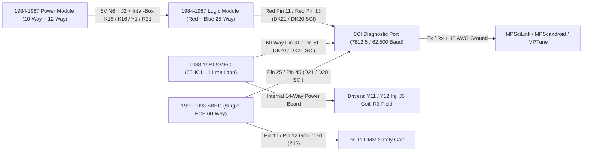

# `LM`, `SMEC` & `SBEC` Connector Evolution (`1984–1993+`) & `MPSciLink` Notes

Chrysler consolidated its `2.2L` / `2.5L` engine management hardware across three major packaging generations (`MiniMopar` ECU archives): a split cabin/engine-bay **Logic Module (`LM`) + Power Module (`PM`)** pair (`1984–1987`), a dual-board **Single Module Engine Controller (`SMEC`)** (`1988–1989`), and a single-PCB **Single Board Engine Controller (`SBEC` / `SBEC-II`)** (`1990–1993+`).

## Architecture & Harness Consolidation Flow

## Generation Comparison (`LM/PM` -> `SMEC` -> `SBEC`)

| Generation & Years | Processor & Loop Time | Memory & Timer | Housing & Connectors | Key Functional Shifts (`MiniMopar`) |
| :--- | :--- | :--- | :--- | :--- |
| **`1984–1987` `LM` + `PM`** | Motorola `6803` (`22 ms` loop w/ `6840` timer in `86–87`) | `27C128` (`16Kx8`); `6840` timer added `1986–1987` | Cabin `LM` (`2x 25-way` Red/Blue) + fender `PM` (`10-way` + `12-way`) | `1984–1986` (`& 87 L-body`) mount `MAP` inside `LM`; `1987` non-L-body moves `MAP` to strut tower to stop moisture freezing. Air-box ducts cool air through `PM`. |
| **`1988–1989` `SMEC`** | Motorola `68HC11` (`11 ms` loop, `2x` `6803` rate) | `27C128` / `27C256` (`16K`–`32K`) | Engine-bay dual potted boards: `60-way` logic + `14-way` power | Merges `LM` + `PM` into one fender case; retains inter-board control lines (`Y1`, `K16`, `K15`, `R31`). `1989` firmware adds live recovery from limp-in mode. |
| **`1990–1993+` `SBEC` / `SBEC-II`** | Motorola `68HC11` (`11 ms` loop) | `87C257` latched `32Kx8` EPROM | Single PCB, single bolt-on `60-way` connector | Eliminates separate `14-way` power board and inter-board harness lines; unifies high-current drivers onto main PCB and renumbers circuit IDs. |

> [!CAUTION]
> **Critical `60-Way` `Pin 11` & `Pin 12` Hardware Gate**: On `1988–1989 SMEC`, `60-way` `Pin 11` is **unused** while `Pin 12` carries `K14` ignition `B+` from the `14-way` board. On `1990–1993 SBEC`, `Pin 11` and `Pin 12` are **both hard power grounds (`Z12`)**. Always verify harness cavity mapping with a DMM before plugging in any `60-way` ECU; see [Pin 11 Safety Matrix](pin-11-safety-matrix).

## Cross-Generation Pin & Circuit Migration (`MiniMopar` Reference)

| Signal / Circuit Function | `1987 T-II LM` (`Red`/`Blue 25-Way`) + `PM` (`10`/`12-Way`) | `1988–1989 T-II SMEC` (`60-Way` / `14-Way`) | `1990–1993 TBI SBEC` (`60-Way` Single Board) |
| :--- | :--- | :--- | :--- |
| **`MAP` Sensor Signal** | `Blue Pin 19` (`K4`, `DG/RD*`) | `Pin 1` (`K4`, `DG/RD*`) | `Pin 1` (`K01`, `DG/RD*`) |
| **`ECT` Coolant Temp Signal** | `Blue Pin 23` (`K10`, `TN/BK*`) | `Pin 3` (`K10`, `TN/WT*`) | `Pin 2` (`K02`, `TN/BK*`) |
| **`TPS` Signal & `+5 V` Ref** | `Blue Pin 21` (`K7`) / `Blue Pin 1` (`K6`) + `Red Pin 1` (`K8`) | `Pin 22` (`K7`) / `Pin 13` (`K8` `+5 V` `MAP`/`TPS`) | `Pin 22` (`K22`) / `Pin 6` (`K06` `+5 V` `MAP`/`TPS`) |
| **`+8 V` Hall Supply (`N6`)** | `PM 12-Way Pin 12` -> `Red Pin 23` (`N6`, `OR`) | `14-Way Pin 1` -> `Pin 52` (`N6`, `OR`) | `Pin 7` (`K07`, `OR` internal regulator) |
| **Distributor Ref (`N7`) / Sync (`Y7`)** | `Red Pin 10` (`N7`) / `Blue Pin 17` (`Y7`) | `Pin 47` (`N7`) / `Pin 26` (`Y7`) | `Pin 24` (`K24`, `GY/BK*` ign ref) |
| **Sensor Return & Power Ground** | `Red Pin 24/25` (`K5`/`N5`), `Blue Pin 7/8` (`K9`), `PM 10-Way Pin 9/10` (`J9`) | `Pin 4/5` (`N5`/`K5`), `Pin 15/16` (`K9`), `14-Way Pin 6/7` (`J9`) | `Pin 4/5` (`K04`/`Z11`), `Pin 11/12` (`Z12` ground) |
| **`SCI` `TX` / `RX` Diagnostics** | `Red Pin 11` (`DK21`, `PK`) / `Red Pin 13` (`DK20`, `LG`) | `Pin 51` (`DK21`, `PK`) / `Pin 31` (`DK20`, `LG`) | `Pin 25` (`D21`, `PK`) / `Pin 45` (`D20`, `LG`) |
| **Injector & Ignition Drivers** | `PM 10-Way Pin 5/7` (`Y11`/`Y12`), `Pin 1` (`J5`), `Pin 8` (`R3`) | `14-Way Pin 9/10` (`Y11`/`Y12`), `Pin 12` (`J5`), `Pin 14` (`R3`) | `Pin 16` (`K11` TBI), `Pin 19` (`K19` coil), `Pin 20` (`K20` alt) |
| **Inter-Board Control Lines** | `Red Pin 2/3/6/5` (`K16`/`Y1`/`K15`/`R31`) -> `PM 12-Way` | `Pin 33/32/34/14` (`K16`/`Y1`/`K15`/`R31`) -> `14-Way` | Eliminated (internal PCB traces on `SBEC`) |
| **`ASD` Control & Sense (`Z1`)** | `Red Pin 17` (`K19`) / `PM 10-Way Pin 6` (`Z1`) | `Pin 58` (`K19`) / `Pin 10` (`Z1`) | `Pin 51` (`K51`) / `Pin 3` (`A14` sense) |

## `MPSciLink` / `MPScandroid` Diagnostic Interface Notes (`Turbo-Mopar` Archive)

The `Turbo-Mopar (pre-2017 Wayback archive)` / `MPSciLink` (`MWM Engineering`) ecosystem provides open hobbyist telemetry across `1984–1993` `LM`, `SMEC`, `SBEC`, and `SBEC-II` controllers over the factory `SCI` port:

- **Hardware Stack**: `MPSciLink` interface shield mounted on an `Arduino Mega` driving a `Nextion` touchscreen display, paired optionally with `MPScandroid` (`Android 4.4+` Bluetooth telemetry) and `MPTune` (PC calibration/Arduino firmware flashing). `SBEC`/`SBEC-II` high-speed `SCI` sessions require the `SCI-SBEC` adapter.
- **Electrical & Grounding Precautions**:
  - Add a **`2 A` inline fuse** on the incoming `+12 V` supply (no onboard fuse is fitted).
  - **Never apply `+12 V` to `ECU Tx` or `ECU Rx`** on the `MPSciLink` board; doing so destroys the `74HC04` logic inverter/buffer. Reversed `Tx`/`Rx` leads prevent communication.
  - Replace long `22 AWG` ground runs with a short **`18 AWG` chassis ground** at the board `Gnd` terminal to eliminate ground-offset voltage drop on auxiliary analog inputs.
- **Storage & RTC Hygiene**: Use a **`4–16 GB` `FAT32` microSD card** for logs and Nextion sideloading, and install a **`CR1220` RTC battery** (setting the clock on first boot) so log filenames never inherit an invalid `Month = 0` timestamp. Verify Bluetooth link health via `MPScandroid -> MPSciLink Version` or `Miscellaneous -> Nextion Tasks -> Module Settings`. *(Historical `MPFlash` / BoostButton hardware notes remain outside LogicAIDE's read-only Hardware Deadbolt scope.)*

## Related Pages

- [ECU Families Overview](ecu-families-overview)
- [Chrysler LM / PM 6803 Reference](lm-pm-6803)
- [Chrysler SMEC 68HC11 Reference](smec-68hc11)
- [Chrysler SBEC & SBEC-II 68HC11 Architecture](sbec-68hc11)
- [60-Way SMEC & SBEC Connector Atlas](60-way-connector-atlas)
- [60-Way Harness Pin 11 Safety Matrix](pin-11-safety-matrix)
- [Wiki Home](Home)
