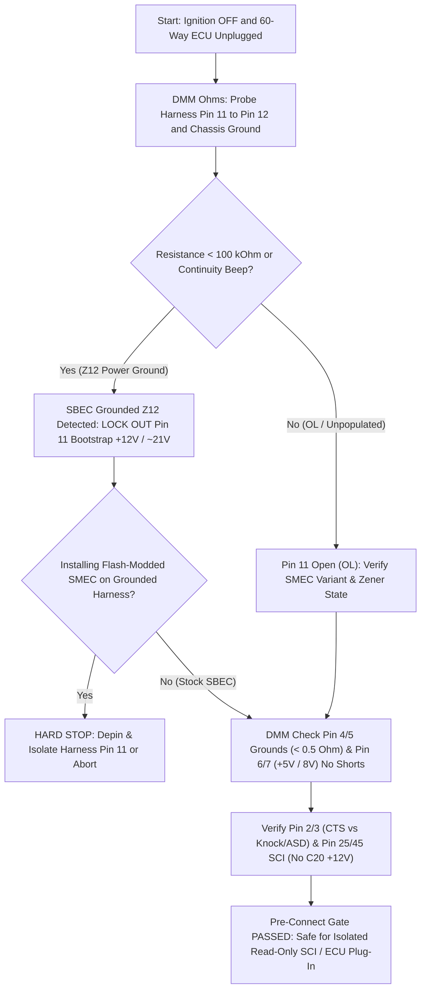

# 60-Way Harness Pin 11 Safety Matrix & Pre-Connect Gate

The single highest-risk electrical fault across Chrysler `1988–1993` `60-way` engine controllers occurs at **Cavity 11 (`Pin 11`)**. Despite sharing a physically keyed `60-way` connector shell, **1988–1989 SMEC** and **1990–1993 SBEC / SBEC-II** harnesses assign `Pin 11` to electrically opposite roles.

> [!CAUTION]
> **Hardware Deadbolt & Short-Circuit Hazard**:
> - On **1988–1989 SMEC** factory harnesses, `Pin 11` is **unpopulated (blank cavity)** until pinned for EEPROM in-circuit programming (`+12V` VPP/flash bias when the internal `22V` Zener clamp is bypassed, or `> 22V` stock bootstrap threshold).
> - On **1990–1993 SBEC / SBEC-II** harnesses (verified across both `1991` FSM Wiring Diagrams Supplement and `1992` T1 SBEC-II pinouts), **BOTH `Pin 11` AND `Pin 12` are `Z12 16BK/TN Power Ground`** bonded directly to chassis/engine ground.
> - **Catastrophic Failure Mode**: Plugging a flash-modified SMEC onto a grounded SBEC `Pin 11` harness—or applying `+12V`/`~21V` bootstrap power to `Pin 11` on an SBEC car—creates a **direct dead short to ground**, melting harness insulation, blowing supply fuses, or destroying internal VPP/Zener PCB traces.

## 1. Verified Harness Evidence & Failure Anatomy

- **1988–1989 SMEC EEPROM Programming Circuit**:
  - From the factory, the gray `60-way` harness plug leaves cavity `Pin 11` sealed with a thin plastic knockout. Retrofitting an in-circuit `28C256` EEPROM requires prying out the red locking wedge, drilling `~1/32 in` through the `Pin 11` knockout, and snapping a donor terminal into cavity `11`.
  - Inside the SMEC logic board, `Pin 11` feeds an internal **`22V` Zener diode clamp** (`> 22V` stock bootstrap threshold, commonly satisfied with `12V + 9V` series bench bias). Flashable SMEC retrofits jumper across the `22V` Zener so switching **`+12V` switched fusebox power** onto `Pin 11` energizes the internal SPDT write-enable relay coil and enters download mode.
- **1990–1993 SBEC / SBEC-II Grounded Pin 11 Circuit**:
  - Verified Chrysler `1991` FSM Supplement and `1992` T1 SBEC-II pinouts explicitly bond **both `Pin 11` (`Z12 16BK/TN`) and `Pin 12` (`Z12 16BK/TN`)** to Power Ground.
  - Consequently, any `+12V` or `~21V` download switch energized on an SBEC-wired harness—or any modified SMEC whose `Pin 11` path connects to `+12V` or VPP—immediately dead-shorts through `Z12` to chassis ground.

## 2. Controller Generation & Pin 11 Decision Matrix

| Controller Family | Model Years | Main Connector | `Pin 11` Assignment | `Pin 12` Assignment | `Pin 2` / `Pin 3` / `Pin 25` / `Pin 45` Notes | Cross-Plug / Energize Verdict |
| :--- | :--- | :--- | :--- | :--- | :--- | :--- |
| **Logic Module (`LM`)** | `1984–1987` | **Red/Blue `50-way`** (`2 x 25-pin` + Power Module) | Red `Pin 11`: `DK21 PK` (`SCI TX`); Blue `Pin 11`: `C2 BR` (`A/C Pressure`) | Red `Pin 12`: `T21 GY/LB` (`Tach`); Blue `Pin 12`: `S4 BR/YL` (`P/N`) | Incompatible `2 x 25-pin` bulkhead; requires full `LM -> SMEC` harness adapter. Red `Pin 13` = `SCI RX`, Blue `Pin 1` = `+5V TPS`, Red `Pin 1` = `+5V MAP`, Red `Pin 23` = `8V`. | **INCOMPATIBLE** without dedicated harness conversion. |
| **SMEC** *(Dual-Board)* | `1988–1989` | **`60-way` Logic** + **`14-way` Power** | **Factory Blank**; retrofit `+12V` VPP (`22V` Zener jumpered) or `> 22V` bootstrap | `Z1` (`BK/TN` / `BK*`) Power Ground | Early Turbo I/II SMECs: `Pin 2` = Knock, `Pin 3` = `CTS`; `Pin 25` (`SCI TX`) may be blank and `Pin 45` may carry `C20` A/C clutch instead of `SCI RX`. | **SAFE FOR SMEC BENCH** only after confirming `Pin 11` is open (`OL`) to ground. |
| **SBEC** *(Single-Board)* | `1990–1991` | **`60-way` Unified** | **`Z12 16BK/TN` Power Ground** *(bonded to Pin 12)* | **`Z12 16BK/TN` Power Ground** | `Pin 2` = `CTS` (`K02`), `Pin 3` = `A14` Fuel Pump/ASD (`1991` Supp.), `Pin 6` = `+5V` (`K06`), `Pin 7` = `8V` (`K07`), `Pin 25` = `SCI TX` (`D21`), `Pin 45` = `SCI RX` (`D20`). | **LOCK OUT `+12V`/`~21V` ON PIN 11**. Depin/isolate `Pin 11` before any SMEC test. |
| **SBEC-II** *(Single-Board)* | `1992–1993+` | **`60-way` Unified** | **`Z12 16BK/TN` Power Ground** *(bonded to Pin 12)* | **`Z12 16BK/TN` Power Ground** | Same `Z12` ground pair (`Pin 11`/`12`); `Pin 8` vs `Pin 57` (`A142` ASD Voltage Sense) and single-wire mux cruise deltas vs `1991` SBEC. | **LOCK OUT `+12V`/`~21V` ON PIN 11**. Never attach flash-biased SMEC hardware. |

## 3. Critical `60-Way` Cavity Cross-Check Reference

| Cavity | Early Turbo `SMEC` (`1988–1989`) | `SBEC` (`1990–1991` Supp.) & `SBEC-II` (`1992`) | Required Pre-Connect Verification |
| :---: | :--- | :--- | :--- |
| **`Pin 2`** | Knock / Detonation (`N12 BK/LG*`) | Coolant Temp Sensor (`K02 20TN/BK`) | Confirm sensor continuity to CTS vs. knock module; Knock moves to `Pin 42` (`K42`) on SBEC. |
| **`Pin 3`** | Coolant Temp (`K10 TN/WT`) | Fuel Pump / ASD (`A14 16RD/WT`) | **Critical**: Never feed `A14` battery/ASD voltage into an early SMEC `CTS` input. |
| **`Pin 4` / `Pin 5`** | `K4` / `BK/WT*` Sensor & Logic Returns | `K04 18BK/LB` Logic Ref / `Z11 16BK/WT` Signal Gnd | Confirm `< 0.5 Ohm` to Battery Negative with Key `OFF`. |
| **`Pin 6` / `Pin 7`** | `+5.0 V` Sensor Supply / `8V` Hall Supply | `K06 18VT/WT` (`+5V` MAP/TPS) / `K07 18OR` (`8V`) | Confirm zero short-to-ground or short-to-`+12V` before ECU plug-in; verify `+5.0 V +/- 0.25 V` Key `ON`. |
| **`Pin 8` / `Pin 57`** | Power-stage split (`14-way` module) | `1991`: `Pin 8` `A61` Fuel Pump; `1992`: `Pin 57` `A142` ASD Sense | Verify `Pin 8` vs. `Pin 57` when swapping `1991` SBEC and `1992` SBEC-II units. |
| **`Pin 25` / `Pin 45`** | May be blank (`Pin 25`) or `C20` A/C (`Pin 45`) | `D21 20PK` (`SCI TX`) / `D20 20LG` (`SCI RX`) | Confirm continuity to diagnostic pigtail and zero `+12V` on `Pin 45` before attaching isolated FTDI (`1–4.7 kOhm` series + `5.1 V` clamp). |

## 4. Mandatory Pre-Connect DMM Verification Protocol (Human Only)

Perform every step below in sequence with **Ignition `OFF`**, **ECU unplugged** from the `60-way` harness, and no external serial/bootstrap tool attached (`docs/HARDWARE_AND_SCI_PROTOCOL.md`):

1. **Gate 1 — `Pin 11` to `Pin 12` (`Z12` Power Ground) Resistance Test**:
   - Set a Digital Multimeter (`DMM`) to resistance (`Ohms`) / continuity mode.
   - Probe harness cavity **`Pin 11`** to harness cavity **`Pin 12`** and again from **`Pin 11`** to **Battery Negative / Chassis Ground**.
   - **Pass for SMEC Bootstrap Wiring**: Open circuit (`OL` / `> 10 MOhm`) when `Pin 11` is unpopulated or switched open.
   - **SBEC Grounded Harness Detected**: Any continuity (`< 100 kOhm`, typically `< 0.5 Ohm` on `Z12 16BK/TN`) confirms an SBEC-grounded `Pin 11`. **HARD STOP**: lock out all `+12V` or `~21V` bootstrap power injection and do NOT plug in a modified SMEC without physically depinning and heat-shrinking `Pin 11`.
2. **Gate 2 — `Pin 2` / `Pin 3` & `5V` / `8V` Sensor Supply Integrity**:
   - **Ground Returns (`Pin 4` & `Pin 5`)**: Measure `Pin 4` (`K04` Sensor Signal Reference) and `Pin 5` (`Z11` Signal Ground) to Battery Negative; confirm `< 0.5 Ohm` and zero stray voltage.
   - **Regulated Supplies (`Pin 6` & `Pin 7`)**: With ECU unplugged and Key `OFF`, verify **`Pin 6`** (`K06`, `+5.0 V` MAP/TPS supply) and **`Pin 7`** (`K07`, `8V` Hall/distributor supply) are NOT shorted to ground or `+12V`. After ECU connection (`Key-ON`), confirm `Pin 6 = +5.0 V +/- 0.25 V` and `Pin 7 = ~8.0 V`.
   - **Variant `Pin 2` / `Pin 3` Check**: Verify against the model-year FSM whether `Pin 2` routes to Coolant Temp (`K02`) or Knock (`N12`), and whether `Pin 3` carries `A14` Fuel Pump/ASD or `CTS` (`K10`).
3. **Gate 3 — `Pin 25` / `Pin 45` SCI & ASD Relay Cavities**:
   - Measure continuity from **`Pin 25`** (`D21 20PK`, SCI TX) and **`Pin 45`** (`D20 20LG`, SCI RX) to the under-hood diagnostic connector.
   - Verify **`Pin 45`** shows **no `+12V` feed** with Key `ON` (confirming it is not wired to `C20` A/C clutch on an early `1988–1989` Turbo I SMEC harness) before connecting a galvanically isolated `FT232RL` adapter.
   - Verify ASD coil control (`Pin 51` `K51`) and `Pin 8` / `Pin 57` continuity against the target ECU's model year.

## 5. Pre-Connect Electrical Safety Gate Flowchart

## 6. FTDI Serial Isolation & Hardware Deadbolt Boundaries

- **Galvanic & Transient Protection (`FT232RL`)**: Because automotive harnesses carry inductive alternator spikes and potential `+12V`/`~21V` Pin 11 bootstrap voltages adjacent to `3.3V`/`5V` TTL SCI lines, isolate the USB host with an `ADuM3160` (or opto-isolated `TX`/`RX` barrier) and protect `Pin 25` (`SCI TX`) and `Pin 45` (`SCI RX`) with `1 kOhm–4.7 kOhm` series resistors and bidirectional TVS / `5.1 V` Zener clamps.
- **Bootstrap Path Separation**: Keep any manual SMEC `Pin 11` programming switch physically separated from `Pin 25`/`Pin 45` logic rails and engage it **only** after confirming SMEC board identity and `OL` ground isolation on `Pin 11`.
- **Agent Hardware Deadbolt**: LogicAIDE software agents remain strictly read-only (`0xF2`/`0xF4`/`0xF6` SCI telemetry and offline simulation) and never issue serial bootloader writes, probe live COM/USB hardware ports, or alter stock ROM baselines.

## Related Pages

- [Chrysler SBEC & SBEC-II (`68HC11`) ECU Architecture](sbec-68hc11.md)
- [ECU Families Overview](ecu-families-overview.md)
- [Wiring & Diagnostics Overview](../wiring-and-diagnostics/wiring-and-diagnostics-overview.md)
- [ROM & SCI Protocol Overview](../rom-and-sci/rom-and-sci-overview.md)
- [Hardware Bench Overview](../hardware-bench/hardware-bench-overview.md)
- [Wiki Home](../Home.md)
