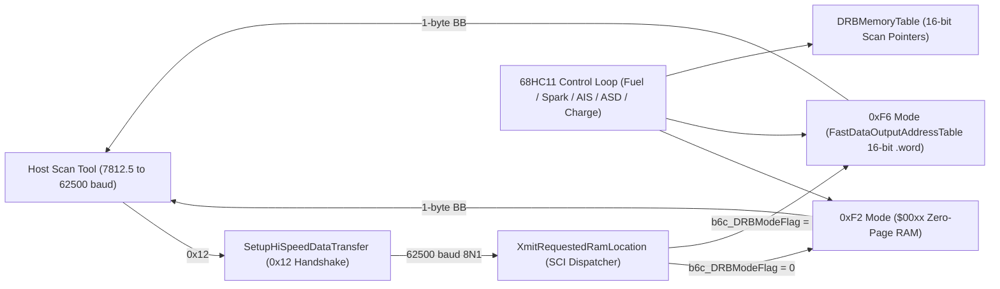

# Chrysler SBEC & SBEC-II (`68HC11`) ECU Architecture

The **Single Board Engine Controller (`SBEC`, `1990–1991`)** and **SBEC-II (`1992–1993+`)** consolidated Chrysler's earlier dual-board `1988–1989` SMEC logic and power stages onto a single conformal-potted printed circuit board inside an engine-bay aluminum housing with a unified **60-way** harness connector.

> [!CAUTION]
> **Hardware Deadbolt & Pin 11 Hazard**: LogicAIDE agents operate strictly read-only on `32 KB` binaries staged under `staging/candidates/`. Never energize or cross-plug a `60-way` SBEC harness without first completing the [Pin 11 Safety Matrix](pin-11-safety-matrix.md) DMM isolation check (`Pin 11` is grounded on SBEC harnesses).

## 1. Hardware & Memory Layout (`sbec_90_93_v3_1`)

- **Processor & Bus Clock**: Motorola `68HC11` (`8.0 MHz` crystal, `2.0 MHz` E-clock, `500 ns` bus cycle) with integrated 8-channel A/D converter, hardware timer input-capture/output-compare channels, and on-chip SCI UART (`$102B`–`$102F`).
- **Internal Zero-Page RAM (`$0000`–`$00FF`)**: `256` bytes of high-speed internal RAM, with standby battery-backed cells preserving adaptive fuel memory (`ValueFromAdaptiveMemory`) and stored fault-code registers across key cycles.
- **EPROM Window (`32 KB` `27C256`)**: Mapped from **`$8000`–`$FFFF`** (`32,768` bytes) in the `sbec_90_93_v3_1` layout (`T-SBEC_v3_1.asm`), replacing the SMEC two-board ribbon/power split while preserving deterministic `68HC11` fixed-point execution (`< 11.0 ms` main-loop budget).
- **Interrupt & Reset Vector Table (`$FFC0`–`$FFFF`)**: The upper `64`-byte region reserves `21` active `16-bit` Motorola `68HC11` vectors from **`$FFD6`–`$FFFF`**:
  - `$FFD6`–`$FFD7`: `SCI` serial interrupt (`Interrupt_SerialCommunications`)
  - `$FFD8`–`$FFEF`: `SPI`, `Pulse Accumulator`, `TOI`, `OC1`–`OC5` (including dwell and wastegate PWM), and `IC1`–`IC3` (distributor and speedo pickups)
  - `$FFF0`–`$FFFD`: `RTI`, `IRQ`, `XIRQ`, `SWI`, `Illegal Opcode`, `COP Watchdog`, and `Clock Monitor`
  - `$FFFE`–`$FFFF`: Power-on / external `Reset` vector (`$E000` entry)

## 2. Firmware & SCI Enhancements Over `SMEC`

| Subsystem | `1988–1989` `SMEC` Baseline | `1990–1993` `SBEC` / `SBEC-II` (`T-SBEC_v3_1.asm`) |
| :--- | :--- | :--- |
| **High-Speed SCI Mode (`62,500` baud)** | `XmitRequestedRamLocation` (`L1417`) supports `0xF2` (`$00xx` zero-page direct RAM reads) and `0xFE` exit only. | `XmitRequestedRamLocation` (`L1181`) supports **both** `0xF2` (`$00xx` single-byte mode, `b6c_DRBModeFlag = 0`) **and** `0xF6` multi-byte/extended RAM streaming (`b6c_DRBModeFlag = 1`), plus `0xFE` exit. |
| **Fast-Data Pointer Table** | Not implemented in stock `T-SMEC_v19.asm`. | `0xF6` indexes `FastDataOutputAddressTable` (`L1220`) via `lslb` (`16-bit .word` RAM pointers), bounds-checked against `FastDataOutputCommandByte` (stock `0x18`, `24` slots; template reserves `31` slots, returning `0xFF` out-of-bounds). |
| **SCI Initialization** | `SetupHiSpeedDataTransfer` (`L3659`) via `DRBFunctionTable`. | `SetupHiSpeedDataTransfer` (`L3788`, invoked via `DRBFunctionTable` at `L3531` on `0x12` handshake) sets `DRBSerialMode` bit `7`, waits for `CPU_SerialStatus` TC (`0x40`), and writes `CPU_SerialBaudRate = 0x01` (`62,500` baud). |
| **DRB Scan-Tool Table** | `DRBMemoryTable` (`L3467`). | Expanded `16-bit` `DRBMemoryTable` (`L3603`) storing `.word` RAM pointers (`AmbientAirTempVolts`, `O2SensorVolts`, `CoolantTemp`, `MapValue`, `EngineRpm_HB`, `BoostTarget`, `ChargeTemp`, `BoostActuatorADutyCycle_VNT`, `BoostActuatorBDutyCycle_WG`). |
| **Charge / IAT Thermal Curve** | External charge-temp voltage handling. | `60 degC` enclosed IAT thermal curve with dual-slope `TMPTL1_TempForColdScaleFromA2D` / `TMPTL2_TempForHotScaleA2D` hysteresis switching (`0x40` / `0xDC` thresholds in `CheckAndFilterCoolantAndChargeTempSensors_MM`) and `DEFCHG` limp-in fallback. |
| **Body & Powertrain Integration** | Discrete power board; early harnesses lack CCD bus. | Integrated single-board **ASD** diagnostics (`VerifyOperationOfASDRelayAndO2Sensor_MM`), **charging/voltage regulation** (`VerifyOperationOfBatteryVoltage_MM`, `WOTBAT`), **AIS** stepper control (`AISTEP_BitPatternForAisControl`, spark scatter), and `CCDBusComs` (`Pin 26`/`46` on G/J/AA bodies). |

### SCI `0xF2` vs. `0xF6` Dispatch Flow

1. **Handshake (`7812.5` baud)**: Host sends `0x12`; `DRBFunctionTable` (`L3531`) dispatches `SetupHiSpeedDataTransfer` (`L3788`), which waits for transmit-complete (`CPU_SerialStatus & 0x40`) and sets `CPU_SerialBaudRate = 0x01` (`62,500` baud, 8N1, zero-echo).
2. **`0xF2` Mode (Zero-Page `$00xx`)**: Receiving `0xF2` clears `b6c_DRBModeFlag` in `BitFlags6c`; subsequent offset byte `B` reads `L0000 + B` directly (`ldx #L0000; abx; ldab 0x00, X`).
3. **`0xF6` Mode (`FastDataOutputAddressTable`)**: Receiving `0xF6` sets `b6c_DRBModeFlag`; subsequent index byte `B` is checked against `FastDataOutputCommandByte` (`0x18` stock limit), shifted left (`lslb`), and dereferenced through the `16-bit .word` pointer table at `FastDataOutputAddressTable` (`L1220`) to stream arbitrary 16-bit RAM addresses. Receiving `0xFE` exits high-speed mode.
4. **Dead-Cell Quarantine Boundary**: Never guess `0xF2`/`0xF6` offsets across calibration masks; LogicAIDE resolves all slots from `rom_manifest.json` and quarantines unresponsive offsets (`12 ms` probe timeout) to `null`.

## 3. Core Fuel Calibration Regions & Single-Board Integration (`T-SBEC_v3_1.asm`)

Calibration templates between `T-SMEC` and `T-SBEC` are **not interchangeable** due to distinct ROM table layouts and data-section offsets:

| Symbol (`T-SBEC_v3_1.asm`) | Line Anchor | Axes & Units | Engineering Role & Scaling Rule |
| :--- | :---: | :--- | :--- |
| **`BATOFF_FuelBatteryOffset`** | `L6360`, `L7806` | `0–16.2 V` to `0–4096 uSec` | Voltage-indexed injector opening latency; **never scale** by injector flow ratio (governed by coil/pintle & `55.0 psi` rail). |
| **`PEFTBL_PumpingEfficiency`** | `L6608` | `0–8192 RPM` to `0–100 %` | Volumetric/pumping efficiency scalar applied to `SumOfFuelModifiers_HB`; keep aligned to breathing, not injector sizing. |
| **`WOTTBL_FuelFullThrottle`** | `L6972`, `L6984` | `MAP` to `0–65535 uSec` | Full-throttle pulsewidth baseline and upper clamp comparing `MAPIDL` (`L6967`) and `MAPTBL` (`L6976`) at `L6984`. |

- **ASD, Charging, AIS, Actuator Test & Enclosed IAT Integration**:
  - **Enclosed `60 degC` IAT / Charge Temp**: `CheckAndFilterCoolantAndChargeTempSensors_MM` (`L8388`) filters `ChargeTempRaw`, switches cleanly between cold (`TMPTL1`) and hot (`TMPTL2`) A/D linearization curves at `0x40` / `0xDC` hysteresis bounds, and falls back to `CoolantTemp` or `DEFCHG` on fault.
  - **Charging & Voltage Regulation**: `VerifyOperationOfBatteryVoltage_MM` (`L1246`) and `WOTBAT_WOTBatteryVoltsTarget` manage alternator field duty directly from the main board (`Pin 20` `K20`), eliminating the SMEC power-board regulator split.
  - **ASD, AIS & Actuator Tests (`ATMFunctionTable`)**: `VerifyOperationOfASDRelayAndO2Sensor_MM` (`L5454`) supervises Auto Shutdown (`Pin 51` / `Pin 3`) and O2 feedback, AIS bipolar stepper control (`AISTEP_BitPatternForAisControl`) pairs with `UsingSparkScatterToControlIdle` (`L6379`), and `ATMFunctionTable` (`L3566`) exposes `0x13` actuator tests (`ATM_ASDRelay`, `ATM_AISMotorOpenClose`, `ATM_WGSolenoid`, `ATM_InjBank1`–`4`).

## 4. `SMEC` to `SBEC` / `SBEC-II` Harness Conversion Differences

When adapting a `1988–1989` SMEC chassis to a `1990–1993` SBEC/SBEC-II controller (or swapping between `1991` SBEC and `1992` SBEC-II), verify every critical `60-way` cavity against the vehicle FSM before key-on:

1. **Pin 11 Ground vs. SMEC Bootstrap Hazard**: `1990–1993` SBEC/SBEC-II harnesses tie **both `Pin 11` and `Pin 12` (`Z12 16BK/TN`)** directly to Power Ground. Unmodified/flashable SMEC harnesses leave `Pin 11` blank or wired to `+12V`/`~21V` bootstrap. Always verify `Pin 11` resistance before plugging in any controller; see [Pin 11 Safety Matrix](pin-11-safety-matrix.md).
2. **`Pin 2` / `Pin 3` Sensor & ASD Reassignment**: On `1990–1993` SBEC/SBEC-II, **`Pin 2`** carries `CTS` (`K02 20TN/BK`) and **`Pin 3`** carries `Fuel Pump / ASD` (`A14 16RD/WT`), whereas Knock/Detonation moves to **`Pin 42`** (`K42 18BK/LG`). On early `1988–1989` Turbo SMEC harnesses, `Pin 2` carries Knock and `Pin 3` carries `CTS`.
3. **`5V` Sensor Supply, Logic Returns & `8V` Supply**: Confirm **`Pin 6`** (`K06 18VT/WT`, regulated `+5.0 V` for MAP & TPS), **`Pin 4`** (`K04 18BK/LB`, sensor logic return), **`Pin 5`** (`Z11 16BK/WT`, signal ground), and **`Pin 7`** (`K07 18OR`, `8V` Hall/pickup supply) show clean continuity without shorts to battery `+12V` or chassis ground.
4. **AIS Stepper & SCI Cavities**: SBEC drives the 4-wire bipolar AIS stepper on **`Pin 39`** (`K39`, #3), **`Pin 40`** (`K40`, #1), **`Pin 59`** (`K59`, #4), and **`Pin 60`** (`K60`, #2). SCI telemetry resides on **`Pin 25`** (`D21 20PK`, TX) and **`Pin 45`** (`D20 20LG`, RX)—verify `Pin 45` is not `C20` A/C clutch on early `1988–89` Turbo I harnesses.
5. **`1991` SBEC vs. `1992` SBEC-II (`P/G/J/AA`-Body Deltas)**: `1992` SBEC-II swaps `Pin 8` (`A61` Fuel Pump on `1991` supplement) / `Pin 57` (`A142` ASD Voltage Sense), switches Cruise Control to a single-wire three-step resistive mux (dropping `Pin 48/49/50`), and relies on `Pin 25`/`45` SCI where CCD bus (`Pin 26` `D01`, `Pin 46` `D02`) is absent on P-bodies.

## 5. Offline Emulation & Candidate Staging Gate

- **Moates Ostrich 2.0 (`28-Pin` vs. `32-Pin` Alignment)**: On socketed `32 KB` SBEC/SMEC test benches, align the red Pin 1 stripe on the Ostrich 2.0 `28-pin` ribbon header strictly with the ECU DIP-28 socket Pin 1 notch/dot, set side switches to `28-pin` mode, and load the `32,768`-byte `.bin` **top/end-justified** (`$8000`–`$FFFF`). Never center a `28-pin` cable blindly in a `32-pin` socket.
- **Deterministic Build Sign-Off**: Before any human operator loads a candidate ROM to bench hardware or an emulator, LogicAIDE verifies SHA-256 checksums, `$FFC0`–`$FFFF` interrupt vectors, `<= 11.0 ms` (`<= 22,000` E-cycles) loop bounds, and Python-Twin parity under `staging/candidates/<build_id>/`, leaving `rom/inputs/` and `rom/stock_baselines/` immutable.

## Related Pages

- [Pin 11 Safety Matrix](pin-11-safety-matrix.md)
- [ECU Families Overview](ecu-families-overview.md)
- [ROM & SCI Protocol Overview](../rom-and-sci/rom-and-sci-overview.md)
- [Wiring & Diagnostics Overview](../wiring-and-diagnostics/wiring-and-diagnostics-overview.md)
- [Hardware Bench Overview](../hardware-bench/hardware-bench-overview.md)
- [Wiki Home](../Home.md)
