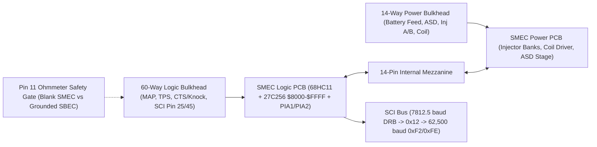

# Chrysler SMEC (`68HC11` Dual-Board, `1988–1989`)

The **Single Module Engine Controller (`SMEC`)** consolidated Chrysler's `1984–1987` cabin/engine-bay boxes into a single potted aluminum engine-bay housing while retaining a **dual-board internal layout**:

- **Logic PCB & Power PCB Mezzanine**: Separate logic and power circuit boards joined internally by a `14-pin` board-to-board mezzanine header, sharing external **60-way logic** and **14-way power** bulkhead connectors.
- **Motorola `68HC11` Migration**: Replaced the `6803` + external `ADC0808` with a `68HC11` microcontroller running an `8.0 MHz` crystal (`2.0 MHz` E-clock, `0.5 µs` per cycle), on-chip 8-channel `ADC`, `SPI`/`SCI` UART, and external `28-pin` `32 KB` `27C256` EPROM.

## `68HC11` Memory Map & `27C256` EPROM Layout (`smec_88_89_v19`)

| Address Region | Size / Hardware | Function & Safety Constraints |
| :--- | :--- | :--- |
| **`$0000`–`$00FF`** | `256 B` Internal Zero-Page RAM | Battery-backed keep-alive adaptive/fault region (`$0002`–`$0025`, `DCCOR1`–`5`, `AutoCalCell0`–`12`, `ErrorBitRegister0`–`3`) plus runtime state (`$0057`–`$00D9`) and stack/scratch (`$00DA`–`$00FF`). |
| **`$1000`–`$103F`** | `64 B` On-Chip Registers | `Port A`–`E`, `TCNT` & `IC1`–`2` / `OC1`–`5` (`$100E`–`$101F`), `SCI` (`BAUD` `$102B`, `SCCR1`/`2`, `SCSR`, `SCDR` `$102F`), `ADC` (`$1030`–`$1034`), `OPTION`/`CONFIG`/`INIT` (`$1039`–`$103F`). |
| **`$4000`–`$6000`** | External `PIA1`, `PIA2` & Switch Port | `PIA1` (`$4000`–`$4003`: `ASD`, fan, A/C, wastegate, baro, `AIS` stepper); `PIA2` (`$5000`–`$5003`: tach, `CCD`, knock cap clear, alt field, coil/inj sense); `SwitchPortAccessReg` (`$6000`). |
| **`$8000`–`$FFBF`** | `32 KB` `27C256` EPROM Window | `DataOrg = 0x8000` calibration tables (`$8000`–`$8FFF`) and `CodeOrg = 0x9000` firmware (`smec_88_89_v19`). |
| **`$B600`–`$B7FF`** | On-Chip `512 B` EEPROM Hole | **Mandatory unallocated hole** inside `32 KB` `.asm`/linker builds so external EPROM reads never collide with internal `68HC11` EEPROM mapping. |
| **`$FFC0`–`$FFFF`** | Hardware Interrupt & Reset Vectors | Active vectors (`$FFD6`–`$FFFF`: `SCI` `$FFD6`, `OC5` Dwell `$FFE0`, `OC2` Wastegate `$FFE6`, `IC2` Speedo `$FFEC`, `IC1` Dist `$FFEE`, `IRQ` PIA `$FFF2`, `COP`/`Clock`/`Reset` `$FFFA`–`$FFFF`) MUST resolve inside `$8000`–`$FFBF`. |

### External `PIA1`, `PIA2` & `SwitchPort` Register Allocation (`$4000`–`$6000`)

| Register | Address | Bit Assignments (`T-SMEC v19` Verified) |
| :--- | :--- | :--- |
| **`PIA1_PortA_ControlRegister`** | `$4001` | `bit 7` Cruise Vent, `bit 6` Check Engine Light, `bit 5` `ASD` Relay, `bit 4` Fan Relay, `bit 3` A/C Clutch Relay, `bit 2` Part-Throttle Unlock (`PTU`), `bit 1` Purge Solenoid, `bit 0` Cruise Vacuum. |
| **`PIA1_PortB_ControlRegister`** | `$4003` | `bit 7` `EGR` Solenoid, `bit 6` Wastegate Solenoid, `bit 5` Baro Read Solenoid, `bit 4` Emissions Maint Light (`EMR`), `bits 3..0` `AIS` stepper phases `AIS3`–`AIS0`. |
| **`PIA2_PortA_ControlRegister`** | `$5001` | `bit 3` Fuel Monitor (`Navigator`), `bit 2` Tachometer output, `bit 1` `CCD` Bus chip enable. |
| **`PIA2_PortB_ControlRegister`** | `$5003` | `bit 7` Coolant Temp Range bit, `bit 5` Knock Cap clear, `bit 4` Alternator field control, `bit 3` `OC1` toggle, `bit 1` Ignition Coil Driver Sense, `bit 0` Fuel Injector Driver Sense. |
| **`SwitchPortAccessReg`** | `$6000` | `bit 7` Park/Neutral, `bit 6` Brake, `bit 5` Dist Sync, `bit 4` A/C Clutch in, `bit 3` Cruise Resume, `bit 2` Cruise On/Off, `bit 1` Cruise Set, `bit 0` `B1` Voltage Sense. |

## Calibrated Reference Architecture (`T-SMEC_25_MTX_B151` / `smec_88_89_v19`)

### Core ROM Calibration Tables (`$81xx`–`$82xx` in `T-SMEC_25_MTX_B151`)

- **`WOTTBL_FuelFullThrottle`** (`$81E5` in `B151` listing): `MAP`-indexed full-throttle fuel curve and part-throttle upper clamp.
- **`BATOFF_FuelBatteryOffset`** (`$81FA` in `B151` listing): Battery-voltage injector deadtime compensation (`0`–`4095.94 µs`).
- **`PEFTBL_PumpingEfficiency`** (`$82C7` in `B151` listing; `;.org 0x8322` / `;mptbladdr 0x087C` in `T-SMEC_25_MTX_B151_Stock.tpl`): `RPM`-indexed volumetric/pumping efficiency fuel curve (`T2` calibrations also populate `AIRTMP_FuelEnrichmentFromChargeTemp`, whereas stock `89 T1` builds omit it).

### Diagnostic Dispatch (`DRBFunctionTable`) & High-Speed `SCI` (`XmitRequestedRamLocation`)

At key-on, the `68HC11` `SCI` initializes via `CPU_SerialBaudRate` (`$102B`, where `8.0 MHz` crystal / `2.0 MHz` E-clock prescaler encodings include `0x25` for `977` baud, `0x33` for `1200` baud, `0x30` for `9600` baud, and `0x01` for `62,500` baud) to `7812.5` baud (`8N1`, echoed) and services `DRBFunctionTable` (`0x10`–`0x1C`):

| Command | Routine / Behavior | Notes |
| :--- | :--- | :--- |
| **`0x10` / `0x11` / `0x17`** | `OutputErrorCodes` / `OutputErrorBits` / `ClearErrorCodes` | Reads or clears stored `BBRAM` fault codes and status bitmasks. |
| **`0x12`** | `SetupHiSpeedDataTransfer` | Sets `DRBSerialMode` `bbe_FastSerial`, waits for `TC` (`0x40`), and writes `BAUDHI` (`0x01`) to `$102B` for **`62,500` baud** zero-echo mode. |
| **`0x13` / `0x1A`** | `SetupATM` / `SwitchTest` | Actuator Test Mode (`ATMFunctionTable` `0x00`–`0x19`) and switch state inspection (`0x01`–`0x03`). |
| **`0x14`** | `SendDiagnosticDataToSCI` | Serves **`DRBMemoryTable`** (`26` single-byte `$00xx` offsets for sub-tests `0x01`–`0x1A`, e.g., `0x71` AmbientTempVolts, `0x6A` CoolantTemp, `0x63` MapValue, `0x5D` EngineRpm_HB, `0xA0` CalculatedSparkAdvance, `0xD8` BoostTarget) plus `RealTimeDataTable` (`0x40`–`0x43`). |
| **`0x16` / `0x1B` / `0x1C`** | `SendECUIDToSCI` / `InitByteModeDownload` / `EMR` | Returns ECU ID (`0x16`), initializes byte-mode trim (`0x1B`), or resets EMR (`0x1C`). |

In high-speed `62,500` baud mode, **`XmitRequestedRamLocation`** inspects incoming bytes on `CPU_SerialData` (`$102F`):
- **`0xF2`**: Echoes `0xF2` back to the host as a live logger-mode heartbeat/confirmation (distinct from `0xF4` virtual table selectors in later `68HC11` masks).
- **`0xFE`**: Clears `bbe_FastSerial` in `DRBSerialMode`, returning serial port control to the `7812.5` baud `DRB` loop.
- **Zero-Page Offset (`$00xx`)**: Loads index `X = 0x0000 + B` and transmits the single RAM byte directly.

> [!CAUTION]
> **Hardware Deadbolt**: LogicAIDE strictly enforces read-only telemetry (`0xF2` / `0xF4` polling and `0xFE` exit) and deterministic offline `m68hc11` simulation within the `<= 11.0 ms` (`22,000` E-cycles) main-loop budget. Legacy flash-write opcodes are prohibited across all agent workflows and cleanroom documentation.

## SMEC vs. `SBEC` (`1990–1993`) Calibration & Harness Boundaries

| Subsystem | `1988–1989` `SMEC` (`SMEC_DUAL_BOARD`) | `1990–1993` `SBEC` (`SBEC_SINGLE_BOARD`) |
| :--- | :--- | :--- |
| **IAT / Charge-Temp Sensor** | Open-element fast-response sensor calibrated to **`90 °C` reference** (`iat_reference_c = 90`). | Shrouded thermistor calibrated to **`60 °C` reference** (`iat_reference_c = 60`). |
| **Turbo Wastegate & Baro** | `PIA1` Port B (`$4003`) drives `WastegateSolenoid` (`OC2` `$1018` scheduling) & `BaroReadSolenoid`; `DCCOR1`–`5` adapt from knock (`RT1`–`4`), while `HandleBaroReadRequirement_MM` refreshes `BaroPressure` (`$000E`) at key-on/idle via `MAP`. | Single-board driver stage; `T-SMEC` and `T-SBEC` `.tpl` templates are **non-interchangeable** (`DataOrg`/`CodeOrg` and table structures differ). |
| **60-Way `Pin 2` / `Pin 3`** | Early Turbo SMECs often assign `Pin 2` = `Knock`, `Pin 3` = `CTS`. | Later `SMEC`/`SBEC` harnesses commonly assign `Pin 2` = `CTS`. |
| **60-Way `Pin 25` / `Pin 45`** | Some early Turbo I harnesses leave `Pin 25` blank and use `Pin 45` for `C20` A/C clutch, routing `SCI` to an under-hood pigtail. | Standard `Pin 25` = `SCI TX` (`D21`), `Pin 45` = `SCI RX` (`D20`). |
| **60-Way `Pin 11` Hazard** | Factory blank on many `1988–1989` Turbo harnesses (used for `+12V`/`~21V` bootstrap on bench-verified SMEC units). | Several `1990–1993` `SBEC` / `TBI` harnesses bond **`Pin 11` directly to Chassis/Power Ground (`Pin 12`)**. |

- **`2.2L` / `2.5L` Calibration Flags**: `smec_88_89_v19` templates (`T-SMEC_22_*`, `T-SMEC_25_*`) use `CONFIG` / `OPTION` flags and `2-bar` / `3-bar` `MAP` scaling constants so identical firmware handles `2.2L` / `2.5L` `MTX`/`ATX` Turbo I/II builds without cross-family table mixing.

> [!WARNING]
> **Critical SMEC `Pin 11` Power Short Hazard**: Never energize `+12V` or `~21V` bootstrap power on `Pin 11` without first confirming controller generation and performing a disconnected-ECU ohmmeter continuity check against `Pin 12` / battery negative. Consult **[Pin 11 Safety Matrix](pin-11-safety-matrix.md)** before any harness probing.

## Related Pages

- [Pin 11 Safety Matrix](pin-11-safety-matrix.md)
- [Chrysler LM / PM 6803 Reference (1984–1987)](lm-pm-6803.md)
- [ECU Families Overview](ecu-families-overview.md)
- [Wiring Bulkheads & Diagnostics Overview](../wiring-and-diagnostics/wiring-and-diagnostics-overview.md)
- [ROM Architecture & SCI Protocol Overview](../rom-and-sci/rom-and-sci-overview.md)
- [Hardware Bench Overview](../hardware-bench/hardware-bench-overview.md)
- [Wiki Home](../Home.md)
