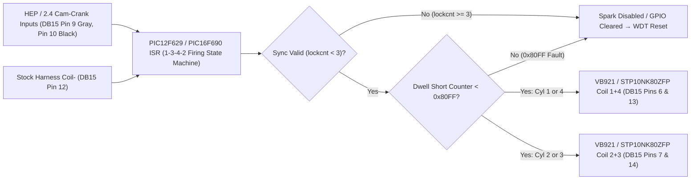

# SCI, Knock Box Conditioning & Waste-Spark DIS Adaptor Hardware Notes

This reference covers two bench and auxiliary signal-conditioning assemblies documented for Chrysler `2.2L` / `2.5L` / `2.4L` platforms: (1) the opto-isolated **SCI / Knock Conditioning Box** and Arduino `Knock_Board` interface, and (2) the **PIC-based Waste-Spark DIS Adaptor** (`1-3-4-2` coil-pair driver).

> [!CAUTION]
> **Hardware Deadbolt & Isolation Boundary**:
> Never connect an unprotected `3.3 V` or `5 V` USB-UART adapter to Chrysler `60-way` SCI or ignition lines without verified optical isolation (`4N25`), series current-limiting, and `5.1 V` Zener clamping (`1N4733A-TR`). Always perform the `Pin 11` / `Pin 25` / `Pin 45` DMM verification in [Pin 11 Safety Matrix](../ecu-families/pin-11-safety-matrix.md) prior to harness attachment.

---

## 1. SCI & Knock Conditioning Hardware BOM (`Order 1` + `Order 2`)

The conditioning interface isolates host serial and knock-integrator logic from automotive `+12 V` transients, drives `+12 V` / `+5 V` regulated rails, and converts tachometer pulses to analog voltage via an `LM2907`/`LM2917` frequency-to-voltage (`F-to-V`) stage (`66 Hz/V`, `12 V` max).

| Subsystem | Mfr / Distributor Part # | Qty | Value / Function |
| :--- | :--- | :--- | :--- |
| **Optical & Bus Isolation** | `4N25` (`78-4N25`) | `10` | Phototransistor optocoupler (galvanic barrier on SCI / trigger lines) |
| **Voltage Clamping** | `1N4733A-TR` (`78-1N4733A`) | `10` | **`5.1 V 1.0 W`** Zener diode (`3.3V`/`5V` TTL clamp per `SECURITY.md`) |
| **Differential Transceiver** | `SN75176BD` (`595-SN75176BD`) | `2` | RS-485 differential bus transceiver IC |
| **Rectifier / Reverse Guard** | `1N4001` (`512-1N4001`) | `10` | `50 V 1 A` rectifier diode |
| **Linear Regulators** | `LM7812ACT` (`512-LM7812ACT`), `LM7805ACT` (`512-LM7805ACT`) | `10` ea | `+12 V 1 A` (`4%`) and `+5 V` (`2%`) linear voltage regulators |
| **NPN Transistor Stages** | `2N3904CTA` (`512-2N3904CTA`), `2N4401TFR` (`512-2N4401TFR`) | `10` / `20` | General-purpose small-signal NPN switching/buffering |
| **Precision / Bias Resistors** | `273-4.7K-RC`, `MF1/2DCT52R4701F`, `CCF0710K0GKE36`, `MF1/4DC1001F`, `CCF071K00JNR36`, `MF1/4LCT52R332J`, `MF1/4DC1003F`, `273-470-RC`, `MF1/2DCT52R3900F`, `MF1/4LLT52R511J`, `CMF603K9200FHEK`, `293-1.0-RC` | `10` ea | `4.7 kOhm` (`1/2W 1%`), `10 kOhm` (`1/4W 2%`), `1.0 kOhm` (`1/4W 1%/5%`), `3.3 kOhm`, `100 kOhm`, `470 Ohm`, `390 Ohm`, `510 Ohm`, `3.92 kOhm` (`1/2W 1%`), `1.0 Ohm` (`1/2W 5%`) |
| **Filter / Timing Capacitors** | `C330C105M5R5CA`, `140-50Z5-203M-RC`, `140-50Q5-103Z-RC`, `5WF103MECAI`, `140-50P2-102K-RC`, `140-50N5-470J-TB-RC` | `10` ea | `1.0 uF` (`50 V X7R`), `0.02 uF` (`50 V`), `0.01 uF` (`50 V` / `25 V`), `1000 pF` (`50 V`), `47 pF` (`50 V NP0`) |

---

## 2. Arduino `Knock_Board` Pinout, Math & Firmware Review

### Hardware Pinout & Serial Interfaces (`Knock_Board.pde`)

| Arduino Pin | Signal Name | Direction / Mode | Functional Role |
| :--- | :--- | :--- | :--- |
| **`D2`** | `ignEvent` | Input (`FALLING` ISR) | Triggers `IgnoreIgnition()` interrupt on ignition edge to mask switching noise |
| **`D3`** | `knockDiscrete` | Digital Output | Driven `HIGH` when `knock_deter >= 100%`; cleared `LOW` after `alertLength` |
| **`D4`** | `clearKnock` | Digital Output | Pulsed inside `IgnoreIgnition()` to discharge/reset external knock integrator |
| **`D5` / `D6`** | `SoftwareSerial` | `RX=5` / `TX=6` (`9600` baud) | Drives `16x2` serial LCD display at `4 Hz` (`250 ms` period) |
| **`D13`** | `LEDPin` | Digital Output | Visual knock indicator LED |
| **`A0`** | `rpmPin` | Analog Input (`0–5 V`) | Conditioned RPM voltage from `LM2907` / `LM2917` (`66 Hz/V`) |
| **`A1`** | `knockPin` | Analog Input (`0–5 V`) | Conditioned knock-sensor integrator voltage |
| **Hardware `Serial`** | `USB UART` | `115200` baud | CLI menu (`m/g/e/r/v/c/q/h`) + `10 Hz` (`100 ms` period) telemetry datalog |

### ADC Scaling, RPM Conversion & `34-Byte` EEPROM Map

- **ADC Mapping**: `10-bit` `analogRead()` (`0..1023`) is remapped via `map(..., 0, 1023, 0, 65535)`, yielding `volt_lsb = 5.0 / 65536` (`0.0000762939 V/LSB`).
- **RPM Formula** (`freq_volt = 66` `Hz/V`):
  - `RPM = (rpm_volt * volt_lsb * freq_volt * 60) / (0.5 * numCylinders)`
- **Threshold Calculation (`grab_process_analog`)**:
  - `knock_deter = (knock_volt * 100.0) / threshold_at_rpm`
  - Asserts `knock_present = true` and `knockDiscrete = HIGH` while `knock_deter >= 100` (`%`), refreshing `mark_event = time`; clears only when `knock_deter < 100` AND `(time - mark_event) >= alertLength`.
- **EEPROM Layout (`34` bytes)**:
  - Bytes `0..15`: `rpmLookup[8]` (`8 x uint16`, `2` bytes each)
  - Bytes `16..31`: `knockLookup[8]` (`8 x uint16`, `2` bytes each, max knock voltage threshold)
  - Byte `32`: `numCylinders` (`byte`)
  - Byte `33`: `alertLength` (`byte`, alert hold duration in seconds)

> [!WARNING]
> **Documented `isKnock()` Interpolation Bug in `Knock_Board.pde`**:
> Source review identified three defects in the `isKnock()` table lookup routine:
> 1. The lower-bound range check reads `if (rpmLookup[i] >= x && x <= rpmLookup[i+1])` (inverted lower bound; should be `rpmLookup[i] <= x`).
> 2. The linear interpolation numerator uses `(rpmLookup[i+1] - rpmLookup[i])` instead of `(knockLookup[i+1] - knockLookup[i])`.
> 3. The `else` branch increments `i++` twice, skipping odd table segments. Do not deploy unmodified `Knock_Board.pde` threshold interpolation without patching `isKnock()`.

---

## 3. Waste-Spark DIS Adaptor Hardware & PIC Firmware (`1-3-4-2`)

The Waste-Spark DIS Adaptor converts single-coil distributor trigger signals (`Coil -`) and Hall-Effect Pickup (`HEP`) or `2.4L` cam/crank edges into paired waste-spark outputs (`Coil 1+4` and `Coil 2+3`).

### Hardware BOM & Variant Depopulation (`DIS_Adaptor`)

| Part Number | Qty / Ref | Description & Revision Notes |
| :--- | :--- | :--- |
| `PIC12F629-E/SN` (`PIC12F629-E/SN-ND`) | `5` | `8-bit` CMOS MCU, `1K` Flash, `8-SOIC` (`f629tempo2.asm`; `PIC16F690` used in `690Hybrid.asm`) |
| `VB921` (`Q1`, `Q2`) / `STP10NK80ZFP` | `Q1, Q2` / `10` | `VB921` ignition coil drivers (`11-9-07` spec); `STP10NK80ZFP` (`800 V 9 A` N-CH MOSFET, `TO-220F`) |
| `MC7805BDTRKG` (`MC7805BDTRKGOSCT-ND`) | `5` | `+5 V 1 A` linear voltage regulator, `DPAK` |
| `MMBT2222A` / `MMBT4403` (`Q7`–`Q9`) | `60` ea | General-purpose `SOT-23` NPN / PNP transistors |
| `PCE4074CT-ND` (`C1`, `C3`) / `399-1249-1-ND` | `5` / `10` | `22 uF 50 V` SMD electrolytic (`>= 22 uF`); `0.10 uF 50 V X7R` SMD `1206` |
| `RHM1.0KERCT-ND` / `RHM220ERCT-ND` / `RHM1.0MERCT-ND` | `50` / `10` / `10` | `1.0 kOhm`, `220 Ohm`, `1.0 MOhm` `1/4W 5%` SMD `1206` resistors (`R4 >= 1/4W` sensor-supply current limit) |

- **Board Variant Depopulation (`11-9-07`)**: Depopulate `R8, R13, Q8` for **Carb/TBI** builds; depopulate `R8, R12, R13, R14, Q8, Q9` for **Hybrid** builds.

### DB15 Pinout (`11-9-07` vs. `5-20-08` Revisions)

| DB15 Pin | Signal Assignment | Hardware & Revision Notes |
| :---: | :--- | :--- |
| **`1`** | Simulated HEP Out Gray | Turbo builds only |
| **`2`** | **`+8 V` HEP Supply (In)** vs. **`NC`** | **`+8 V` input in `11-9-07`**; **Not Connected (`NC`) in `5-20-08`** |
| **`3`** | Simulated HEP Out Black | Turbo & TBI/Carb builds |
| **`4`** | `+5 V` Sensor Supply (Out) | Feeds cam/crank or HEP sensors (`R4 >= 1/4W` current-limited) |
| **`5`** | `+Battery` | Connect to stock harness `Coil +` |
| **`6` & `13`** | `1+4` Coil Out (Paired) | Drives waste-spark tower for Cylinders `1` & `4` |
| **`7` & `14`** | `2+3` Coil Out (Paired) | Drives waste-spark tower for Cylinders `2` & `3` |
| **`8, 11, 15`** | Ground | Tie all three together close to module to heavy engine ground |
| **`9`** | HEP In Gray / `2.4` Crank In | Turbo HEP Gray or `2.4L` Crank sensor input |
| **`10`** | HEP In Black / `2.4` Cam In | Turbo HEP Black or `2.4L` Cam sensor input |
| **`12`** | `Coil -` In | Stock harness ignition driver input (**do NOT leave stock coil connected**) |

### PIC Firing State Machine, Base Timing & Lockout Protection

- **MCU Pin Mappings**:
  - **`PIC16F690` (`690Hybrid.asm`)**: `PORTB,4` = Black HEP in, `PORTB,5` = Gray HEP in, `PORTB,7` = Simulated Carb/TBI HEP out, `PORTC,7` = `Coil -` input, `PORTC,6` = Coil `1+4` out, `PORTC,3` = Coil `2+3` out, `PORTC,0` = Spark-enabled indicator.
  - **`PIC12F629` (`f629tempo2.asm`)**: `GPIO,0` = Gray in, `GPIO,1` = Black in, `GPIO,5` = `Coil -` input, `GPIO,2` = Coil `1+4` out, `GPIO,4` = Coil `2+3` out.
- **Base Timing Variants**: **Hybrid** (turbo distributor + HEP) sets base advance mechanically at the distributor; **Non-NGC** (pre-`2003` `2.4L`) fixes base timing at **`9°` BTDC** (`5-20-08` spec; `11-9-07` noted `10°` BTDC); **NGC** (`2003+` / `SRT-4`) fixes base timing at **`9°` BTDC**.
- **Sync Edge Detection & Firing Order (`1-3-4-2`)**:
  - Interrupt-on-Change ISR detects **Cylinder `#4` Sync** (`status,1`: rising Gray while Black is High), **Cylinder `#1` Sync** (`status,2`: rising Black while Gray is High), and **Normal Cylinder Advance** (`status,3`: falling Black while Gray is Low).
  - `CylData` lookup sequences `1` -> `3` -> `4` -> `2` -> `1` (`retlw 3, 1, 4, 2`), routing `1` & `4` to **Coil `1+4`** and `2` & `3` to **Coil `2+3`**.
- **Safety Lockouts (`lockcnt >= 3` & `0x80FF` WDT Short Guard)**:
  - **Sync-Loss Lockout**: `lockcnt` increments on each cylinder transition lacking a valid sync pulse; when **`lockcnt >= 3`**, spark enable (`status,0`) is cleared to prevent out-of-phase firing.
  - **Dwell Short Protection (`PIC12F629`)**: If `shortcounth:shortcount` reaches **`0x80FF`** during continuous dwell, firmware clears `GPIO` (de-energizing both coil drivers) and enters an infinite loop until the Watchdog Timer (`WDT`) resets the controller.

---

## Related Pages

- [Hardware Bench Overview](hardware-bench-overview.md)
- [SMEC `28C256` & Bank-Switched Socket Notes](smec-28c256-read-only-socket-notes.md)
- [60-Way Harness Pin 11 Safety Matrix](../ecu-families/pin-11-safety-matrix.md)
- [Chrysler SCI `7812.5` & `62,500` Baud Protocol](../rom-and-sci/sci-7812-and-62500-protocol.md)
- [Wiki Home](../Home.md)
