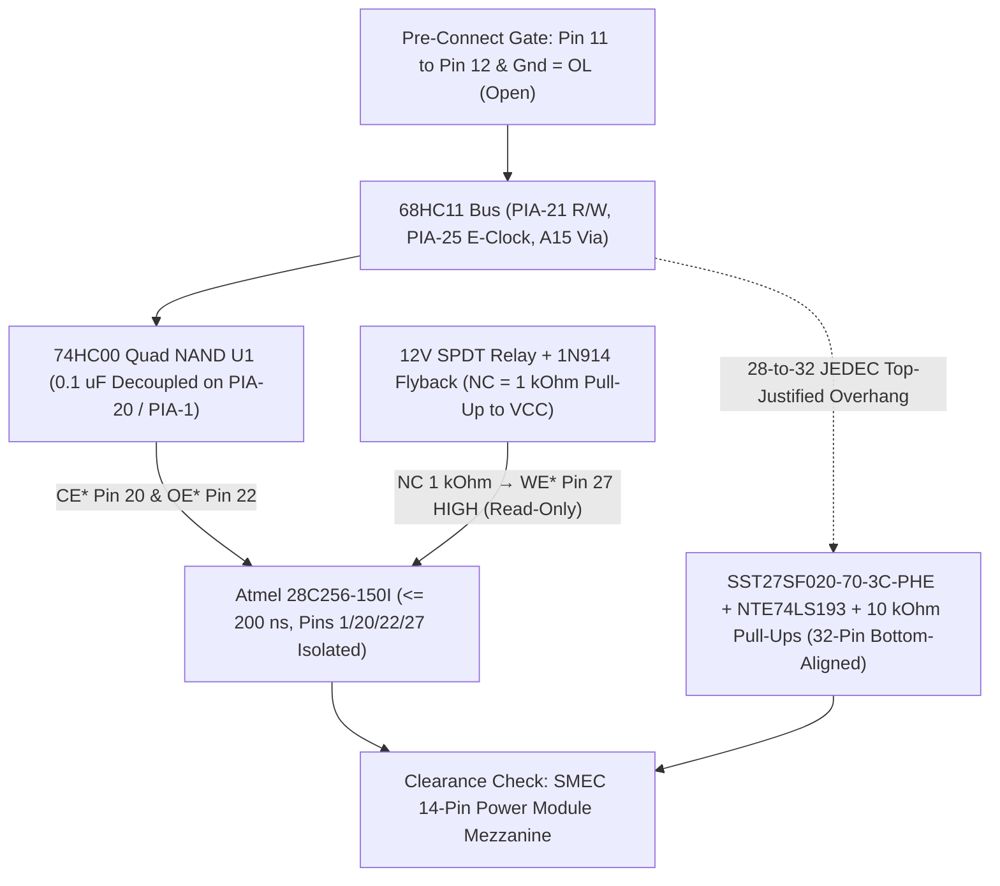

# SMEC `28C256` & Bank-Switched Socket Read-Only Hardware Notes

This article documents the physical socket topology, address/control gating, and Bills of Materials (BOMs) for `1988–1989` Chrysler **SMEC** (`68HC11` dual-board) ROM sockets, covering both multi-bank `SST27SF020` / Ostrich 2.0 `28-pin` vs. `32-pin` adapters and legacy `Atmel 28C256-150I` + `74HC00` board retrofits.

> [!CAUTION]
> **Hardware Deadbolt (Strictly Read-Only Bench Reference)**:
> LogicAIDE treats all `SMEC_88_89` socket hardware strictly as a **read-only bench and offline-verification reference**. Zero flash-write opcodes, serial bootstrap loaders, or live USB-serial port writes are included or permitted. Candidate binaries must be staged offline under `staging/candidates/<build_id>/` with SHA-256 checksums, `$FFC0`–`$FFFF` vector proof, and `< 11 ms` cycle validation.

---

## 1. Mandatory `SECURITY.md` Safety & Pre-Connect Gates

Before inspecting, opening, or bench-connecting any `60-way` Chrysler SMEC logic module:

1. **Pin 11 `SBEC` `Z12` Direct Ground-Short Warning**:
   - On `1988–1989` **SMEC** harnesses, `60-way` `Pin 11` is factory blank (unpopulated) unless retrofitted with a `22 V` Zener bypass.
   - On `1990–1993` **SBEC / SBEC-II** harnesses, **`Pin 11` AND `Pin 12` are both bonded directly to `Z12 16BK/TN` Power Ground**. Energizing `+12 V` or `~21 V` onto `Pin 11`—or plugging a Pin-11-biased SMEC onto an SBEC harness—causes an immediate **direct ground short**, risking melted harness insulation and destroyed PCB traces.
2. **Pre-Connect DMM Ohmmeter Isolation Check (Ignition `OFF`, ECU Unplugged)**:
   - Measure resistance across harness **`Pin 11` to `Pin 12`** and **`Pin 11` to chassis/battery negative ground**.
   - A safe SMEC harness MUST read **`OL` (`> 10 MOhm`)**. Any continuity (`< 100 kOhm`) confirms a grounded `SBEC` `Z12` circuit and enforces a **HARD STOP** (see [Pin 11 Safety Matrix](../ecu-families/pin-11-safety-matrix.md)).
3. **Variant Pin Verification (`Pin 2`, `Pin 3`, `Pin 25`, `Pin 45`)**:
   - Verify exact model-year FSM assignments before probing: early Turbo SMECs swap `Pin 2` (Knock) / `Pin 3` (`CTS`) relative to SBEC `Pin 2` (`CTS`) / `Pin 3` (`A14` Fuel Pump/ASD), and early Turbo I harnesses may leave `Pin 25` (`SCI TX`) blank or wire `Pin 45` to `C20` A/C clutch (`+12 V`) instead of `SCI RX` (see [SCI Protocol](../rom-and-sci/sci-7812-and-62500-protocol.md)).
4. **SMEC Potting Toxic Fume Ventilation Warning**:
   - Stock `1988–1989` SMEC logic boards are encapsulated in elastomer potting compound that **emits toxic fumes when heated with a soldering iron**. Work only under active fume extraction / ventilation and avoid inhaling solder smoke.
5. **Power Module Mezzanine Clearance Warning**:
   - The SMEC **Power PCB** stacks directly above the Logic PCB via a `14-pin` internal mezzanine header ([SMEC 68HC11 Reference](../ecu-families/smec-68hc11.md)). Stacking a `DIP` socket + EEPROM + `74HC00` or tall Ostrich 2.0 header on top of the EPROM site interferes mechanically with the Power Module. Use low-profile sockets, mount `74HC00` inverted on the `PIA` if socketed, and verify cover/mezzanine clearance before reassembly.

---

## 2. Topology A: `SST27SF020` Bank-Switched Adapter & Ostrich 2.0 Alignment

Stock SMEC logic boards map external `32 KB` (`$8000`–`$FFFF`, minus the mandatory `$B600`–`$B7FF` `68HC11` internal EEPROM hole) onto a **`28-pin` `27C256` DIP** footprint (`A0`–`A14`). Multi-bank adapters and `32-pin` Ostrich 2.0 ribbon headers bridge `32-pin` JEDEC devices into that `28-pin` site.

### Bank-Switched Adapter BOM (`SST27SF020` + `NTE74LS193`)

| Qty | Mfr / Distributor Part # | Component & Specification | Role in Read-Only Socket Adapter |
| :--- | :--- | :--- | :--- |
| `5` | `SST27SF020-70-3C-PHE` (`804-27SF0207CPHE`) | `256K x 8` (`2 Mbit`) MTP Flash/EEPROM, **`70 ns`**, `DIP-32` | Stores `8 x 32 KB` offline-programmed calibration banks (`A15`–`A17` bank-selected) |
| `5` | `NTE74LS193` (`526-NTE74LS193`) | Synchronous 4-bit binary up/down counter IC, `DIP-16` | Latches and steps upper address lines (`A15`–`A17`) to select active `32 KB` ROM bank |
| `5` | `4832-6004-CP` (`517-4832-6004-CP`) | `32-pin` dual-wipe `DIP` IC socket | Accepts `SST27SF020` without direct solder stress |
| `10` | `1-390261-4` (`571-1-390261-4`) | `16-pin` economy tin `DIP` IC socket | Mounts `NTE74LS193` bank counter |
| `20` | `CCF0710K0JKE36` (`71-CCF0710K0JKE36`) | **`10 kOhm`** `1/4W` (`1/2W` rated) `5%` metal film resistor | Pull-up resistors stabilizing counter inputs and high-order address lines |

### `28-Pin` vs. `32-Pin` JEDEC Top-Justification & Ostrich 2.0 Alignment

When seating a `32-pin` device (`SST27SF020`) or a `32-pin` **Ostrich 2.0** DIP ribbon adapter into a `28-pin` SMEC `27C256` socket:

- **Bottom-Aligned (JEDEC Pin-14-to-Pin-16) Justification**: Align `Pin 14` (`GND`) and `Pin 15` (`DQ3`) of the `28-pin` SMEC socket with **`Pin 16` (`GND`) and `Pin 17` (`DQ3`)** of the `32-pin` header.
- **Top-End Overhang**: `Pins 1, 2, 31, 32` (`VPP`/`A16`, `A16`, `PGM`/`A17`, `VCC` on `32-pin`) overhang the **notch (`Pin 1` / `Pin 28`) end** of the `28-pin` socket; `28-pin` `Pin 28` (`+5 V` `VCC`) mates directly with `32-pin` `Pin 30` (`A17`/`VCC` jumpering per adapter wiring).
- **Ostrich 2.0 Mechanical Check**: Prefer a `28-pin` Ostrich ribbon cable when targeting `28-pin` SMEC sockets, verify Pin 1 notch orientation prior to key-on, and confirm the `14-pin` Power Module mezzanine does not pinch the ribbon header.

---

## 3. Topology B: `Atmel 28C256-150I` & `74HC00` Control-Signal Architecture

Legacy `SMEC` hardware modifications replace the stock `27C256` UVPROM with an industrial-temperature **`Atmel 28C256-150I`** (`<= 200 ns` access time required to meet `2.0 MHz` `68HC11` `E`-clock timing) plus a **`74HC00`** quad 2-input NAND gate (`U1`). Under LogicAIDE's Hardware Deadbolt, this circuit is documented strictly to understand **read-only bus decoding, `WE*` pull-up state, and Pin 11 isolation**.

### `28C256-150I` + `74HC00` Hardware BOM

| Component | Specification | Board Mounting & Isolation Notes |
| :--- | :--- | :--- |
| **EEPROM** | **Atmel `28C256-150I`** (`<= 200 ns`, industrial temp) | Pins **`1, 20, 22, 27`** bent up / isolated from SMEC PCB pads; PCB pad `27` routes to EEPROM pin `1` (`A14`) |
| **Logic IC (`U1`)** | **`74HC00`** quad 2-input NAND gate | Glued inverted onto `PIA` chip (if EEPROM is socketed) or onto `28C256` (if socketless) for Power Module clearance |
| **Decoupling Cap** | **`0.1 uF`** ceramic capacitor | Wired directly across `U1-14` (`VCC` from `PIA-20`) and `U1-7` (`GND` from `PIA-1`) |
| **Relay** | Miniature **`12 VDC` SPDT** single-side-stable (`1 A @ 30 VDC`, `515 Ohm` coil) | Low-profile placement; NC state enforces read-only `WE*` pull-up |
| **Flyback Diode** | **`1N914`** fast switching diode | Across relay coil: **anode** to EEPROM `Pin 14` (`GND`), **cathode** (black band) to `60-way` `Pin 11` board via |
| **Pull-Up Resistor** | **`1 kOhm`** resistor | Connects relay NC (non-energized) terminal to EEPROM `Pin 28` (`VCC`) |
| **Wiring / Zener** | `30 AWG` Teflon wire-wrap wire; stock `22 V` Zener on `Pin 11` trace | Leave `22 V` Zener intact and `Pin 11` open/isolated for read-only bench safety |

### `74HC00` NAND Gating & Read-Only Deadbolt State

| Signal / Bus Line | Source Tap on SMEC Logic PCB | `74HC00` (`U1`) & EEPROM Routing | Read-Only State (`Pin 11` Unpowered) |
| :--- | :--- | :--- | :--- |
| **`VCC` / `GND`** | `PIA-20` (`+5 V`) / `PIA-1` (`GND`) | `U1-14` (`VCC`), `U1-7` (`GND`) + `0.1 uF` cap | Powered (`+5.0 V`) |
| **`R/W`** | `PIA-21` | `U1-1, 2, 13` (`U1-3` links to `U1-9`) | Read cycle HIGH (`R/W = 1`) |
| **`E` Clock** | `PIA-25` (`2.0 MHz` processor clock) | `U1-10, 12` (qualified when `E` is HIGH) | Active `2.0 MHz` bus sync |
| **`A15` (`CS*` Bypass)** | Board `A15` address via | `U1-4, 5` → `U1-6` → EEPROM `Pin 20` (`CE*`) | Bypasses stock decode chip (`$8000`–`$FFFF` active) |
| **`OE*`** | `U1` output gate | `U1-11` → EEPROM `Pin 22` (`OE*`) | Driven LOW during valid `68HC11` ROM reads |
| **`WE*`** | Relay common → EEPROM `Pin 27` (`WE*`) | Relay NC → `1 kOhm` → EEPROM `Pin 28` (`VCC`); Relay NO → `U1-8` | **Locked HIGH (`+5 V` read-only)** while relay coil is de-energized |

---

## Related Pages

- [Hardware Bench Overview](hardware-bench-overview.md)
- [1988–1989 Chrysler SMEC (`68HC11`) Reference](../ecu-families/smec-68hc11.md)
- [60-Way Harness Pin 11 Safety Matrix](../ecu-families/pin-11-safety-matrix.md)
- [Chrysler SCI `7812.5` & `62,500` Baud Protocol](../rom-and-sci/sci-7812-and-62500-protocol.md)
- [Wiki Home](../Home.md)
