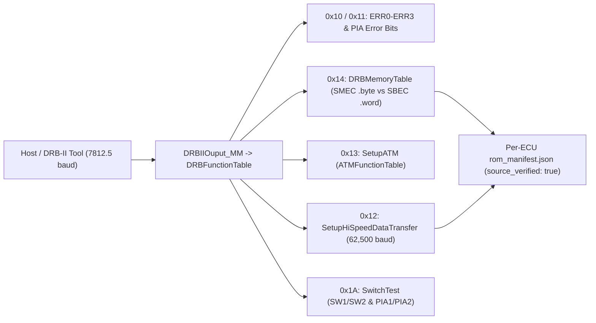

# DRB-II Commands, `10`-Protocol XREF & Fault Registers

Chrysler's factory Diagnostic Readout Box (`DRB-II`) communicates over the `7812.5` baud echoed SCI channel (`DRBIISerialCommunications_MM` and `DRBIIOuput_MM`) using command dispatch tables, calibrated memory maps, and bit-packed fault/switch registers. Because zero-page RAM layouts shift between `LM`, `SMEC T1`, `SMEC T2`, and `SBEC` calibrations, every offset MUST be gated through a per-ECU `rom_manifest.json` (`source_verified: true`).

---

## 1. `DRBFunctionTable` Dispatch (`0x10`–`0x1C` / `0x23`)

When `DRBIIOuput_MM` receives a valid command byte `>= 0x10`, it subtracts `0x10`, multiplies by `2`, and executes an indexed `.word` jump into `DRBFunctionTable` (`T-SMEC_v19.asm` `L3402–L3415`, `T-SBEC_v3_1.asm` `L3531–L3552`). `DRBSerialToggles` encodes whether each command expects `1`, `2`, or `3` total bytes (`DRBPointer1` command + `DRBPointer2` sub-command/address).

| Command | SMEC Handler (`0x10`–`0x1C`) | SBEC Handler (`0x10`–`0x23`) | Operational Role |
| :---: | :--- | :--- | :--- |
| **`0x10`** | `OutputErrorCodes` | `OutputErrorCodes` | Streams stored fault codes (`ERR0`–`ERR3` / `ERS0`–`ERS3`), terminated with `0xFE` + checksum. |
| **`0x11`** | `OutputErrorBits` | `OutputErrorBits` | Returns `PIA1` / register `ErrorBitsAssociatedWithPIA1AndReg1eTo25` high/low bytes. |
| **`0x12`** | `SetupHiSpeedDataTransfer` | `SetupHiSpeedDataTransfer` | Echoes `0x12` at `7812.5` baud, waits for `TC` (`0x40`), switches SCI to `62,500` baud. |
| **`0x13`** | `SetupATM` | `SetupATM` | Actuator Test Mode (`ATMFunctionTable`: coil, injector banks, AIS, fan, A/C, ASD, purge, WG, baro). |
| **`0x14`** | `SendDiagnosticDataToSCI` | `SendDiagnosticDataToSCI` | Sub-commands `0x01`–`0x1A` (`DRBMemoryTable`) and `$40`–`$43` (`RealTimeDataTable`). |
| **`0x15`** | `DRB_Return` | `SendECUIDToSCI` | No-op return on SMEC; emits `ENDIT1_PNPrefix` ECU ID bytes on SBEC. |
| **`0x16`** | `SendECUIDToSCI` | `SendConstValues` | Emits ECU part-number prefix + checksum on SMEC; calibration constants on SBEC. |
| **`0x17`** | `ClearErrorCodes` | `ClearErrorCodes` | Clears stored fault counters (`ERASE_ERROR_CODES` after `0x18` key-cycle threshold if engine stopped). |
| **`0x1A`** | `SwitchTest` | `SwitchTest` | `SwitchTestTable` (`0x01` `StartupSwitchMirror2`, `0x02` `PIA1_PortA_DataDirection`, `0x03` `PIA1_PortB_DataDirection`). |
| **`0x1B`** | `InitByteModeDownload` | `InitByteModeDownload` | Sets `ByteMode` flag in `DRBSerialMode`. |
| **`0x1C`** | `DRB_Return` | `DRB_ResetEMR` | Emission Maintenance Reminder (`EMR`) reset handler (`0x1D`–`0x23` on SBEC add special/adaptive routines). |

---

## 2. `DRBMemoryTable`: SMEC `.byte` vs. SBEC `.word`

Command `0x14` indexes `DRBMemoryTable` (`sub-command - 1`) to read single-byte diagnostic parameters without entering `62,500` baud mode:

- **SMEC (`T-SMEC_v19.asm`, `L3467–L3495`)**: Stores **`26` `.byte` zero-page offsets** (`0x01`–`0x1A`, `$00xx` only), e.g., `0x01` `0x71` (`AmbientAirTempVolts`), `0x02` `0x6C` (`O2SensorValue`), `0x05` `0x6A` (`CoolantTemp`), `0x07` `0x67` (`TpsVolts`), `0x0A` `0x6B` (`BatteryVolts`), `0x0B` `0x63` (`MapValue`), `0x10` `0x5D` (`EngineRpm_HB`), `0x15` `0xA0` (`CalculatedSparkAdvance`), `0x16`–`0x19` `0xA2`/`0xA1`/`0xA3`/`0xA4` (`Cylinder1..4Retard`), and `0x1A` `0xD8` (`BoostTarget`).
- **SBEC (`T-SBEC_v3_1.asm`, `L3603–L3646`)**: Expands to **`44` `16-bit .word` pointers** (`0x00xx` and extended RAM), preserving core indices (`AmbientAirTempVolts`, `O2SensorVolts`, `CoolantTemp`, `MapValue`, `EngineRpm_HB`, `CalculatedSparkAdvance`, `BoostTarget`) while appending `ChargeTemp`, `ChargeTempRaw`, `BoostActuatorADutyCycle_VNT`, `BoostActuatorBDutyCycle_WG`, and `CCDFlags5`.

---

## 3. DRB-II Command & Manifest Resolution Flow

---

## 4. `mprxref` (`402` Variables Across `10` Protocols) & Offset Drift

The MPR cross-reference corpus (`mprxref.csv`, `mprramdesc.csv`, `mprsettings.csv`, `mprbitsettings.csv`, `mprfunctionsets.csv`, `mprecutypes.csv`) catalogs **`402` telemetry variables** (`ItemNum` `0..405`) across **`10` Chrysler protocols**:

`0: LM` | `1: SMEC T1` | `2: SMEC T2` | `3: SBEC T1` | `4: SBEC TIII` | `5: SBECII T1` | `6: SBECII TIII` | `7: FCC` | `8: CUSTOM1` | `9: CUSTOM2`

- **Scaling (`mprsettings`) & Curves (`mprfunctionsets`)**: Each variable carries `Size` (`1` or `2` bytes), `Divisor`, `Units`, `Display Min`/`Max`, and `Ecu Min`/`Max` (e.g., `BATV` `volts` `0..15.75 V`, `AVGMAPV` `psi` `0..29.4 psi`). Non-linear thermistors and TPS linearization use piecewise `(V:eng)` curves in `mprfunctionsets`: `AMBVAL` (`ItemNum 12`, `-60..260 °F`), `CHRG` (`ItemNum 79`, `-21..261 °F`), and `TPSPOS` (`ItemNum 392`, `0..100%`).
- **Mandatory Per-ECU Offset Verification**: Zero-page addresses shift even between sibling `T1` and `T2` builds. Hardcoding offsets across controllers causes silent channel corruption:

| Variable (`Short Name`) | `LM` | `SMEC T1` | `SMEC T2` | `SBEC T1` / `SBEC TIII` |
| :--- | :---: | :---: | :---: | :---: |
| **`RPM`** (`EngineRpm_HB` / `RPMLM`) | `143` (`0x8F`, `RPMLM`) | `93` (`0x5D`) | `94` (`0x5E`) | `121` (`0x79`) |
| **`MAP`** (`MapValue`) | `148` (`0x94`) | `99` (`0x63`) | `100` (`0x64`) | `130` (`0x82`) |
| **`ADV`** (`CalculatedSparkAdvance`) | `114` (`0x72`) | `160` (`0xA0`) | `62` (`0x3E`) | `194` (`0xC2`) |
| **`BATV`** (`BatteryVolts`) | `161` (`0xA1`) | `107` (`0x6B`) | `107` (`0x6B`) | `138` (`0x8A`) |
| **`ERR0`** (`ErrorBitRegister0`) | `70` (`0x46`) | `30` (`0x1E`) | `30` (`0x1E`) | `31` (`0x1F`) |

Uncorroborated `mprxref` entries MUST remain `source_verified: false` and return **`No Verified Source Match`** in strict query mode until verified against the target ECU's `.asm`/`.sym` equates.

---

## 5. Verified Fault Registers (`ERR0`–`ERR3`, `ERS0`–`ERS3`) & Status Bitfields

From `mprbitsettings.csv`, live fault registers `ERR0`–`ERR3` (`ItemNum 174..177`) and non-volatile stored mirrors `ERS0`–`ERS3` (`ItemNum 178..181`) pack Chrysler 2-digit flash codes (`11`–`54`) MSB-to-LSB:

| Register | Bit 7 | Bit 6 | Bit 5 | Bit 4 | Bit 3 | Bit 2 | Bit 1 | Bit 0 |
| :--- | :--- | :--- | :--- | :--- | :--- | :--- | :--- | :--- |
| **`ERR0` / `ERS0`** | `Code44_LostFJ2` | `Code45_Nothing` | `Code46_HighVoltage` | `Code47_LowVoltage` | `Code51_StuckLean` | `Code52_StuckRich` | `Code53_Checksum` | `Code54_DistSync` |
| **`ERR1` / `ERS1`** | `Code33_AcCutoutRelay` | `Code34_SpeedCtlSolenoid` | `Code35_RadFanRelay` | `Code36_WastegateSolenoid` | `Code37_BaroReadSolenoid` | `Code41_ChargingSystem` | `Code42_ASDRelay` | `Code43_IgnitionCoil` |
| **`ERR2` / `ERS2`** | `Code22_CoolantTempSensor` | `Code23_ChargeTempSensor` | `Code24_TPS` | `Code25_AIS` | `Code26_InjectorCurrent` | `Code27_InjectorDriver` | `Code31_PurgeSolenoid` | `Code32_EGR` |
| **`ERR3` / `ERS3`** | `Code11_NotCranked` | `Code12_MemPowerLost` | `Code13_MapPneumatic` | `Code14_MapElectrical` | `Code15_DistanceSensor` | `Code16_BattVoltageSense` | `Code17_EngineTooCool` | `Code21_O2Sensor` |

### Switch, Actuator & Power-Loss Bitfields (`mprbitsettings.csv`)

- **`SW1` / `SW2`** (`StartupSwitchMirror1`/`2`, `ItemNum 307`/`312`): `Bit 7..0` = `PNswitch`, `Brake`, `DistSync`, `ACclutch`, `CruiseResume`, `CruiseOnOff`, `CruiseSet`, `B1Volt`.
- **`PIA1`** (`PIA1_Buffer`, `ItemNum 270`): `Bit 7..0` = `CEL`, `PurgeSol`, `Fan`, `ASD`, `AISMotor3`, `AISMotor2`, `AISMotor1`, `AISMotor0`.
- **`PIA2`** (`PIA2_Buffer`, `ItemNum 273`): `Bit 7..0` = `VNTSol`, `WGSol`, `EGRSol`, `Baro`, `ACRelay`, `PTU`, `SCVent`, `SCVac`.
- **`IPL1`** (`PowerLoss1`, `ItemNum 282`): `Bit 7..0` = `MapStuck`, `TpsBadSignal`, `MapBadSignal`, `Bad_BatVolts`, `bit3`, `BattNotCharging`, `BadCoolantTemp`, `BadChargeTemp`.
- **`IPL2`** (`PowerLoss2`, `ItemNum 283`): `Bit 7..0` = `EGRSolFault`, `MajorFault`, `bit5`, `InjectorFault`, `WGSolFault`, `EMRLight`, `bit1`, `bit0`.

---

## Related Pages

- [Chrysler SCI 7812.5 & 62,500 Baud Serial Protocol](sci-7812-and-62500-protocol.md)
- [ROM Architecture & SCI Protocol Overview](rom-and-sci-overview.md)
- [ECU Families Overview](../ecu-families/ecu-families-overview.md)
- [Wiki Home](../Home.md)
