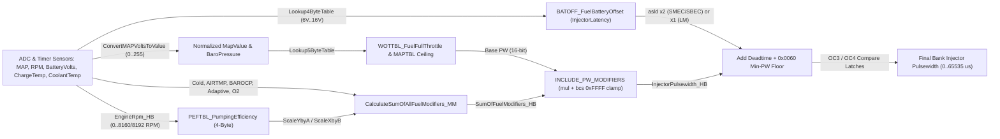

# `68HC11` / `6803` Fuel & Spark Math: `BATOFF`, `PEFTBL`, `WOTTBL` & MAP Scaling

Chrysler `1984–1987` Logic Modules (`6803` LM) and `1988–1993` `SMEC`/`SBEC` controllers (`68HC11`) compute injector pulse width and ignition dwell using deterministic `uint8`/`uint16` fixed-point math (`MUL`, shifts, and saturating clamps) with zero floating-point hardware. Every calibration modification passes bit-exact Python Behavioral Twin parity and `$8000`–`$FFFF` `m68hc11` verification before entering `staging/candidates/<build_id>/`.

> [!CAUTION]
> **Hardware Deadbolt**: All ROM math verification runs offline in `rom/models/*_twin.py` and the `m68hc11` emulator. Stock baselines (`rom/inputs/`, `rom/stock_baselines/`) are immutable, and live ECU write or flash operations remain strictly behind a human-only boundary.

---

## 1. End-to-End Fuel & Saturation Pipeline

### Fixed-Point Table & Scaling Primitives

| Routine | Tuple / Input Semantics | Output Precision | Typical Consumers |
| :--- | :--- | :--- | :--- |
| **`Lookup4ByteTable`** | `[X_break, Y_u8, slope_hi, slope_lo]` | `uint8` (`A = B`) | `BATOFF`, `PEFTBL`, `AIRTMP`, `BAROCP`, `CURVEA`/`B`/`C` |
| **`Lookup5ByteTable`** | `[X_break, Y_u16_hi, Y_u16_lo, slope_hi, slope_lo]` | `uint16` (`D = A:B`) | `WOTTBL`, `MAPTBL`, `MAPIDL`, `DWELL` (1's-complemented) |
| **`ScaleYbyA`** | `A` = `0..255` (`0.0..1.0`), `Y` = 16-bit slope | `uint16` (`Y`) | `PEFTBL` scaling (`T-SMEC_v19` `L9108`), `Lookup5ByteTable` |
| **`ScaleXbyB_addingA_intoD`** | Scales `*X` by `B/256`; adds `1.0 * (*X)` if `A=1`, clamps `0xFFFF` | `uint16` (`D`) | `AIRTMP`, adaptive trim, open-loop fraction (`L9126`) |

---

## 2. `BATOFF` / `BATOFF_FuelBatteryOffset` (Injector Voltage Deadtime)

| ECU Family | Assembly Dispatch | Table Axis & Range | Timer-Tick Scaling |
| :--- | :--- | :--- | :--- |
| **LM (`6803`)** | `T-LMv13` (`L3751`, `L3843–L3846`) | `0..16.2 V` to `0..4096 us` | `asld` (`x 2` into `Temp0`; `.tpl` Y-bytes scaled `2x` vs. SMEC) |
| **SMEC (`68HC11`)** | `T-SMEC_v19` (`L5877`, `L6213–L6224`) | `0..16.2 V` to `0..4095.94 us` | `clra; asld; asld` (`x 4` timer ticks) + `#0x0060` floor |
| **SBEC (`68HC11`)** | `T-SBEC_v3_1` (`L6360`, `L7806`, `L7036`) | `0..16.2 V` to `0..4096 us` | `clra; asld; asld` (`x 4` timer ticks) across `Bank1..4` |

- **Monotonic Voltage-Latency Physics (`6.0 V .. 16.0 V`)**: Injector solenoid coil current builds against inductance ($L/R$) and fuel-rail differential pressure. During cranking or alternator sag (`6.0–10.0 V`), slow magnetic flux rise stretches pintle/ball opening delay; at `14.0–16.0 V`, high `di/dt` pull-in shrinks deadtime.
- **Mapping `profiles/presets/injectors_batoff.json`**: LogicAIDE converts its `95` validated presets (`voltage_points_v`, `deadtime_ms`, `pressure_slope_ms_per_psi` nominal `0.0065 ms/psi`, `short_pulse_knee_ms` `1.05 ms`, and `min_linear_pw_ms` `1.35 ms`) into 4-point piecewise-linear `BATOFF` segments (`Lookup4ByteTable`), keeping commanded pulse width above the SMEC `#0x0060` minimum floor and avoiding the non-linear short-pulse knee.
- **Start-to-Run Decay Hand-off**: During cranking (`T-LMv13` `L3795–L3851`, `T-SMEC_v19` `L6829–L6842`, `T-SBEC_v3_1` `L7022–L7033`), `Factor_StartFuelDecayIntoRunFuel` (`SFDCAY`) decays cranking pulse width smoothly down to running `InjectorPulsewidth_HB` before adding `InjectorLatency` and latching `OC3`/`OC4`.

| Reference Voltage | `holley_delphi_75lb_788cc` (`deadtime_ms`) | Stock `SMEC`/`SBEC` `BATOFF` Byte (`x 16 us` tick) | Stock `LM` `BATOFF` Byte (`x 8 us` tick) |
| :---: | :---: | :---: | :---: |
| **`6.0 V`–`9.0 V`** | `2.55 -> 1.26 ms` | `0x59` -> `0x6A` (`1.696 ms` @ `0x59`) | `0x59` -> `0xD5` (`1.704 ms` @ `0x59`) |
| **`10.0 V`–`12.0 V`** | `1.02 -> 0.71 ms` | `0x81` -> `0x3B` (`0.944 ms` @ `0x81`) | `0x82` -> `0x77` (`0.952 ms` @ `0x82`) |
| **`13.0 V`–`14.0 V`** | `0.62 -> 0.54 ms` | `0xC2` -> `0x1F` (`0.496 ms` @ `0xC2`) | `0xC2` -> `0x3F` (`0.504 ms` @ `0xC2`) |
| **`15.0 V`–`16.0 V`** | `0.44 -> 0.37 ms` | `0xFA` -> `0x13` (`0.304 ms` @ `0xFA`) | `0xFB` -> `0x26` (`0.304 ms` @ `0xFB`) |

---

## 3. `PEFTBL` / `PEFTBL_PumpingEfficiency` (VE x RPM Surface)

- **Firmware Semantics**: `CalculateSumOfAllFuelModifiers_MM` (`T-SMEC_v19` `L6127`, `T-SBEC_v3_1` `L6608`, `T-LMv13` `L3933`) indexes `PEFTBL` by `EngineRpm_HB` (`0..8160` or `0..8192 min⁻¹`; `T-LMv13` pre-shifts `EngineRpm_HB` via `asld`) through `Lookup4ByteTable`. When non-zero, `ScaleYbyA` (`SMEC`/`SBEC`) or `ScaleXbyB_addingA_intoD` (`LM`) scales the accumulated `Temp0` modifier (`BAROCP`, `AIRTMP`, cold curves, adaptive memory, and O2 feedback) into `SumOfFuelModifiers_HB`.
- **Cross-Controller Architectural Differences**:
  - **Charge-Temp Polarity (`AIRTMP`)**: All three families index `AIRTMP_FuelEnrichmentFromChargeTemp` by unfiltered charge-temp NTC voltage (`0–5 V`), where **higher voltage represents colder intake air** (`1.00–1.996` enrichment factor).
  - **Selective Bank Enrichment (`LM 6803`)**: `T-LMv13` (`L3756–L3769`, `L4349–L4363`) computes `BankEnrichmentFactor` from `SBNRMP` (MAP) and `SBNRRP` (RPM) to trim individual cylinder banks (`SBNRBS_BankSelect`), whereas `SMEC`/`SBEC` apply `SumOfFuelModifiers_HB` uniformly after `PEFTBL`.
- **8V Flowbench vs. `ECC`/`EDZ` CCW Cam-Peak Shift**:
  - Normalized `28.0 inH2O` (`6.97 kPa`) bench curves (`profiles/presets/cylinder_head_flowbench.json`, [Cylinder Head Flowbench Atlas](../turbo-and-airflow/cylinder-head-flowbench-atlas.md)) show stock `2.5L` `#782` swirl castings stalling around `126.00 CFM` (`59.465 L/s`) intake at `0.50"`, whereas ported `#445` G-head and swirl heads flow `187.00–195.40 CFM`. Stock `PEFTBL` reflects this 8V SOHC volumetric curve: peaking mid-RPM (`0xE9` / `~91%`) and rolling down to `0xA6` (`~65%`) near redline.
  - Swapping a `2.0L ECC` or `2.4L EDZ`/SRT-4 `16V` DOHC head onto a `2.2L`/`2.5L` K-block (`HYBRID_MACHINING_REQUIRED`, [Drivetrain & Swaps Overview](../drivetrain-and-swaps/drivetrain-and-swaps-overview.md)) extends high-RPM breathing and rotates the `PEFTBL` peak counter-clockwise (`ccw_peftbl_cam_peak_rotation` in `profiles/examples/csx_89_neon_dohc.json`).
- **8-Bit Saturation Clamps**: Stock `PEFTBL` elements are unsigned bytes (`0..255`, representing `0..99.6%` or `0..100%`). Commanded `16V` top-end VE cannot exceed `0xFF` in stock `PEFTBL` math without wrapping or clipping; excess airflow demand must be absorbed into `WOTTBL`/`MAPTBL` or base injector scale (unless running an explicit `150%` `PEFTBL` code patch).

| Controller Calibration | `PEFTBL` Breakpoints | Peak `PEFTBL` Byte (`~%`) | High-RPM Tail Byte (`~%`) |
| :--- | :---: | :---: | :---: |
| **`T-LM` (`2.2L MTX A171`)** | `5` points (`0x4B`..`0xB8`) | `0xEC` (`~92.5%` @ `0x7D`) | `0xCD` (`~80.4%` @ `0xB8`) |
| **`T-SMEC` (`2.5L MTX B151`)** | `10` points (`0x4B`..`0xEA`) | `0xE9` (`~91.0%` @ `0x71`–`0x86`) | `0xA6` (`~64.8%` @ `0xC2`–`0xEA`) |
| **`T-SBEC` (`2.5L ATX A577`)** | `8` points (`0x32`..`0xC2`) | `0xE9` (`~91.0%` @ `0x71`–`0x86`) | `0xA6` (`~64.8%` @ `0xC2`) |

---

## 4. `WOTTBL`, Spark Dwell & `2-bar` to `3-bar` MAP Scaling Invariants

- **Dual Role of `WOTTBL_FuelFullThrottle`**: Dispatched via `Lookup5ByteTable` (`T-SMEC_v19` `L6780`/`L6792`, `T-SBEC_v3_1` `L6972`/`L6984`, `T-LMv13` `L4271`), `WOTTBL` supplies the 16-bit full-throttle MAP-indexed pulse width (`0..65535 us`) AND acts as the upper ceiling on `MAPTBL_FuelPartThrottle` (`cmpD Temp5; bls ...`). Next, `INCLUDE_PW_MODIFIERS` multiplies that 16-bit base by `SumOfFuelModifiers_HB`, clamping any carry overflow to `#0xFFFF` (`LOAD_MAX_INJ_PULSEWIDTH`).
- **Spark Dwell Complement & Anti-Dwell Math (`CalculateSparkAdvance_MM`)**: Because `Lookup5ByteTable` only supports positive slopes (`T-SMEC_v19` `L7856–L7882`), `DWELL_DwellTimeFromBatteryVoltsComp` stores the 1's-complement curve (`COMA; COMB` recovers decreasing dwell as battery voltage rises), then enforces `If (DWELL + MINADW) < DISTPW Then ADWELL = DISTPW - DWELL Else ADWELL = MINADW` to protect ignition coil saturation at high RPM.
- **`Baro`/`MAP` ADC Normalization (`ConvertMAPVoltsToValue`)**: In `T-SMEC_v19` (`L7842–L7854`), `CPU_A2DResults1` is multiplied by `MAPMULT_ScaleMAPVoltsToPresMultiplyConst`, added to `Temp5` when positive (saturated to `0xFF`), and offset by `MAPADD_ScaleMAPVoltsToPresAddConst` (saturated to `0xFF`). `SaveBaroPressure` (`L1519–L1531`) checks `BaroPressure` against `BAROHI` and `BAROLO`, substituting `BARDFT` if outside limits.
- **`2-bar` to `3-bar` MAP & Fuel Scaling Invariants**:
  - Converting `map_sensor_bar` from `2` (`~0–200 kPa`) to `3` (`~0–300 kPa`) compresses `kPa/tick` resolution by `~1.5x` within the same `0..255` `MapValue` byte and requires rescaling `MAPMULT`/`MAPADD`, `BAROHI`/`BAROLO`/`BARDFT`, `OBCONST_OverboostConstant1`, and all MAP-indexed X-axes (`WOTTBL`, `MAPTBL`, `MAPIDL`, `HMPMUL`, `PWADD`).
  - Effective injector flow scales with rail pressure and fuel specific gravity (`SG`, `0.742` gasoline reference):
    $$Q_{\text{eff}} = Q_{\text{rated}} \cdot \sqrt{\frac{P_{\text{rail}}}{P_{\text{rated}}} \cdot \frac{\text{SG}}{0.742}}$$
    Verified profile examples (`P_rail = 55.0 psi`, `P_rated = 43.5 psi`, `SG = 0.742`): `80.0 lb/hr` becomes `89.96 lb/hr` (`csx_89_neon_dohc.json`) and `46.0 lb/hr` becomes `51.72 lb/hr` (`shadow_90_sbec_t2.json`).

| Overflow / Scaling Hazard | Trigger Above OEM `2-bar` Ceiling | Guard & Mitigation |
| :--- | :--- | :--- |
| **`MapValue` / `Baro` Clipping** | Boost > `200 kPa` on `2-bar` sensor pegs ADC `0xFF` | Upgrade to `3-bar` sensor + rescale `MAPMULT`/`MAPADD`/`BAROHI` |
| **Premature Overboost Cut** | Unscaled `OBCONST_OverboostConstant1` (`0xAA` stock `T-LM`) | Recalibrate `OBCONST` and `overboost_fuel_cut_kpa` to `3-bar` ticks |
| **`INCLUDE_PW_MODIFIERS` Clamp** | High `WOTTBL` x `SumOfFuelModifiers_HB` carry (`bcs`) | Size injectors via $Q_{\text{eff}}$ so `INCLUDE_PW_MODIFIERS` stays below `0xFFFF` |
| **Spark / Knock Byte Wrap** | Unscaled MAP boost retard + knock retard underflow `0x00` | Verify floor clamps in `spark_twin.py` across Sobol sweeps |

---

## 5. Python Behavioral Twin Parity & `<= 11 ms` Deadbolt Gate

- **Bit-Exact Twin (`rom/models/*_twin.py`)**: `fuel_twin.py`, `spark_twin.py`, and `boost_twin.py` mirror 68HC11 `MUL`, `IDIV`, carry flags, and saturating clamps in explicit `uint8`/`uint16` Python integer arithmetic (`0` LSB tolerance against `m68hc11` `$8000`–`$FFFF` execution).
- **Monte Carlo & Staging Gate**: `scipy.stats.qmc.Sobol` and `Optuna` campaigns perturb battery sag (`9.5–15.0 V`), `ACT` heat-soak (`0..+95 °C`), `±10 kPa` MAP steps, and `PEFTBL`/`WOTTBL` edge indices. Candidate builds land solely in `staging/candidates/<build_id>/` after passing SHA-256 round-trip checks, `$FFC0`–`$FFFF` vector checks, zero `8-bit` carry/wrap defects, sequential `uv run pytest -n 0` parity tests, and the **`<= 11.0 ms` (`<= 22,000` E-cycles @ `2.0 MHz` E-clock)** loop budget.
- **Verification Entrypoints**:
  - `uv run logicaide sim manifest-sync` — regenerates `tags` linking `.asm` labels to `rom/models/*_twin.py`.
  - `uv run logicaide heritage sync-wiki --validate-only` — validates YAML frontmatter, Mermaid ASTs, links, and cleanroom rules.

### Cross-Controller Symbol & Dispatch Summary

| Symbol / Routine | `T-LMv13` (`6803`) | `T-SMEC_v19` (`68HC11`) | `T-SBEC_v3_1` (`68HC11`) |
| :--- | :--- | :--- | :--- |
| **`BATOFF_FuelBatteryOffset`** | `L3751` (disp.), `L3845` (`x2`) | `L5877` (disp.), `L6215` (`x4`) | `L6360` / `L7806` (disp.), `L7038` (`x4`) |
| **`PEFTBL_PumpingEfficiency`** | `L3933` (`EngineRpm_HB << 1`) | `L6127` (`ScaleYbyA`) | `L6608` (`ScaleYbyA`) |
| **`WOTTBL_FuelFullThrottle`** | `L4271` (WOT + cap `L4312`) | `L6780` (WOT + cap `L6792`) | `L6972` (WOT + cap `L6984`) |
| **`CalculateSumOfAllFuelModifiers_MM`** | `L3853`–`L3990` | `L5929`–`L6176` | `L6412`–`L6618` |

## Related Pages

- [ROM & SCI Overview](rom-and-sci-overview.md) | [SCI 7812.5 & 62,500 Baud Protocol](sci-7812-and-62500-protocol.md)
- [Cylinder Head Flowbench Atlas](../turbo-and-airflow/cylinder-head-flowbench-atlas.md) | [Drivetrain & Swaps Overview](../drivetrain-and-swaps/drivetrain-and-swaps-overview.md)
