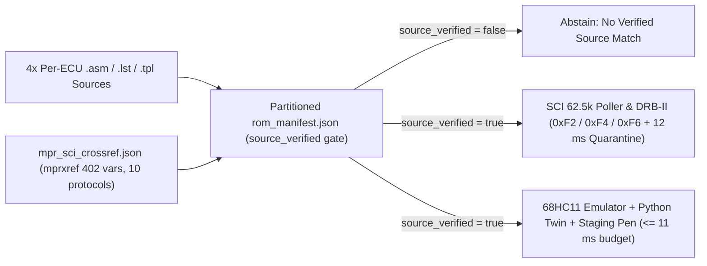

# ROM Architecture & SCI Protocol Overview

This category documents Chrysler `6803` (`LM`) and `68HC11` (`SMEC`/`SBEC`) ROM structure (`$8000`–`$FFFF`), `976`/`7812.5` to `62,500` baud Serial Communications Interface (SCI) polling, `DRB-II` command dispatch, manifest-gated RAM watchlists, and bit-exact Python Behavioral Twins.

> [!CAUTION]
> **Hardware Deadbolt**: LogicAIDE enforces strictly read-only SCI polling (`0xF2`, `0xF4`, `0xF6`) and deterministic offline `m68hc11` simulation. Live vehicle ECU write/flash sequences and modifications to stock ROM baselines (`rom/inputs/`, `rom/stock_baselines/`) are prohibited.

---

## Manifest-Verified Read & Simulation Pipeline

Because zero-page RAM offsets shift across `LM`, `SMEC T1`, `SMEC T2`, and `SBEC` builds, LogicAIDE forbids cross-mask offset guessing and requires every live poll or twin run to pass through a partitioned `rom_manifest.json` corroborated by `.asm`/`.sym` equates.

---

## Partitioned Per-ECU Manifests (`4` Reference ROM IDs)

| Partitioned `rom_id` | MCU & Image Scope | Key SCI / DRB & Calibration Coverage |
| :--- | :--- | :--- |
| **`smec_88_89_v19`** | `68HC11` (`32 KB`, `$8000`–`$FFFF`) | `XmitRequestedRamLocation` (`0xF2` zero-page / `0xFE`), `DRBFunctionTable` (`0x10`–`0x1C`), `26` `.byte` `DRBMemoryTable` entries, `BATOFF`/`PEFTBL`/`WOTTBL`. |
| **`sbec_90_93_v3_1`** | `68HC11` (`32 KB`, `$8000`–`$FFFF`) | `0xF2` zero-page + `0xF6` `FastDataOutputAddressTable` (`16-bit .word`), `SetupHiSpeedDataTransfer`, `44` `.word` `DRBMemoryTable` pointers, `BATOFF`/`PEFTBL`/`WOTTBL`. |
| **`lm_86_87_v13`** | `6803` (`8 KB` / `16 KB` LM) | `976` -> `7680`/`7812.5` baud `0x12` wake, `ToggleSerialClock_MM`, `$2000`/`ADC0808` I/O mapping, `BATOFF`/`PEFTBL`/`WOTTBL` routines kept distinct from `68HC11`. |
| **`lm_86_glhs_v1`** | `6803` (`8 KB` / `16 KB` GLHS) | `1986` Shelby GLHS `6803` Logic Module calibration layout (`PEFTBL_PumpingEfficiency_FromRpm`, `BATOFF`, `WOTTBL`), strictly isolated from SMEC/SBEC offsets. |

---

## Verified Guides in This Category

- [SCI 7812.5 & 62,500 Baud Protocol](sci-7812-and-62500-protocol.md) — Two-speed `8N1` bus framing, `0x12` `SetupHiSpeedDataTransfer`, SMEC `0xF2` vs. SBEC `0xF6` `FastDataOutputAddressTable`, `LM` `976` baud wake, and `12 ms` Dead-Cell Quarantine.
- [DRB-II Commands & Prompts](drb-ii-commands-and-prompts.md) — `DRBFunctionTable` (`0x10`–`0x1C`/`0x23`), `DRBMemoryTable`, `mprxref` `402`-variable / `10`-protocol cross-reference, and `ERR0`–`ERR3` / `SW1`–`SW2` / `PIA1`–`PIA2` / `IPL1`–`IPL2` bitfields.
- [Fuel & Spark Math: BATOFF, PEFTBL & WOTTBL](fuel-and-spark-math-peftbl-wottbl.md) — `6803` / `68HC11` `uint8`/`uint16` fixed-point fuel pulse width, dwell, `2-bar -> 3-bar` MAP scaling invariants, and `$FFC0`–`$FFFF` / `<= 11 ms` safety gates.

## Related Categories

- [Wiki Home](../Home.md)
- [ECU Families Overview](../ecu-families/ecu-families-overview.md)
- [Hardware Bench Overview](../hardware-bench/hardware-bench-overview.md)
