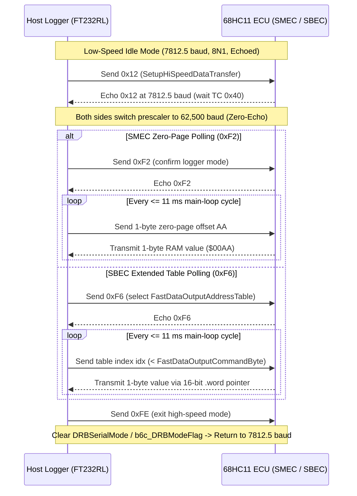

# Chrysler SCI `7812.5` & `62,500` Baud Serial Protocol

Chrysler's Serial Communications Interface (SCI) provides a two-speed asynchronous `8N1` (`1` start, `8` data, no parity, `1` stop) diagnostic bus on `68HC11`-based `SMEC` and `SBEC` controllers, plus an earlier `6803` variant on `1984–1987` Logic Modules (`LM`).

> [!CAUTION]
> **Hardware Deadbolt**: LogicAIDE operates strictly read-only over the SCI bus (`0xF2` / `0xF4` / `0xF6` RAM reads and `0x10`–`0x11` fault queries). Live ECU flash/write sequences, serial bootloader injection, and direct modifications to stock ROM baselines (`rom/inputs/`, `rom/stock_baselines/`) are prohibited.

---

## 1. Physical Layer, Clocking & Idle Diagnostic Rate (`7812.5` Baud)

On `1988–1993` `68HC11` controllers running an `8.0 MHz` crystal (`2.0 MHz` E-clock), the on-chip SCI UART (`$102B`–`$102F`: `CPU_SerialBaudRate`, `CPU_SerialStatus`, `CPU_SerialData`) derives exact `7812.5` baud (`BAUDLO_DRBBaudRateLo = 0x22`) and `62,500` baud (`BAUDHI_DRBBaudRateHi = 0x01`) rates. An `FT232RL` USB-UART interface (`3 MHz / N` integer/sub-integer clock divider) matches both `7812.5` and `62,500` baud with `0%` bit-timing error when paired with galvanic USB isolation and `1 kΩ`–`4.7 kΩ` / `5.1 V` line clamping.

### Harness Pinout & Controller Variants (`YEAR / CALIBRATION VERIFICATION REQUIRED`)

| Controller Family | SCI TX (`ECU -> Host`) | SCI RX (`Host -> ECU`) | Idle / Wake Rate | High-Speed Rate |
| :--- | :--- | :--- | :--- | :--- |
| **LM (`6803`, `1984–87`)** | Red Conn. `Pin 11` (`DK21`, `PK`) | Red Conn. `Pin 13` (`DK20`, `LG`) | `976` baud `8N1` wake (`0x12`) | `7680` / `7812.5` baud (`get_byte` 6-byte readback) |
| **SMEC (`68HC11`, `1988–89`)** | `60-way` `Pin 25` (`D21`, `PK`) or diag pigtail | `60-way` `Pin 45` (`D20`, `LG`) or diag pigtail | `7812.5` baud `8N1` (echoed) | `62,500` baud `8N1` (`0xF2` zero-page) |
| **SBEC (`68HC11`, `1990–93`)** | `60-way` `Pin 25` (`D21`, `PK`) | `60-way` `Pin 45` (`D20`, `LG`) | `7812.5` baud `8N1` (echoed) | `62,500` baud `8N1` (`0xF2` + `0xF6` table) |

- **Early SMEC Harness Caveat**: Early `1988–89` Turbo I/II harnesses can leave `Pin 25` unpopulated or assign `Pin 45` to `C20` (A/C switch/clutch), routing SCI exclusively to the under-hood diagnostic connector. Always verify FSM continuity before connecting an adapter.
- **LM `6803` Early Wake (`sample.cpp`, `T-LMv13-2017.asm`)**: `6803` LM firmware manages SCI through `CPU_SCI_ModeControlReg` (`$0010`), `CPU_SCI_TxRxCntrlReg` (`$0011`), `CPU_SCI_RxDataReg` (`$0012`), and `CPU_SCI_TxDataReg` (`$0013`) with `ToggleSerialClock_MM`. Host initialization opens at `976` baud (`8N1`), transmits `0x12` twice, switches to `7680` (`7812.5` nominal) baud, and awaits echoed `0x12` before single-byte address polling (`get_byte`).

### Low-Speed DRB Handshake (`0x10`–`0x17` & `0x12` Transition)

In low-speed idle mode (`7812.5` baud), `DRBIISerialCommunications_MM` echoes every accepted command byte back to the host before executing `DRBFunctionTable` handlers (`0x10`–`0x17` core commands: `0x10` Read Stored DTCs, `0x11` Error Bits, `0x12` High-Speed Switch, `0x13` Actuator Test Mode, `0x14` Diagnostic RAM/Real-Time Read, `0x16` ECU ID, `0x17` Clear DTCs). Sending `0x12` invokes `SetupHiSpeedDataTransfer`:
1. Sets the `FastSerial` bit (`0x80`) in `*DRBSerialMode` and clears `DRBPointer1`.
2. Polls `CPU_SerialStatus` bit `0x40` (`TC`, Transmit Complete) until the `0x12` echo finishes shifting out at `7812.5` baud.
3. Writes `0x01` (`BAUDHI_DRBBaudRateHi`) to `CPU_SerialBaudRate`, immediately locking the UART to `62,500` baud (`16 µs/bit`, `~160 µs/byte`).

---

## 2. High-Speed SCI Mode (`62,500` Baud, Zero-Echo)

Once switched to `62,500` baud, the ECU services one request per `<= 11 ms` (`<= 22,000` E-cycles @ `2.0 MHz`) main-loop / timer interrupt pass via `XmitRequestedRamLocation`.

### UART Error Gate & Frame Mechanics

Before reading any RAM cell, `XmitRequestedRamLocation` inspects `CPU_SerialStatus`:
- **Framing / Noise / Overrun (`bita #0x0e`)**: If any UART error flag is set, the ECU performs a dummy read of `CPU_SerialData` to clear the status flag and returns without transmitting, preventing garbage echoes or pointer corruption.
- **Receive Data Register Full (`bita #0x20`)**: If `RDRF` is clear, no byte is pending and the routine exits cleanly for that `<= 11 ms` cycle.

### SMEC vs. SBEC High-Speed Command Semantics

| Controller | Mode Entry / Selector | Address Resolution | Exit Command |
| :--- | :--- | :--- | :--- |
| **SMEC (`T-SMEC_v19.asm`, `L1417–L1436`)** | `0xF2` echoes `0xF2` as logger-mode confirmation (always zero-page direct). | Host sends 1-byte `<offset>` (`0x00`–`0xFF`, excluding `0xF2`/`0xFE`); ECU loads `X = #0x0000 + offset` and transmits `$00xx` with **zero echo** (for example, offset `0xAA` returns RAM cell `$00AA`). | `0xFE` clears `DRBSerialMode` (`FastSerial \| TestType3 \| TestType2`) to return to `7812.5` baud DRB mode (falling through once to transmit `$00FE`). |
| **SBEC (`T-SBEC_v3_1.asm`, `L1181–L1225`)** | `0xF2` clears `b6c_DRBModeFlag` (zero-page `$00xx` mode) and echoes `0xF2`. `0xF6` sets `b6c_DRBModeFlag` (`FastDataOutputAddressTable` mode) and echoes `0xF6`. | In `0xF2` mode: `X = #0x0000 + offset`. In `0xF6` mode: checks `idx < FastDataOutputCommandByte` (else returns `0xFF`), indexes `16-bit .word` pointer `FastDataOutputAddressTable[idx * 2]`, and transmits `[X]`. | `0xFE` clears `DRBSerialMode` (`0xB0`) and `b6c_DRBModeFlag`, exiting cleanly back to `7812.5` baud. LogicAIDE also supports `0xF4` virtual table selectors where mapped by `rom_manifest.json`. |

---

## 3. SCI Session Sequence (`7812.5` -> `62,500` -> `0xFE`)

---

## 4. Cleanroom Framing, Dead-Cell Quarantine & Strict Source Gate

Polling an unmapped or disabled RAM offset on `SMEC`/`SBEC` firmware can cause the dispatcher to drop the reply (`NO_REPLY`), stalling naive blocking readers and introducing timestamp skew into `load_cell_rollups`. LogicAIDE enforces two deterministic invariants:

1. **Dead-Cell Timeout Quarantine (`12 ms` Probe Gate)**:
   - Immediately after the `0x12` transition, each configured `(FX, AA)` offset is probed in isolation with `probe_timeout_ms = 12`.
   - **Startup Demotion**: `2` consecutive `NO_REPLY` timeouts promote the offset to `QUARANTINED` (`STARTUP_PROBE_TIMEOUT`).
   - **Runtime Demotion**: `3` consecutive timeouts during live logging demote the active offset to `QUARANTINED` (`RUNTIME_TIMEOUT`) and flush the UART RX buffer to prevent `1`-byte frame slip.
   - **Null Preservation**: Quarantined channels are removed from the hot poll ring and recorded as explicit `null` in 30s Parquet chunks—never `0` or last-value hold.
2. **Strict `No Verified Source Match` Abstention**:
   - LogicAIDE never guesses `0xF2` / `0xF4` / `0xF6` RAM offsets across calibration masks. Every polled offset MUST resolve from the vehicle's verified `rom_manifest.json` (`source_verified: true`) corroborated by `.asm` (`DRBMemoryTable`, `FastDataOutputAddressTable`, zero-page equates) or `.sym` definitions; uncorroborated queries return `No Verified Source Match`.

---

## Related Pages

- [DRB-II Commands, 10-Protocol XREF & Fault Registers](drb-ii-commands-and-prompts.md)
- [ROM Architecture & SCI Protocol Overview](rom-and-sci-overview.md)
- [Wiring Bulkheads & Diagnostics Overview](../wiring-and-diagnostics/wiring-and-diagnostics-overview.md)
- [Wiki Home](../Home.md)
