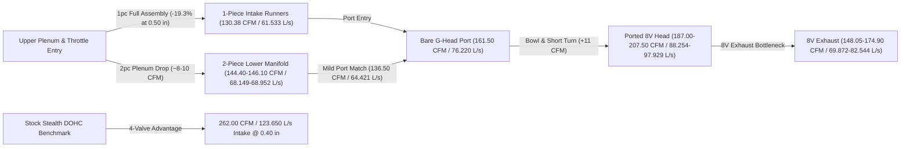

# Cylinder Head & Intake Manifold Flowbench Atlas (`28.0 inH2O` / `6.97 kPa`)

All volumetric bench measurements are normalized at **`28.0 inH2O` (`6.97 kPa`)** test depression using the **NIST SP 811** conversion (`1 CFM = 0.47194745 dm³/s = L/s`). Data mirrors `profiles/presets/cylinder_head_flowbench.json` and the cleanroom Tier 2 digest in `knowledge/tier2_verified/g_head_flowbench.md`.

## Head-vs-Manifold Airflow Bottleneck Flow

## 8V Swirl, G-Head (`#445` / `#782` Porting) & DOHC Comparison

- **Stock Swirl (`#782`) vs. Ported Swirl**: A stock `2.5L` swirl head stalls early (`126.00 CFM / 59.465 L/s` intake and `116.55 CFM / 55.005 L/s` exhaust at `0.50"`). Community porting raises swirl-head flow dramatically to `195.40 CFM / 92.219 L/s` intake (`210.50 CFM / 99.345 L/s` at `0.60"`) and `174.90 CFM / 82.544 L/s` exhaust at `0.50"`.
- **G-Head (`#445` / Open-Chamber) Porting Stages**:
  - `Bowl & Short Turn Porting` lifts intake from `183.00 CFM / 86.366 L/s` to `194.00 CFM / 91.558 L/s` at `0.50"` while raising exhaust sharply from `103.95 CFM / 49.059 L/s` to `148.05 CFM / 69.872 L/s` (`+42.4%`).
  - `Full Rework (Big Valves)` and `Community Ported G-Head (2.5L Bench)` focus gains into low- and mid-lift (`68.31 CFM / 32.239 L/s` intake at `0.10"`, `151.50 CFM / 71.500 L/s` exhaust at `0.50"`).
- **DOHC Benchmark**: `Stock Stealth DOHC` achieves `262.00 CFM / 123.650 L/s` intake at `0.40"` and `219.00 CFM / 103.356 L/s` exhaust at `0.50"`.

| Configuration (`28.0 inH2O` / `6.97 kPa`) | Intake `0.20"` (`CFM / L/s`) | Intake `0.40"` (`CFM / L/s`) | Intake `0.50"` (`CFM / L/s`) | Exhaust `0.40"` (`CFM / L/s`) | Exhaust `0.50"` (`CFM / L/s`) |
| :--- | :---: | :---: | :---: | :---: | :---: |
| Stock Swirl (`2.5L` Bench) | `74.25 / 35.042` | `118.80 / 56.067` | `126.00 / 59.465` | `110.25 / 52.032` | `116.55 / 55.005` |
| Community Ported Swirl Head | `107.80 / 50.876` | `177.20 / 83.629` | `195.40 / 92.219` | `160.00 / 75.512` | `174.90 / 82.544` |
| LW Swirl Head | `119.88 / 56.577` | `191.40 / 90.331` | `—` | `161.40 / 76.172` | `—` |
| Stock Head (`G-Head` Bench) | `103.95 / 49.059` | `161.86 / 76.389` | `183.00 / 86.366` | `103.95 / 49.059` | `103.95 / 49.059` |
| G-Head Bowl & Short Turn Porting | `103.95 / 49.059` | `172.26 / 81.298` | `194.00 / 91.558` | `133.87 / 63.180` | `148.05 / 69.872` |
| G-Head Full Rework (Big Valves) | `112.86 / 53.264` | `175.68 / 82.912` | `187.00 / 88.254` | `141.75 / 66.899` | `151.50 / 71.500` |
| KMP Flowbench Corrected | `109.95 / 51.891` | `181.86 / 85.828` | `207.50 / 97.929` | `133.95 / 63.217` | `135.95 / 64.161` |
| Stock Stealth DOHC | `179.00 / 84.479` | `262.00 / 123.650` | `256.00 / 120.819` | `216.00 / 101.941` | `219.00 / 103.356` |

## `1-Piece` vs. `2-Piece` Intake Manifold Restriction Curves

Flowing the G-Head (`161.50 CFM / 76.220 L/s` bare at `0.50"`) through factory manifolds exposes the primary upper-end airflow ceiling on `2.2L`/`2.5L` turbo builds:

- **`1-Piece` Intake**: Drops `0.50"` peak flow to `130.38 CFM / 61.533 L/s` (`-19.3%`), with mild porting improving `0.10"` low-lift (`49.70 / 23.456` vs. `44.10 / 20.813`) without raising `0.50"` peak (`130.20 / 61.448`).
- **`2-Piece` Intake**: Outflows the `1-piece` above `0.20"`, reaching `133.70 CFM / 63.099 L/s` as-cast and `136.50 CFM / 64.421 L/s` mildly ported (`-15.5%` vs. bare head).
- **Lower-Runner Isolation**: Testing the `2-piece` lower manifold alone yields `144.40 CFM / 68.149 L/s` (stock) and `146.10 CFM / 68.952 L/s` (mildly ported) at `0.50"`, confirming roughly half of total `2-piece` manifold loss occurs in the upper plenum/neck.

| Lift (in) | G-Head Only (`CFM / L/s`) | `1pc` Intake (`CFM / L/s`) | Mild `1pc` (`CFM / L/s`) | `2pc` Lower (`CFM / L/s`) | Mild `2pc` Lower (`CFM / L/s`) | `2pc` Full (`CFM / L/s`) | Mild `2pc` Full (`CFM / L/s`) |
| :---: | :---: | :---: | :---: | :---: | :---: | :---: | :---: |
| `0.10` | `46.20 / 21.804` | `44.10 / 20.813` | `49.70 / 23.456` | `46.10 / 21.757` | `51.20 / 24.164` | `49.40 / 23.314` | `49.40 / 23.314` |
| `0.20` | `93.20 / 43.986` | `85.20 / 40.210` | `88.00 / 41.531` | `88.30 / 41.673` | `92.30 / 43.561` | `89.00 / 42.003` | `89.00 / 42.003` |
| `0.30` | `128.10 / 60.456` | `108.90 / 51.395` | `110.60 / 52.197` | `116.90 / 55.171` | `120.40 / 56.822` | `113.40 / 53.519` | `114.80 / 54.180` |
| `0.40` | `150.50 / 71.028` | `121.50 / 57.342` | `122.50 / 57.814` | `132.40 / 62.486` | `135.20 / 63.807` | `126.00 / 59.465` | `128.80 / 60.787` |
| `0.50` | `161.50 / 76.220` | `130.38 / 61.533` | `130.20 / 61.448` | `144.40 / 68.149` | `146.10 / 68.952` | `133.70 / 63.099` | `136.50 / 64.421` |

## `2.5L` 4-Cylinder Volumetric Efficiency (VE) Reference Sweep

The accompanying VE reference (`2.5 L`, `4 cyl`, `52.3 lb/hr @ 55.0 psi` injectors, `45.0 psi` static `1:1` FPR) tracks airflow efficiency across `1000–6000 RPM`:

- VE climbs from `0.3604` (`1000 RPM`, `0.0 psi` MAP) to `0.8745` (`2000 RPM`, `1.0 psi` MAP), holds a plateau of `0.8548–0.8882` across `3000–5000 RPM` at `12.0–15.0 psi` boost (peaking at **`0.8882` @ `5000 RPM`**, `66.5%` duty cycle), and tapers to **`0.8342` @ `6000 RPM`** (`75.0%` duty cycle) due to manifold/head flow choking.

| RPM | MAP (`psi`) | IAT (`degF`) | PW (`ms`) | AFR (`:1`) | Rail (`psi`) | Duty Cycle | Calculated VE |
| :---: | :---: | :---: | :---: | :---: | :---: | :---: | :---: |
| `1000` | `0.0` | `85` | `3.00` | `14.7` | `45.0` | `0.025` | `0.3604` |
| `2000` | `1.0` | `90` | `8.00` | `14.0` | `46.0` | `0.133` | `0.8745` |
| `3000` | `12.0` | `108` | `12.46` | `13.0` | `57.0` | `0.311` | `0.8548` |
| `4000` | `15.0` | `120` | `16.00` | `11.0` | `60.0` | `0.533` | `0.8748` |
| `5000` | `15.0` | `130` | `15.97` | `11.0` | `60.0` | `0.665` | `0.8882` |
| `6000` | `15.0` | `130` | `15.00` | `11.0` | `60.0` | `0.750` | `0.8342` |

## Related Documentation

- [Turbocharger & Airflow Engineering Overview](turbo-and-airflow-overview.md)
- [Wiki Home](../Home.md)
