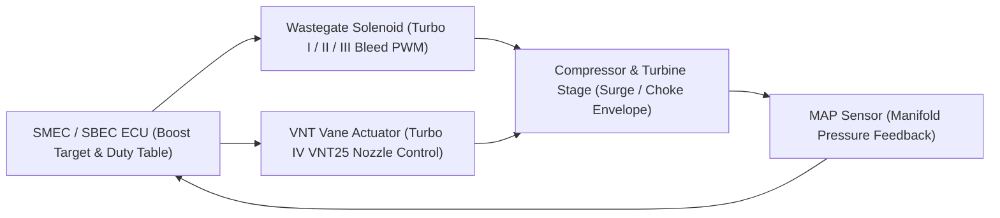

# Chrysler OEM Turbocharger Reference

Factory Chrysler `2.2L` and `2.5L` K-block turbocharged applications span Garrett `T03` / `TB03`, Mitsubishi `TE04H`, and Garrett `VNT25` assemblies. The dimensional table below preserves the exact verified measurements from the Wave A `turbodata_2010_10_27` baseline under **NIST SP 811** dual-unit formatting (`in` and `mm`), with unpopulated baseline cells explicitly marked `—`.

## Verified Wheel & Housing Dimensions (`CHRYSLER OEM TURBOS`)

| Turbo Model | Comp. Inducer (`in` / `mm`) | Comp. Exducer (`in` / `mm`) | Comp. Trim | Comp. A/R | Turb. Major (`in` / `mm`) | Turb. Exducer (`in` / `mm`) | Turb. A/R | Flange |
| :--- | :--- | :--- | :--- | :--- | :--- | :--- | :--- | :--- |
| **`T03 Garrett (T-II)`** | `1.654 in` / `42.00 mm` | `2.362 in` / `60.00 mm` | `—` | `0.42` | `1.890 in` / `48.00 mm` | `—` | `0.48` | `T03` |
| **`TB03 Garrett (T-III)`** *(source: `TB03 Garret (T-III)`)* | `1.772 in` / `45.00 mm` | `2.362 in` / `60.00 mm` | `—` | `0.52` | `1.890 in` / `48.00 mm` | `—` | `0.48` | `T03` |
| **`TE04H Mitsu`** | `1.496 in` / `38.00 mm` | `2.087 in` / `53.00 mm` | `—` | `—` | `2.008 in` / `51.00 mm` | `—` | `—` | `T04` |
| **`VNT25 Garrett` (36 mm)** | `1.417 in` / `36.00 mm` | `2.047 in` / `52.00 mm` | `—` | `0.48` | `—` | `—` | `0.64` | `—` |
| **`VNT25 Garrett` (40 mm)** | `1.575 in` / `40.00 mm` | `2.047 in` / `52.00 mm` | `—` | `—` | `—` | `—` | `—` | `—` |

> [!NOTE]
> **Baseline Completeness & `TD04LR` Scope**: Cells marked `—` (including compressor trim, turbine exducer, and `VNT25` 40 mm A/R and flange fields) are blank in `turbodata_2010_10_27` and are left unpopulated rather than inferred. Chrysler `TD04LR` / `SRT-4` (`2.4L EDZ`) OEM rows are not present in `turbodata_2010_10_27` and require an independent `Tier 1`/`Tier 2` source before entry.

## Model-Year Application & Hardware Spotter's Guide (`1984–1993`)

| Application & Years | Turbo Family | Stock Boost / Output | Exhaust Outlet & Flange | Hardware & Packaging Notes (`TheDodgeGarage` / `Allpar (pre-2017 archive)`) |
| :--- | :--- | :--- | :--- | :--- |
| **`1984` `Turbo I`** | Garrett `T03` | `7.5 psi` (`142 hp`) | `2.25 in` donut / small flange | Dual-port wastegate actuator; pneumatic boost regulation. |
| **`1985–1987` `Turbo I`** | Garrett `T03` | `7–10 psi` (`146 hp`) | `2.25 in` donut / small flange | Single-port ECU-pulsed wastegate (`1985` added `9 psi` transient overboost). |
| **`1986 GLHS / 1987–1989` `Turbo II`** | Garrett `T03` | `12 psi` (`174 hp` / `200 lb-ft`) | `87`: `2.25 in` small; `88`: `2.25 in` large; `89`: `2.50 in` large | Notched turbine housing clears `#3` intake runner; no EGR port (`1987+`). `1986–1988` actuator springs blow open near `14 psi`; `1989` uses stiffer spring. |
| **`1988–1993` `Turbo I` (`2.2L`/`2.5L`)** | Mitsubishi `TE04H` | `7–9 psi` (`150 hp` `2.5L`) | `88`: `2.25 in` large; `89–93`: `2.50 in` large | Same exhaust manifold bolt pattern as `T03`, but distinct coolant/oil lines, smaller shaft bearings, and restrictive turbine outlet. |
| **`1989–1990` `Turbo IV` (`CSX`/production)** | Garrett `VNT25` | `12 psi` (`174 hp` / `225 lb-ft`) | `2.50 in` donut / large flange | `12` movable exhaust vanes (`0.64` A/R) eliminate wastegate bypass; paired with low-restriction intercooler. |
| **`1991–1993` `Turbo III` (`16V` DOHC)** | Garrett `TB03` | `224 hp` (`EDS` `16V`) | `2.50 in` donut / universal `T3` flange | `45.00 mm` inducer + `0.52` comp A/R; universal `T3` turbine flange does **not** bolt to SOHC manifolds. |

- **Turbine & Manifold Nickel Markings (`M26` / `M3` / `M4` / `N`)**: Garrett turbine housings and exhaust outlets carry cast nickel-alloy codes indicating thermal-cycle durability: early `M26` (lower nickel, crack-prone), mid-production `M3` (`1987–1988` / rebuilt `1989 T-II`), and high-nickel `M4` (`VNT25` and `Turbo III` `TB03`). `VNT` exhaust manifolds carry a large cast **`N`** denoting elevated nickel content for high exhaust gas temperatures.

## Boost-Control Topology (`Turbo I / II / III / IV`) & Field Margins

- **Wastegate Solenoid Duty Cycle (`Turbo I / II / III`)**:
  - `LM`, `SMEC`, and `SBEC` controllers regulate manifold pressure above mechanical spring crack pressure (`~5–7 psi` direct manifold feed) by pulsing a wastegate bleed solenoid (`PWM` duty cycle) referenced against the `MAP` sensor target table.
  - Higher compressor inducer sizing (`42.00 mm` on `T03` `T-II` and `45.00 mm` on `TB03` `T-III`, both sharing a `60.00 mm` exducer and `48.00 mm` `0.48` A/R `T03` turbine) trades transient spool speed for higher choke-flow headroom at upper RPM.
- **VNT Vane Actuator Control (`Turbo IV` `VNT25`)**:
  - Unlike a bypass wastegate, the `VNT25` modulates exhaust nozzle vane angle via an ECU-commanded solenoid and pneumatic actuator (`0.64` A/R housing on the `36.00 mm` variant), narrowing effective nozzle area at low exhaust flow for rapid spool and opening vanes at high load to bound drive pressure and shaft speed.
- **Grainger Valve & Field Boost Envelopes (`Gus Mahon` / `TheDodgeGarage` / `Allpar (pre-2017 archive)`)**:
  - Mechanical **Grainger valves** (ball-and-spring pop-off pressure regulators placed in the wastegate actuator line) hold the wastegate shut until the calibrated spring crack threshold is reached, sharpening boost rise vs. factory bleed plumbing.
  - Documented field boost ceilings (with intercooling, race fuel, or alcohol injection, well above factory `MAP` / `Code 45` limits): `20+ psi` (`1984–1987` `T-I` Garrett), `20–21 psi` (`TE04H`), `28–30 psi` (`1987–1989` `T-II` Garrett).
- **`Turbo I` -> `Turbo II` Conversion Wiring & Plumbing Rules**:
  - Swap intake/exhaust manifolds, turbo, throttle body, injectors, and same-year `T-II` ECU together; never run `T-I` injectors with a `T-II` calibration. Extending a `T-I` harness to `T-II` requires adding the extra `2` wires for the `4`-wire `AIS` stepper motor, extending the `ACT` (`K13`) sensor leads, and carefully bending the `T-I` oil-feed line around the `T-II` intake plenum.

## Related Pages

- [Turbo & Airflow Overview](turbo-and-airflow-overview)
- [8V Cylinder Heads, Camshafts & Turbo Builds](eight-valve-heads-camshafts-and-turbo-builds)
- [Cylinder Head Flowbench Atlas](cylinder-head-flowbench-atlas)
- [TurboCalc Compressor Catalog](turbocalc-compressor-catalog)
- [ECU Families Overview](ecu-families-overview)
- [Wiki Home](Home)
