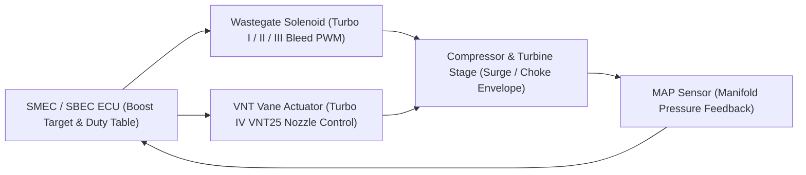

# Chrysler OEM Turbocharger Reference

Factory Chrysler `2.2L` and `2.5L` K-block turbocharged applications span Garrett `T03` / `TB03`, Mitsubishi `TE04H`, and Garrett `VNT25` assemblies. The dimensional table below preserves the exact verified measurements from the Wave A `turbodata_2010_10_27` baseline under **NIST SP 811** dual-unit formatting (`in` and `mm`), with unpopulated baseline cells explicitly marked `—`.

## Verified Wheel & Housing Dimensions (`CHRYSLER OEM TURBOS`)

| Turbo Model | Comp. Inducer (`in` / `mm`) | Comp. Exducer (`in` / `mm`) | Comp. Trim | Comp. A/R | Turb. Major (`in` / `mm`) | Turb. Exducer (`in` / `mm`) | Turb. A/R | Flange |
| :--- | :--- | :--- | :--- | :--- | :--- | :--- | :--- | :--- |
| **`T03 Garrett (T-II)`** | `1.654 in` / `42.00 mm` | `2.362 in` / `60.00 mm` | `—` | `0.42` | `1.890 in` / `48.00 mm` | `—` | `0.48` | `T03` |
| **`TB03 Garrett (T-III)`** *(source: `TB03 Garret (T-III)`)* | `1.772 in` / `45.00 mm` | `2.362 in` / `60.00 mm` | `—` | `0.52` | `1.890 in` / `48.00 mm` | `—` | `0.48` | `T03` |
| **`TE04H Mitsu`** | `1.496 in` / `38.00 mm` | `2.087 in` / `53.00 mm` | `—` | `—` | `2.008 in` / `51.00 mm` | `—` | `—` | `T04` |
| **`VNT25 Garrett` (36 mm)** | `1.417 in` / `36.00 mm` | `2.047 in` / `52.00 mm` | `—` | `0.48` | `—` | `—` | `0.64` | `—` |
| **`VNT25 Garrett` (40 mm)** | `1.575 in` / `40.00 mm` | `2.047 in` / `52.00 mm` | `—` | `—` | `—` | `—` | `—` | `—` |

> [!NOTE]
> **Baseline Completeness & `TD04LR` Scope**: Cells marked `—` (including compressor trim, turbine exducer, and `VNT25` 40 mm A/R and flange fields) are blank in `turbodata_2010_10_27` and are left unpopulated rather than inferred. Chrysler `TD04LR` / `SRT-4` (`2.4L EDZ`) OEM rows are not present in `turbodata_2010_10_27` and require an independent `Tier 1`/`Tier 2` source before entry.

## Boost-Control Topology (`Turbo I / II / III / IV`)

- **Wastegate Solenoid Duty Cycle (`Turbo I / II / III`)**:
  - `LM`, `SMEC`, and `SBEC` controllers regulate manifold pressure above mechanical spring crack pressure by pulsing a wastegate bleed solenoid (`PWM` duty cycle) referenced against the `MAP` sensor target table.
  - Higher compressor inducer sizing (`42.00 mm` on `T03` `T-II` and `45.00 mm` on `TB03` `T-III`, both sharing a `60.00 mm` exducer and `48.00 mm` `0.48` A/R `T03` turbine) trades transient spool speed for higher choke-flow headroom at upper RPM.
- **VNT Vane Actuator Control (`Turbo IV` `VNT25`)**:
  - Unlike a bypass wastegate, the `VNT25` modulates exhaust nozzle vane angle via an ECU-commanded solenoid and pneumatic actuator (`0.64` A/R housing on the `36.00 mm` variant), narrowing effective nozzle area at low exhaust flow for rapid spool and opening vanes at high load to bound drive pressure and shaft speed.
- **Compressor Surge & Choke Margins on `SMEC` / `SBEC`**:
  - Smaller inducers (`36.00 mm` `VNT25` and `38.00 mm` `TE04H`) deliver strong low-RPM transient response on `2.2L` / `2.5L` `8V` engines, while reaching compressor choke earlier at elevated RPM and pressure ratio than the `42.00 mm` `T03` or `45.00 mm` `TB03` (`16V` `Turbo III`) wheels.
  - Aggressive closed-loop duty or rapid throttle lift at high pressure ratio can push low-mass-flow points toward the compressor surge line; `SMEC` / `SBEC` strategies pair boost-solenoid clamp tables with overboost fuel-cut and spark-retard hysteresis.

## Related Pages

- [Turbo & Airflow Overview](turbo-and-airflow-overview.md)
- [Wiki Home](../Home.md)
- [ECU Families Overview](../ecu-families/ecu-families-overview.md)
