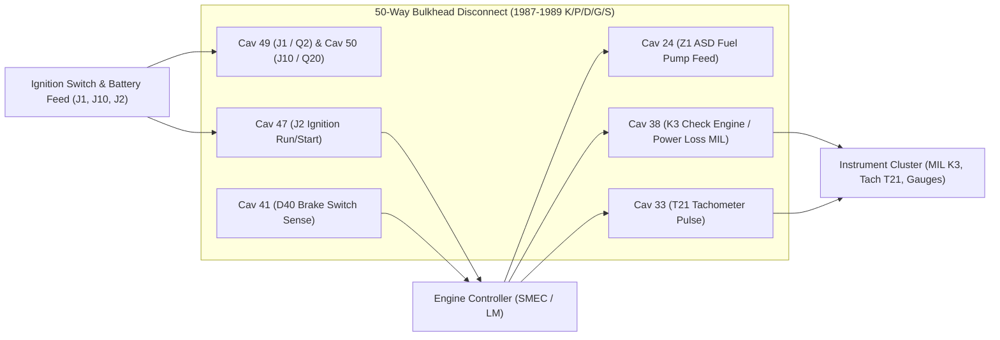

# `50-Way` Bulkhead & `1984` `40-Way` Firewall Disconnect Atlas

Chrysler routed cabin-to-engine-bay power, ignition, fuel pump, Check Engine lamp, speedometer/tachometer, and A/C feeds through a single bolted firewall disconnect block: **`40-Way` on `1984 L/M-Z`** (`MZ 63`), transitioning to the standardized **`50-Way` Bulkhead Disconnect on `1987–1989` `G`, `K/P/D`, and `S`-Body** vehicles (`G-V 93/94`, `K-PD 60`, `G-V 75/76`, `8W-155`).

> [!IMPORTANT]
> **Critical Engine-Swap Caution**:
> Despite looking visually similar (top `Small Index`, bottom `Large Index`, central retention bolt), `1984 L-Body` (`40-Way` `6x7` matrix) is **NOT mechanically or electrically pin-compatible** with `1987–1989` `50-Way` bulkhead blocks, and **`1989` `G-Body`** reassigns key ignition feeds (`Q2`/`Q20` at `Cav 49/50`, `G5` at `Cav 7`, `P2` at `Cav 31`) relative to `1987–1988 K/P/D` (`J1`/`J10`).

---

## 1. Key Powertrain & Instrumentation Firewall Circuits (`1987–1989` `50-Way`)

| Cavity | Circuit & Wire Spec (`87–88 K/P/D`) | `1989 G-Body` (`G-V 75/76`) Delta | `1989 S-Body Mini` (`8W-155`) Delta | Controller / Cluster Interface |
| :---: | :--- | :--- | :--- | :--- |
| **`Cav 1`** | `L1` `12RD*` Battery Feed | Same (`L1` `12RD*`) | `L1` `12RD/WT*` Ign Switch Feed | Main unswitched battery junction |
| **`Cav 7`** | `X30` `20DB/RD*` Speed Control | **`G5` `20DB*` Fused Ign Feed** | `X30` `22DB/RD*` Speed Control | Check `89 G` vs `87–88` before splicing cruise |
| **`Cav 11` / `12`** | Blank (`—`) | Blank (`—`) | **`MX2` `20WT/BK*` / `MX1` `20BK`** | **`1989` Mini `CCD Bus (-)/(+)`** (`EATX` / cluster) |
| **`Cav 17`–`19`** | `G20` Temp, `G6` Oil Switch, `G60` Oil Send | Same (`G20`/`G6`/`G60`) | Same (`G20`/`G6`/`G60`) | Cluster temp gauge & oil warning/gauge |
| **`Cav 20`** | `U3` `20OR/LG*` Fuel Pacer Lamp | Same (`U3` `20OR/LG*`) | `U3` `22OR/LG*` Up-Shift Lamp | Economy / manual upshift indicator |
| **`Cav 24`** | **`Z1` `14DG/BK*` Fuel Pump Feed** | **`Z1` `14DG/BK*` Fuel Pump Feed** | **`Z1` `14DG/BK*` Fuel Pump Feed** | Driven from `ASD` relay (`LM`/`SMEC` `Z1` splice) |
| **`Cav 31`** | **`S2` `14YL` Ignition Start** | **`P2` `22BK*` Park Brake Switch** | **`S2` `14YL` Ignition Start** | Crucial starter solenoid circuit (`S2`) check on `89 G` |
| **`Cav 33`** | **`T21` `22GY/LB*` Tach (`87 G`; blank early K-PD)** | **`T21` `22`/`20GY/LB*` Tach (`dash/engine`)** | **`T21` `22GY/LB*` Tachometer** | ECU tach output (`SMEC 1-50` / `LM 1-12`) to cluster |
| **`Cav 37`** | **`C20` `22DB/OR*` A/C Clutch** | `C20`/`C2` A/C Pressure Switch | Unpopulated on `8W-155` | Tied to `SMEC 1-45` (`C20`) on `88 P-Body` |
| **`Cav 38`** | **`K3` `20BK/PK*` Check Engine MIL** | **`K3` `20BK/PK*` Check Engine MIL** | Unpopulated on `8W-155` | Flashes `DRB-II` key-on `Code 11`–`Code 55` sequences (`SMEC 1-59`) |
| **`Cav 41`** | **`D40` `18WT/TN*` Brake Sense** | **`D40` `18WT/PK*` Brake Sense** | Unpopulated | Feeds `SMEC 1-29` (`D40`) for cruise/converter |
| **`Cav 42`** | Blank on `K-PD 60` (`87 G`: `G7` `20WT/OR*`) | **`G7` `22`/`20WT/OR*` Distance (`dash/engine`)** | Unpopulated | `VSS` pulse input to cluster/trip computer |
| **`Cav 47`** | **`J2` `14DB` Ignition Run/Start** | **`J2` `14DB` Ignition Run/Start** | **`J2` `14DB` Ignition Run/Start** | Primary switched `Run/Start` feed to solenoids/`ASD`/`O2` |
| **`Cav 49`** | **`J1` `12RD` Ignition Switch Feed** | **`Q2` `14BK` Ign Run/Start** | **`J1` `12RD` Ignition Feed** | Fusible link supply to steering column switch |
| **`Cav 50`** | **`J10` `12PK*` Ignition Switch** | **`Q20` `12BK/OR*` Ign Run Only** | **`J10` `12PK/BK*` Ign Feed** | Verify `J10` vs. `Q20` on `89 G` clusters/swaps |

*(Additional `50-Way` chassis cavities: `Cav 5/6` `L4/L3` Headlamps, `Cav 8–10` `X31/X33/X32` Cruise, `Cav 21/22` `D6/D5` Turns, `Cav 23` `A3` Hazard, `Cav 26` `L7` Park Lamps, `Cav 27/28` `B1/B2` Back-Up Lamps, `Cav 29/30` `V10/V11` Washer, `Cav 32` `H2` Horn, `Cav 34` `P5` Brake Warn, `Cav 35/36/45/46` `V5/V6/V3/V4` Wipers, `Cav 48` `C13` Rear Defogger.)*

---

## 2. `1984 L/M-Z` (`40-Way` `MZ 63` / `8-612`) Comparison & Pin Map

In `1984 L-Body` (`Omni` / `Horizon` / `Charger` / `Rampage`) harnesses, the central bolt bulkhead contains **`40` cavities (`1–40`)** rather than `50`:

| `84 L` `40-Way` Cavity | Circuit & Wire Spec | Function (`8-612` Engine Side) | Closest `50-Way` Counterpart |
| :---: | :--- | :--- | :---: |
| **`Cav 1`–`Cav 3`** | `X30`, `X31`, `X33` (`20 ga`) | Speed control option circuits | `50-Way` `Cav 7, 8, 9` |
| **`Cav 4`** | `J10` `12PK*` | Ignition switch main feed | `50-Way` `Cav 50` |
| **`Cav 6`** | `R6` `12BK` | Alternator charging splice | Fusible link / `Cav 49` |
| **`Cav 12`** | `C2` `16DB/YL*` | A/C low-pressure switch | `50-Way` `Cav 37` |
| **`Cav 14`** | `S2` `18YL` | Starter relay — ignition | `50-Way` `Cav 31` |
| **`Cav 17` / `Cav 18`** | `G2` `20VT` / `G6` `20GY` | Water temp gauge/lamp & Oil pressure switch | `50-Way` `Cav 17` / `18` |
| **`Cav 27` / `Cav 31`** | `G60` `20GY/YL*` / `T11` `20GY*` | Oil gauge (`Rallye`) & Tachometer (`Option`) | `50-Way` `Cav 19` / `Cav 33` (`T21`) |
| **`Cav 37` / `38` / `40`** | `Q20` `12BR`, `J2` `14DB`, `J1` `12RD` | `1.6L` alt field (`37`), `J2` Ign Run (`38`), `J1` Batt Ign (`40`) | `50-Way` `Cav 50`, `Cav 47`, `Cav 49` |

---

## 3. Firewall Pass-Through Powertrain Topology

**Topology Walkthrough**
- **Power Entry (`Cav 49/50` -> `Cav 47`)**: Unswitched battery feeds (`J1`/`J10` on `87–88`, `Q2`/`Q20` on `89 G`) enter the cabin ignition switch via `Cav 49/50` and return `Run/Start` (`J2`) to the engine bay through `Cav 47`.
- **Fuel & `ASD` Security (`Cav 24`)**: When `LM` or `SMEC` grounds the `ASD` relay (`K14`), switched `+12 V` (`Z1`) back-feeds through bulkhead `Cav 24` to power the in-tank fuel pump.
- **Driver Telemetry & Fault Display (`Cav 38`, `Cav 33`, `Cav 41`)**: Fault blink codes (`K3` via `Cav 38`) and tachometer pulses (`T21` via `Cav 33`) pass into the cluster, while brake pedal status (`D40` via `Cav 41`) feeds the ECU speed-control/TCC logic.

---

## Related Pages
- [60-Way SMEC & SBEC Connector Atlas](60-way-connector-atlas.md)
- [DRB-II Error Registers & Fault Trees](drb-ii-fault-trees.md)
- [LM & PM 6803 Reference](../ecu-families/lm-pm-6803.md)
- [Wiring Bulkheads & Diagnostics Overview](wiring-and-diagnostics-overview.md)
- [Wiki Home](../Home.md)
