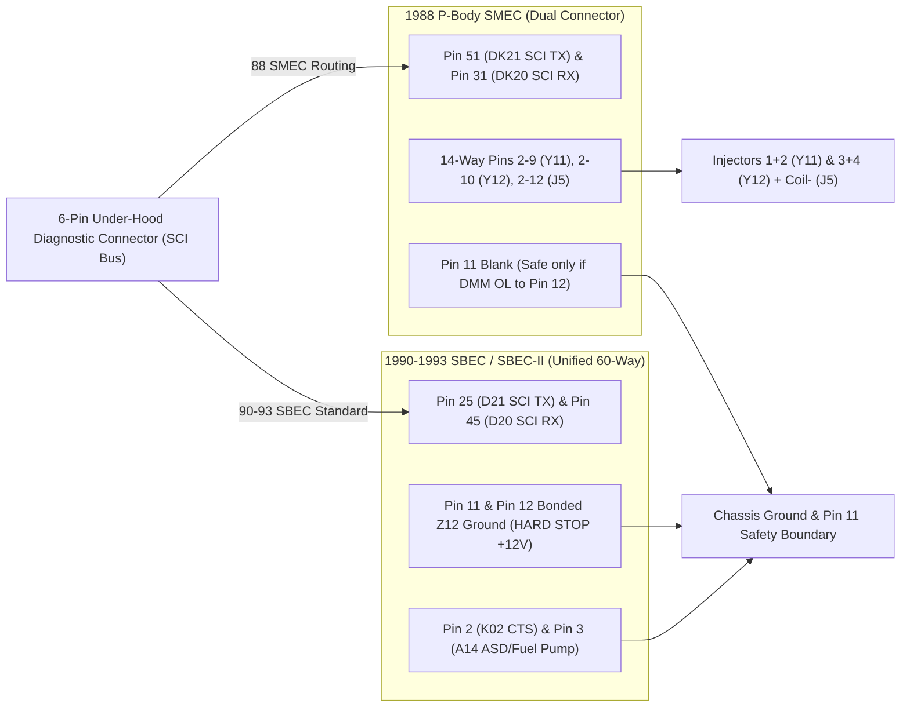

# `60-Way` `SMEC` & `SBEC` Connector Atlas (`1988–1993`)

Chrysler introduced the **`60-Way` rectangular bulkhead ECU connector** with the `1988` **SMEC** (`60-Way` logic plug `1-xx` + `14-Way` power plug `2-xx`) and consolidated all power drivers into a single **`60-Way` unified connector** for `1990–1993+` **SBEC / SBEC-II** controllers. Although both housings share physical shell keying, critical cavities shift across model years.

> [!CAUTION]
> **Mandatory Pre-Connect `DMM` Gate (`Pin 11`, `Pins 2/3`, `Pins 25/45`)**:
> Never cross-plug an `SMEC` and `SBEC` unit or apply `+12 V`/`~21 V` bootstrap power to **`Pin 11`** without running the `DMM` resistance check against **`Pin 12`** (`Z12` Ground on `SBEC_90_93`) and confirming `Pin 2`, `Pin 3`, `Pin 25`, and `Pin 45` against the vehicle's exact model-year FSM. See [Pin 11 Safety Matrix](../ecu-families/pin-11-safety-matrix.md).

---

## 1. Key High-Risk & Cross-Generation Variant Matrix (`1988` `SMEC` vs. `1990–1993` `SBEC`)

| `60-Way` Pin | `1988 P-Body SMEC` (`8N-21..27`) | `1990–1993 SBEC / SBEC-II` (`91/92 Supp.`) | Bench & Swap Verification Rule |
| :---: | :--- | :--- | :--- |
| **`Pin 1`** | `K4` `20DG/RD*` `MAP` Signal (`+5V` ref at `1-13`) | `K4` / `K01` `MAP` Signal | Analog `0–5 V` input from shock-tower MAP sensor |
| **`Pin 2`** | **`N12` `18BK/LG*` Knock Sensor** | **`K02` `20TN/BK` Coolant Temp (`CTS`)** | **YEAR CHECK**: Knock (`SMEC`) vs. `CTS` (`SBEC`; `SBEC` Knock moves to `Pin 42` `K42`). |
| **`Pin 3`** | **`K10` `20TN*` Coolant Temp (`CTS`)** | **`A14` `16RD/WT` Fuel Pump / `ASD` (`91` Supp.)** | **NEVER swap blindly**: Applying `A14` battery power to `Pin 3` damages an `SMEC` `CTS` input. |
| **`Pin 4`** | `N5` `18BK/LB*` `5V` Sensor Signal Return | `K04` `18BK/LB` Sensor Signal Return | Shared analog return (`MAP`, `TPS`, `CTS`, `VSS`, `Dist`). |
| **`Pin 5`** | `K5` `16BK*` Logic / Diagnostic Ground | `Z11` `16BK/WT` Signal Ground | Fuel-rail / block ring terminal (`< 0.5 Ohm` to batt `-`). |
| **`Pin 6`** | Unassigned (`+5V` at `1-13` `K8` on `88 P`) | **`K06` `18VT/WT` `+5.0 V` Reference Supply** | Verify no `+12V` short before key-on (`+5.0 +/- 0.25 V`). |
| **`Pin 7`** | `X33` `20WT/LG*` Speed Control (`+8V` at `1-52` `N6`) | **`K07` `18OR` `+8.0 V` Hall Sensor Supply** | `88 P-Body SMEC` feeds Dist. Hall sensors from **`Pin 52` (`N6`)** / `2-1`. |
| **`Pin 11`** | **Factory Blank** (`+12V` / `>22V` if pinned for `SMEC`) | **`Z12` `16BK/TN` Power Ground** *(tied to `Pin 12`)* | **HARD STOP**: Must measure `OL` (`> 10 MOhm`) to `Pin 12` before any `Pin 11` power injection. |
| **`Pin 12`** | `K14` `18DB*` `ASD` Pull-In (`Z1` GND on later SMEC/SBEC) | **`Z12` `16BK/TN` Power Ground** | Verify exact model-year `Z12` ground vs. `K14` `ASD` pin before bench powering. |
| **`Pin 22`** | `K7` `18OR/DB*` `TPS` Wiper Signal | `K22` `OR/DB` `TPS` Signal | `~0.5 V` closed throttle -> `~4.5+ V` WOT. |
| **`Pin 25`** | Unpopulated on `88 P-Body` (`SCI TX` at `1-51` `DK21`) | **`D21` `20PK` `SCI TX` (`ECU -> Host`)** | **YEAR CHECK**: Check `Pin 25` vs. `Pin 51` continuity to the `6-Pin` under-hood diagnostic connector. |
| **`Pin 41`** | `J1` `16RD` Unswitched Keep-Alive `+12V` | `K41` `BK/DB` Heated `O2` (`88 P`: `O2` at `1-23`) | Verify keep-alive `+12V` (`J1`) vs. `O2` (`N11`/`K41`) across harness generations. |
| **`Pin 45`** | **`C20` `18BR` A/C Clutch/Switch (`88 P-Body`)** | **`D20` `20LG` `SCI RX` (`Host -> ECU`)** | **CRITICAL**: Never connect an `FTDI` `SCI` cable to `Pin 45` if `+12V` (`C20`) is present! (`88 P` uses `Pin 31` `DK20`). |

---

## 2. `1988 P-Body` `SMEC` Full `60-Way` (`1-xx`) & `14-Way` (`2-xx`) Harness Table

Verified from `1988 P/P,D` Chrysler wiring sheets (`8N-21` through `8N-27`, `Dodge Shadow` / `Plymouth Sundance` `2.2L` Turbo):

### `60-Way` Logic Connector (`1-xx`)

| Pin | Circuit & Wire Spec | Function / Destination |
| :---: | :--- | :--- |
| **`1`** | `K4` `20DG/RD*` | `MAP` sensor signal input (`0–5 V`) |
| **`2`** | `N12` `18BK/LG*` | Detonation (knock) sensor signal |
| **`3`** | `K10` `20TN*` | Engine coolant temperature (`ECT`) sensor |
| **`4`** | `N5` `18BK/LB*` | `5V` sensor reference ground splice (`MAP`, `TPS`, `ECT`, `VSS`, `Dist`) |
| **`5`** | `K5` `16BK*` | Logic & diagnostic ground (to fuel rail bolt & diag plug) |
| **`7` / `8` / `9`** | `X33` / `X32` / `X31` (`20 ga`) | Speed control switch inputs (`Resume` / `On-Off` / `Set`) |
| **`10`** | `Z1` `16DG/BK*` | `ASD` switched output sense (`+12 V` coil/injector/pump branch) |
| **`12`** | `K14` `18DB*` | `ASD` relay pull-in coil driver (also spliced to `2-3`) |
| **`13`** | `K8` `20VT/WT*` | `+5.0 V` regulated sensor reference (`MAP` & `TPS`) |
| **`17`–`20`** | `N2, N4, N1, N3` (`18 ga`) | `AIS` idle air control stepper motor phases (`17=N2`, `18=N4`, `19=N1`, `20=N3`) |
| **`22`** | `K7` `18OR/DB*` | `TPS` wiper voltage input |
| **`23`** | `N11` `18BK/DG*` | Heated `O2` sensor input |
| **`26`** | `Y7` `18TN/YL*` | Distributor Cam Sync Hall pickup (`Gray` conn.) |
| **`29` / `30`** | `D40` `18WT/PK*` / `S4` `20BR/YL*` | Brake lamp switch sense (`1-29`) & Park/Neutral interlock (`1-30`) |
| **`31`** | `DK20` `20LG` | **`SCI` `RX` (`Host -> SMEC`)** to `6-Pin` under-hood diag connector |
| **`32`–`34`** | `Y1`, `K16`, `K15` (`20 ga`) | Auxiliary output / radiator fan / solenoid drivers (`1-32..34`) |
| **`38` / `39`** | `Y4` `20LB` / `Y6` `20LG/BK*` | Baro-read solenoid (`1-38`) & Purge/EGR solenoid (`1-39`) |
| **`41`** | `J1` `16RD` | Unswitched keep-alive battery `+12 V` |
| **`45`** | `C20` `18BR` | A/C switch/pressure request input (`1-45`) |
| **`47` / `48`** | `N7` `18GY*` / `G7` `20WT/OR*` | Distributor Reference pickup (`1-47`) & `VSS` distance sensor (`1-48`) |
| **`50` / `51`** | `T21` `20GY/LB*` / `DK21` `20PK` | Cluster tachometer output (`1-50`) & **`SCI` `TX` (`SMEC -> Host`, `1-51`)** |
| **`52`** | `N6` `18OR` | `+8.0 V` Hall-sensor regulator supply (Dist. Sync & Ref) |
| **`53` / `60`** | `X36` `20TN/RD*` / `X35` `20LG/RD*` | Speed control Vent (`1-53`) & Vacuum (`1-60`) servo valves |
| **`54`** | `K1` `20PK*` | Turbo wastegate control solenoid (`WGDC`, `J2` fed) |
| **`56` / `57`** | `N13` / `C27` (`20 ga`) | A/C heater control interfaces |
| **`58` / `59`** | `K19` `20DB/YL*` / `K3` `20BK/PK*` | `ASD` / diag feedback (`1-58`) & Check Engine / Power Loss lamp (`1-59`) |

### `14-Way` Power Stage Connector (`2-xx`, `SMEC` Only)

| `14-Way` Pin | Circuit & Wire Spec | Function |
| :---: | :--- | :--- |
| **`2-1`** | `N6` `18OR` | `+8 V` Hall supply jumper to `1-52` |
| **`2-3`** | `K14` `18DB*` | `ASD` relay driver link to `1-12` |
| **`2-4`** | `DK21` `20PK` | `SCI TX` parallel branch to `1-51` |
| **`2-6` / `2-7`** | `J9` `16BK` | Heavy power / injector grounds (`Fuel Rail Bolt`) |
| **`2-9` / `2-10`** | `Y11` `18WT` / `Y12` `18TN` | Injector Bank `1+2` (`2-9`) & Injector Bank `3+4` (`2-10`) low-side drivers |
| **`2-11` / `2-14`** | `R31` `20DG/OR*` / `R3` `18DG` | Alternator field sense/control (`2-11`) & field drive `+` (`2-14`) |
| **`2-12`** | `J5` `18BK/YL*` | Ignition coil primary `-` switching transistor |

---

## 3. `60-Way` `SMEC` vs. `SBEC` Signal Routing Comparison Diagram

**Architecture Walkthrough**
- **`SCI` Bus Relocation (`1-51`/`1-31` vs. `Pin 25`/`Pin 45`)**: On `1988 P-Body SMEC` harnesses, `DK21` (`SCI TX`) and `DK20` (`SCI RX`) populate `Pin 51` and `Pin 31` (`Pin 45` carries `C20` A/C), whereas `SBEC` standardizes `D21` / `D20` at **`Pin 25` / `Pin 45`**.
- **Power Driver Consolidation**: High-current `Y11`/`Y12` injector sinks and `J5` coil `-` live on the `14-Way` `2-xx` connector in `1988 SMEC`, moving directly into the unified `60-Way` shell on `1990+ SBEC`.
- **Mandatory `Pin 11` Lockout**: Never energize `Pin 11` without first probing `Pin 11` to `Pin 12` (`Z12`) with an ohmmeter—`SBEC` harnesses ground `Pin 11` solidly alongside `Pin 12`.

---

## Related Pages
- [50-Way Firewall Bulkhead & 40-Way Atlas](50-way-bulkhead-atlas.md)
- [Pin 11 Safety Matrix & Pre-Connect Gate](../ecu-families/pin-11-safety-matrix.md)
- [Chrysler SCI `7812.5` & `62,500` Baud Protocol](../rom-and-sci/sci-7812-and-62500-protocol.md)
- [Wiring Bulkheads & Diagnostics Overview](wiring-and-diagnostics-overview.md)
- [Wiki Home](../Home.md)
