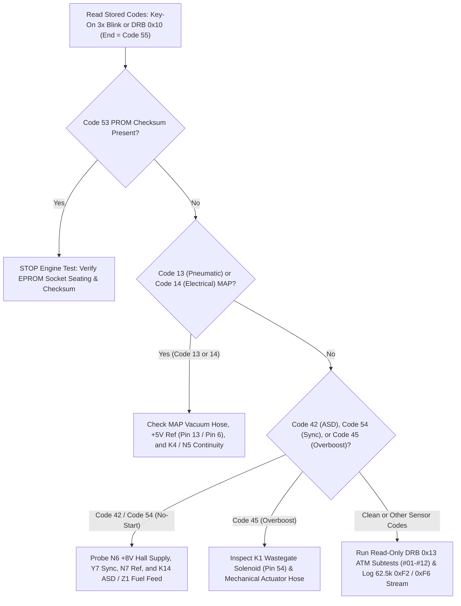

# Chrysler `DRB-II` Error Registers & Fault Isolation Trees (`Code 11`–`Code 55`)

Chrysler `68HC11` (`SMEC` / `SBEC`) and `6803` (`LM`) controllers latch runtime diagnostics across four current-cycle byte registers (**`ErrorBitRegister0–3`**) and four battery-backed stored registers (**`ErrorBitRegisterStored0–3`**), read either by **`3x` ignition key-on MIL blink readout (`K3`, terminating at `Code 55`)** or by **`7812.5`-baud `DRB` serial routine `0x10` / `0x11`**.

> [!IMPORTANT]
> **SMEC vs. SBEC Zero-Page Register Shift (`+1 Byte`)**:
> Never hardcode zero-page addresses across controller families! `T-SMEC_v19` places `ErrorBitRegister0..3` at **`$001E`–`$0021`** (stored `$0022`–`$0025`), whereas `T-SBEC_v3_1` shifts them by `+1` to **`$001F`–`$0022`** (stored `$0023`–`$0026`). Resolve live RAM offsets via `uv run logicaide heritage ...` / `rom_manifest.json`.

---

## 1. Complete `ErrorBitRegister` Bitmask & `DRB-II` `Code 11`–`Code 55` Map

| Blink Code | Meaning (`T-SMEC` / `T-SBEC` Bit Definition) | Register Bit (`SMEC` `$001E..$0021` / `SBEC` `$001F..$0022`) | Primary Circuit & Isolation Target |
| :---: | :--- | :--- | :--- |
| **`Code 11`** | Engine not cranked since battery disconnected | `ERR3` bit 7 (`$0021`/`$0022`) | Cleared automatically once distributor reference (`N7`) crank pulse occurs |
| **`Code 12`** | Memory standby power (`BBRAM` / `J1`) lost within 50 key cycles | `ERR3` bit 6 (`$0021`/`$0022`) | Normal after battery disconnect; check `J1` unswitched `B+` feed |
| **`Code 13`** | **`MAP` Pneumatic** (no expected manifold vacuum/pressure change) | `ERR3` bit 5 (`$0021`/`$0022`) | Inspect `MAP` vacuum hose, throttle-body port, and Baro-read solenoid (`Y4`) |
| **`Code 14`** | **`MAP` Electrical** (`< min` or `> max` voltage rail) | `ERR3` bit 4 (`$0021`/`$0022`) | Probe `+5 V` (`K8`/`K06`), signal (`K4`), and ground return (`N5`/`K04`) |
| **`Code 15`** | Vehicle Distance (`VSS`) sensor missing during road load | `ERR3` bit 3 (`$0021`/`$0022`) | Check `G7` transaxle sensor & `N5` ground continuity |
| **`Code 16`** | Battery voltage sense out of range (`alternator` / `B+` sense) | `ERR3` bit 2 (`$0021`/`$0022`) | Verify `R31`/`J2` charging sense and regulator loop |
| **`Code 17`** | Engine running too cool (stuck-open thermostat / slow warmup) | `ERR3` bit 1 (`$0021`/`$0022`) | Check `195 degF` thermostat and `ECT` curve (`K10` / `K02`) |
| **`Code 21`** | Oxygen (`O2`) sensor inactive / slow cross-count | `ERR3` bit 0 (`$0021`/`$0022`) | Probe `N11`/`K41` signal (`0.1–0.9 V`), `Z1` heater `12 V`, & exhaust leaks |
| **`Code 22`** | Coolant Temperature (`ECT`) sensor voltage out of range | `ERR2` bit 7 (`$0020`/`$0021`) | Open/short on `K10`/`K02` or `N5` return; triggers `DEFTMP` (`0x95`) limpin |
| **`Code 23`** | Charge / Intake Air Temperature (`ACT`) sensor out of range | `ERR2` bit 6 (`$0020`/`$0021`) | Open/short on `K13` (`LM 2-25`); triggers `DEFCHG` (`0xAD`) limpin |
| **`Code 24`** | Throttle Position (`TPS`) below `THRLOW` or above `THRHIG` | `ERR2` bit 5 (`$0020`/`$0021`) | Sweep `K7`/`K22` smoothly (`~0.5–4.5 V`), check `N5`/`K8` |
| **`Code 25`** | Automatic Idle Speed (`AIS`) motor driver open/short | `ERR2` bit 4 (`$0020`/`$0021`) | Check `N1–N4` stepper coils (`1-17..1-20` on `88 P SMEC`) |
| **`Code 26`** | Injector peak current limit not achieved | `ERR2` bit 3 (`$0020`/`$0021`) | Check `Z1` injector `+12 V`, coil resistance, and `Y11`/`Y12` grounds (`J9`) |
| **`Code 27`** | Injector driver interface fault | `ERR2` bit 2 (`$0020`/`$0021`) | Test `Y11`/`Y12` (`2-9`/`2-10`) injector drivers via `DRB 0x13 #04–#06/#1D` |
| **`Code 31`** | Purge solenoid circuit open/short | `ERR2` bit 1 (`$0020`/`$0021`) | Check `Y6` driver (`1-39`) & `J2` ignition feed (`DRB 0x13 #0B`) |
| **`Code 32`** | Exhaust Gas Recirculation (`EGR`) solenoid / diagnostic flow | `ERR2` bit 0 (`$0020`/`$0021`) | Inspect `Y6` / `EGR` transducer, vacuum lines, and valve |
| **`Code 33`** | A/C cutout relay circuit | `ERR1` bit 7 (`$001F`/`$0020`) | Check `C20`/`C27` relay coil (`DRB 0x13 #09`) |
| **`Code 34`** | Speed control (`cruise`) servo solenoid open/short | `ERR1` bit 6 (`$001F`/`$0020`) | Test `X35`/`X36` servo valves (`1-53`/`1-60`) via `DRB 0x13 #0C` |
| **`Code 35`** | Radiator cooling fan relay circuit | `ERR1` bit 5 (`$001F`/`$0020`) | Test fan relay output via `DRB 0x13 #08` |
| **`Code 36`** | **Wastegate control solenoid** (`Turbo` only) | `ERR1` bit 4 (`$001F`/`$0020`) | Check `K1` (`1-54`) + `J2` feed (`DRB 0x13 #11`) & hose routing |
| **`Code 37`** | Barometric read solenoid circuit (`or ATX torque converter lock`) | `ERR1` bit 3 (`$001F`/`$0020`) | Test `Y4` (`1-38`) via `DRB 0x13 #12` |
| **`Code 41`** | Alternator field / charging system driver fault | `ERR1` bit 2 (`$001F`/`$0020`) | Probe `R3` (`2-14`) & `R31` (`2-11`), battery sense, and `DRB 0x13 #0D` |
| **`Code 42`** | Auto Shutdown (`ASD`) relay control circuit | `ERR1` bit 1 (`$001F`/`$0020`) | Check `K14` pull-in (`1-12`), `K19`, & `Z1` contact output (`DRB 0x13 #0A`) |
| **`Code 43`** | Ignition coil control / primary current limit fault | `ERR1` bit 0 (`$001F`/`$0020`) | Test `J5` (`2-12`) primary driver (`DRB 0x13 #01`) and coil resistance |
| **`Code 44`** | Loss of `FJ2` / Battery temperature sensor fault (`SBEC`) | `ERR0` bit 7 (`$001E`/`$001F`) | Check `ASD` / `FJ2` sense (`K19`) or battery tray temp sensor |
| **`Code 45`** | **Turbo Overboost Fuel-Cut Tripped** (`Nothing` NA / `Overboost` Turbo) | `ERR0` bit 6 (`$001E`/`$001F`) | Triggered past `LMPSHF`/boost ceiling; check wastegate hoses & `K1` solenoid |
| **`Code 46`** | Battery / charging system voltage too HIGH | `ERR0` bit 5 (`$001E`/`$001F`) | Check `R3` field short-to-ground or voltage regulator failure |
| **`Code 47`** | Battery / charging system voltage too LOW | `ERR0` bit 4 (`$001E`/`$001F`) | Load-test alternator, `R3` field supply (`J2`), & fusible links |
| **`Code 51`** | `O2` fuel system stuck **LEAN** | `ERR0` bit 3 (`$001E`/`$001F`) | Check fuel pressure, vacuum leaks, injector flow, `O2` bias |
| **`Code 52`** | `O2` fuel system stuck **RICH** | `ERR0` bit 2 (`$001E`/`$001F`) | Check fuel pressure regulator diaphragm, leaking injector, `MAP`/`ECT` |
| **`Code 53`** | Internal ECU ROM / RAM / **`PROM` Checksum** fault | `ERR0` bit 1 (`$001E`/`$001F`) | Confirm `T-LM`/`SMEC`/`SBEC` ROM checksum summation (`BITSUM`); stop & inspect EPROM |
| **`Code 54`** | Distributor **Cam Sync (`Y7`)** signal missing | `ERR0` bit 0 (`$001E`/`$001F`) | Probe `Y7` (`1-26`), `+8 V` (`N6` `1-52`), & `N5` Hall ground (`1-4`) |
| **`Code 55`** | **End of Fault Code Readout** | Normal key-on sequence terminator | No fault implied when `Code 55` follows `Code 12` (`or sole readout`) |

---

## 2. Diagnostic Isolation Tree (`MAP` / `TPS` / `ASD` / `Sync` Triaging)

**Diagnostic Tree Walkthrough**
- **Integrity Gate First (`Code 53`)**: Always resolve `Code 53` EPROM/ROM checksum faults before chasing drivability codes; checksum failure or socket noise invalidates limp-in/fuel math.
- **Speed-Density Sensor Branch (`Code 13` / `Code 14`)**: `Code 14` isolates wiring/voltage rails (`+5 V` `K8` on `Pin 13` `88 SMEC` or `K06` on `Pin 6` `SBEC`, signal `K4`, `N5` ground), whereas `Code 13` isolates vacuum/baro-solenoid plumbing (`Y4`) on an electrically healthy sensor.
- **Crank/Sync & Fuel Power Branch (`Code 42`, `Code 54`, `Code 45`)**: Confirm `+8 V` Hall supply (`N6`), `Y7` sync (`Code 54`), and `K14` `ASD` relay actuation (`Code 42`) cleanly before testing boost control (`Code 45` overboost vs. `K1` solenoid `Pin 54` `DRB 0x13` and `62.5k` `0xF2` / `0xF6` SCI logging).

---

## Related Pages
- [60-Way SMEC & SBEC Connector Atlas](60-way-connector-atlas.md)
- [Chrysler SCI `7812.5` & `62,500` Baud Protocol](../rom-and-sci/sci-7812-and-62500-protocol.md)
- [Wiring Bulkheads & Diagnostics Overview](wiring-and-diagnostics-overview.md)
- [Wiki Home](../Home.md)
