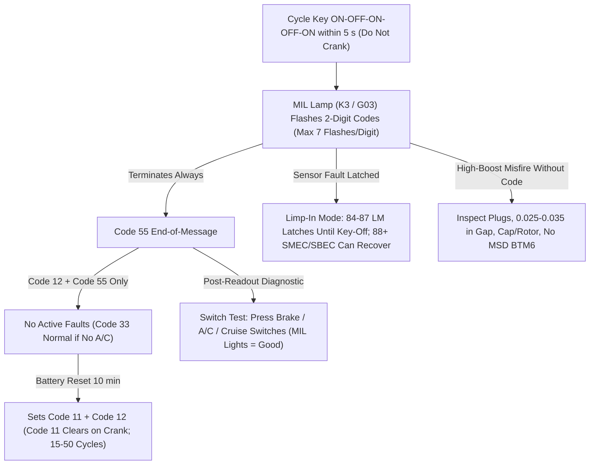

# Key-Dance Fault Codes, Switch Tests & `2.2L` / `2.5L` Ignition Bench

Before connecting a `DRB-II` or `SCI` logger, Chrysler `1984–1994` `LM`, `SMEC`, and `SBEC` controllers expose stored diagnostic codes and discrete switch tests directly through the dashboard `Power Loss` / `Check Engine` lamp (`K3` / `G03`). Pairing key-dance triage with proper ignition-gap and spark-plug inspection prevents misdiagnosing high-boost misfires as sensor faults (`MiniMopar`, `TheDodgeGarage`, `Gus Mahon`).

## Key-Dance Readout & Switch-Test Workflow

## Key-Dance Retrieval & Year-Specific Code Variations (`MiniMopar`)

1. **Trigger Sequence**: With engine off, cycle the ignition key **`ON-OFF-ON-OFF-ON` within `5 seconds`** without engaging `START`.
2. **Blink Decoding**: Count flashes per digit separated by a short pause, with a longer pause between two-digit codes (no digit exceeds `7` flashes). Every sequence ends with **`Code 55`**.
3. **Retention & Clearing**: Stored faults clear after **`15` on/off key cycles** (`MiniMopar`; `SBEC` standby `BBRAM` window `50` cycles). Disconnecting battery power for **`~10 minutes`** clears stored faults and sets **`Code 11`** (clears as soon as the engine cranks) and **`Code 12`** (`BBRAM` standby power recently interrupted). **`Code 33`** is normal on vehicles without factory A/C.
4. **Limp-In & Post-Code Switch Test**: `1984–1987` `LM` controllers stay in limp-in backup maps until the engine is shut off; `1988+` `SMEC` and `SBEC` continue polling failed inputs and can recover dynamically while driving. After **`Code 55`**, toggling the brake pedal, A/C, or cruise switches turns the MIL on/off to verify switch continuity.

| Code(s) | Year / Engine Variant Split (`MiniMopar`) | Practical Triage Notes (see [DRB-II Fault Trees](drb-ii-fault-trees) for RAM bits) |
| :--- | :--- | :--- |
| **`Code 11` / `Code 12`** | All `1984–1994` models | Normal immediately after battery disconnect; `Code 11` clears on first crank pulse. |
| **`Code 17`** | `1985`, `1986`, and `1987+` splits | Thermostat stuck open / engine slow to reach operating temperature. |
| **`Code 23`** | `TBI` vs. `1984` Turbo vs. `1985+` Turbo | Charge/intake air temp sensor (`ACT`) range fault. |
| **`Code 26` / `Code 27`** | `TBI` vs. `MPI` injector banks | Peak injector current (`Code 26`) or driver interface (`Code 27`). |
| **`Code 31` / `Code 34`** | `<1987` & all `L-body` vs. `1987+` non-`L-body` | Purge/EGR solenoid (`Code 31`) and cruise vacuum/vent (`Code 34`) wiring splits. |
| **`Code 36`** | `MPI` `N/A` vs. `Turbo I/II/III` vs. `Turbo IV VNT` | Wastegate / `VNT` solenoid circuit (`Turbo`) vs. `MPI` `N/A` air-switching circuit. |
| **`Code 37`** | `N/A` ATX lockup vs. `Turbo` baro solenoid | Dual-purpose register assignment; verify transaxle vs. `Y4` baro solenoid. |
| **`Code 42` / `Code 44`** | `1984` vs. `1985–1987` vs. `1988+` | `ASD` relay (`Code 42`) and `FJ2` / battery temperature sense (`Code 44`). |
| **`Code 45`** | **Turbo models only** | Overboost fuel-cut tripped past ECU boost ceiling. |
| **`Code 51` / `Code 52` / `Code 54`** | `1984` / `1985` / `1986+` splits | `O2` lean (`51`), `O2` rich (`52`), and distributor cam sync (`54`). |

## `2.2L` / `2.5L` Ignition Bench & High-Boost Misfire Rules (`TheDodgeGarage`)

- **Stock System Headroom**: Healthy OEM inductive ignition supports **`~325–340 hp`** (`10 s` passes at `35 psi` documented, though some builds hit cylinder-pressure spark blowout around `25 psi`). Early oil-filled canister coils tolerate heat better than later thermostat-housing resin coils.
- **Spark Plugs & Gap Discipline**:
  - **Champion `RN12YC`** (stock `N/A` & `TBI`, `0.035 in` gap), **`RN11YC`** (one heat range colder), **`RN9YC`** (two steps colder; factory `Turbo III` `EDS` spec, though `TBI` engines may foul `RN9YC`).
  - **Gap `0.025–0.035 in`**: High specific output (`62.5 hp/cyl` on a `250 hp` `2.2L` vs. `50 hp/cyl` on a `400 hp` `302` V8) creates much higher cylinder pressure; tighten gap to **`0.030 in`** (from `0.035 in`) to cure boost misfires. Never run `0.045 in` V8 gaps, Bosch/Autolite platinum plugs, or SplitFire plugs (reported to disrupt `#782` fast-burn swirl).
- **Distributor, Wires & Cap/Rotor Hygiene**:
  - Inspect the **plastic shutter-wheel retainer disc** at the base of `2.2L`/`2.5L` distributors—aging discs loosen and cause erratic idle/misfire.
  - Use brass-terminal `Blue Streak` caps/rotors (cheap black caps crossfire) and spiral-core suppression wires (`Magnecor` / `Moroso`); **never run solid-core wires** (EMI disrupts `LM`/`SMEC`/`SBEC` microprocessors).
- **Capacitive Discharge (`MSD 6A` / `6AL` / `7AL-2`) Wiring Rules**:
  - Remove the OEM coil noise suppressor and omit any ballast resistor; pair with `Blaster II/III` (`MSD 6A`/`6AL`) or `HVC I/II` (`MSD 7AL-2`).
  - Wire switched `12 V` trigger to an ignition feed that **stays live during cranking** (most FWD Chrysler accessory circuits drop out in `START`). Note the ECU rev limiter still cuts spark first if set below the `MSD` pill.
  - **NEVER install an `MSD BTM6` dial-a-boost-retard box** on a factory turbo Chrysler ECU—factory `LM`/`SMEC`/`SBEC` ROMs already pull timing under boost, so `BTM6` stacks double retard and slows the car down.

## `Gus Mahon` Spark Plug Reading Protocol

| Plug Visual Finding | Physical Cause (`Gus Mahon`) | Corrective Calibration / Mechanical Action |
| :--- | :--- | :--- |
| **"Salt & pepper" specks on white porcelain** | Mild inaudible detonation (`salt` = molten aluminum droplets from piston/head; `pepper` = blasted carbon) | Reduce boost, pull peak spark advance, or raise fuel octane / enrichment |
| **Rounded electrode corners on fresh plugs** | Lean mixture / thermal pre-detonation (sharp `90°` edges rounding off after a few passes) | Add fuel (`WOTTBL`/`PEFTBL` or fuel pressure), reduce timing, or lower boost |
| **Cylinder-to-cylinder color check (unleaded fuel)** | Add `104+` octane booster and drive briefly; compare red/orange fuel additive tint across `#1–#4` | **Reddest** insulator = richest cylinder; **whitest** insulator = leanest cylinder |

## Related Pages

- [Wiring & Diagnostics Overview](wiring-and-diagnostics-overview)
- [Chrysler DRB-II Error Registers & Fault Isolation Trees](drb-ii-fault-trees)
- [LM, SMEC & SBEC Connector Evolution](lm-smec-sbec-connector-evolution)
- [SCI, Knock Box Conditioning & Waste-Spark DIS Notes](knock-and-dis-conditioning)
- [68HC11 / 6803 Fuel & Spark Math: BATOFF, PEFTBL, WOTTBL & MAP Scaling](fuel-and-spark-math-peftbl-wottbl)
- [Wiki Home](Home)
